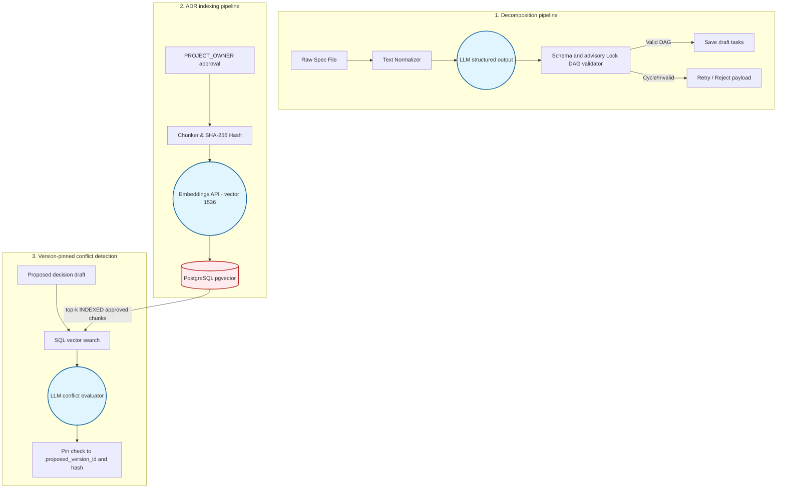

# AI system design and JSON schemas specification

## Team AI orchestrator

**Target backend:** Spring Boot 3.x (Java 21) / Spring AI / OpenAI REST API  
**Vector engine:** PostgreSQL 16+ with `pgvector` (`vector(1536)` HNSW cosine index)

---

## 1. AI subsystem and pipeline architecture

The AI subsystem executes four core workflows:
1. **Requirements decomposition pipeline:** Parses specifications into acyclic backlogs (Epics, tasks, subtasks) with non-empty `acceptance_criteria`, initial `approval_status = 'DRAFT'` and `execution_status = 'BACKLOG'`.
2. **Shared memory indexing pipeline:** Chunks approved ADR versions, calculates SHA-256 hashes (`chunk_hash`) and persists vector embeddings (`vector(1536)`) with `indexing_status = 'INDEXED'`.
3. **Filtered context retrieval (RAG) pipeline:** Performs similarity searches over active `APPROVED` ADR chunks in `INDEXED` status to provide grounded answers with citations.
4. **Version-pinned conflict detection pipeline:** Pre-checks proposals against approved ADRs, pinning results to `proposed_version_id` and `checked_content_hash`.



---

## 2. Embedding rules and standardized RAG SQL query

* **Embedding model:** OpenAI `text-embedding-3-small` (`vector(1536)`).
* **Distance metric:** Cosine similarity (`vector_cosine_ops`).
* **RAG SQL query standard:**
  ```sql
  SELECT mc.chunk_text, dv.decision_id, ad.decision_code, 
         1 - (mc.embedding <=> :queryEmbedding) AS similarity
  FROM memory_chunks mc
  JOIN decision_versions dv ON mc.decision_version_id = dv.id
  JOIN architecture_decisions ad ON dv.decision_id = ad.id
  WHERE mc.project_id = :projectId 
    AND mc.indexing_status = 'INDEXED'
    AND dv.status = 'APPROVED'
  ORDER BY mc.embedding <=> :queryEmbedding
  LIMIT :topK;
  ```

---

## 3. Production JSON schemas

### 3.1 Task decomposition schema (`decomposition_schema.json`)

```json
{
  "$schema": "http://json-schema.org/draft-07/schema#",
  "title": "DecompositionResponse",
  "type": "object",
  "required": ["epics"],
  "additionalProperties": false,
  "properties": {
    "epics": {
      "type": "array",
      "items": {
        "type": "object",
        "required": ["temporary_id", "title", "description", "acceptance_criteria", "tasks"],
        "additionalProperties": false,
        "properties": {
          "temporary_id": { "type": "string" },
          "title": { "type": "string", "minLength": 3 },
          "description": { "type": "string" },
          "acceptance_criteria": { "type": "string", "minLength": 5 },
          "tasks": {
            "type": "array",
            "items": {
              "type": "object",
              "required": ["temporary_id", "title", "description", "acceptance_criteria", "blocked_by_temp_ids", "subtasks"],
              "additionalProperties": false,
              "properties": {
                "temporary_id": { "type": "string" },
                "title": { "type": "string", "minLength": 3 },
                "description": { "type": "string" },
                "acceptance_criteria": { "type": "string", "minLength": 5 },
                "blocked_by_temp_ids": {
                  "type": "array",
                  "items": { "type": "string" }
                },
                "subtasks": {
                  "type": "array",
                  "items": {
                    "type": "object",
                    "required": ["temporary_id", "title", "description", "acceptance_criteria", "blocked_by_temp_ids"],
                    "additionalProperties": false,
                    "properties": {
                      "temporary_id": { "type": "string" },
                      "title": { "type": "string", "minLength": 3 },
                      "description": { "type": "string" },
                      "acceptance_criteria": { "type": "string", "minLength": 5 },
                      "blocked_by_temp_ids": {
                        "type": "array",
                        "items": { "type": "string" }
                      }
                    }
                  }
                }
              }
            }
          }
        }
      }
    }
  }
}
```

### 3.2 Conflict check schema (`conflict_check_schema.json`)

```json
{
  "$schema": "http://json-schema.org/draft-07/schema#",
  "title": "ConflictCheckResponse",
  "type": "object",
  "required": ["status", "reasoning", "evidence_source_codes"],
  "additionalProperties": false,
  "properties": {
    "status": {
      "type": "string",
      "enum": ["NO_CONFLICT", "POSSIBLE_CONFLICT", "INSUFFICIENT_CONTEXT"]
    },
    "reasoning": {
      "type": "string",
      "minLength": 10
    },
    "evidence_source_codes": {
      "type": "array",
      "items": { "type": "string" }
    }
  }
}
```

### 3.3 Grounded context QA schema (`grounded_qa_schema.json`)

```json
{
  "$schema": "http://json-schema.org/draft-07/schema#",
  "title": "GroundedQAResponse",
  "type": "object",
  "required": ["answer", "has_sufficient_context", "citations"],
  "additionalProperties": false,
  "properties": {
    "answer": { "type": "string" },
    "has_sufficient_context": { "type": "boolean" },
    "citations": {
      "type": "array",
      "items": {
        "type": "object",
        "required": ["decision_code", "decision_title", "quoted_passage"],
        "additionalProperties": false,
        "properties": {
          "decision_code": { "type": "string" },
          "decision_title": { "type": "string" },
          "quoted_passage": { "type": "string" }
        }
      }
    }
  }
}
```

---

## 4. Error handling and fallbacks

1. **Schema validation retry:** Malformed LLM outputs trigger up to 2 corrective retries. Failing calls log `operation_status = 'FAILED'` in `ai_operation_logs`.
2. **DAG validation error handling:** Graph cycles trigger payload rejection, logging `operation_status = 'FAILED'` with cycle error details.
3. **Non-hallucination fallback:** If RAG similarity search returns 0 passages exceeding threshold $0.70$, generation is skipped, returning `INSUFFICIENT_CONTEXT`.
4. **Analytics logging guarantee:** All AI requests log model name, token counts (`prompt_tokens`, `completion_tokens`), generation latency, error messages, and review outcomes (`ACCEPTED`, `MODIFIED`, `REJECTED`).