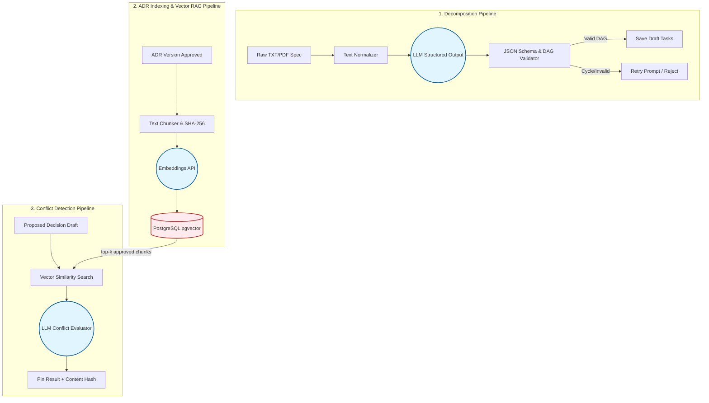

# AI system design and JSON schemas specification

## Team AI orchestrator

**Target backend:** Spring Boot 3.x (Java 21) / Spring AI / OpenAI REST API  
**Vector engine:** PostgreSQL 16+ with `pgvector` extension  

---

## 1. AI system overview and pipeline architecture

The AI subsystem of Team AI orchestrator governs four primary operational workflows:
1. **Requirements decomposition pipeline:** Parses raw specification text into structured, acyclic task hierarchies (Epics, tasks, subtasks) with explicit acceptance criteria.
2. **Shared memory RAG and vector indexing pipeline:** Chunks, hashes and indexes approved Architectural decision records (ADRs) for project-isolated semantic search.
3. **Grounded context retrieval pipeline:** Retrieves active approved ADR passages to answer project questions with verifiable source references.
4. **Conflict pre-detection pipeline:** Pre-checks new ADR proposals against existing approved knowledge to flag contradictions, pinning evaluations to specific content hashes.

---

## 2. Detailed pipeline specifications

### 2.1 Requirements decomposition pipeline
* **Input:** Raw text extracted from `.txt` or text-layer `.pdf` specification documents.
* **Process:**
  1. **Text normalization:** Strips binary artifacts and limits context length to configured window limits (e.g., 32,000 tokens).
  2. **LLM prompt execution:** Sends system prompt with strict `json_schema` enforcement requesting epics, tasks, subtasks, acceptance criteria and dependency edges.
  3. **Backend schema and DAG validation:** Verifies JSON payload against `DecompositionResponseSchema`. Executes Depth-First Search (DFS) graph traversal to ensure no cyclic dependency exists (`blocking_task_id` $\rightarrow$ `blocked_task_id`).
  4. **Persistence:** Saves tasks in `DRAFT` status and logs execution metrics in `ai_operation_logs`.

### 2.2 Shared memory RAG and vector indexing pipeline
* **Trigger:** Asynchronous `AdrApprovedEvent` emitted upon `PROJECT_OWNER` approval of an ADR version.
* **Process:**
  1. **Supersede prior vectors:** Marks old version chunks as invalid or deletes superseded records.
  2. **Chunking strategy:** Sliding window chunking ($500$ tokens per chunk with $50$-token overlap). Calculates SHA-256 hash per chunk (`chunk_hash`) for deduplication.
  3. **Embedding generation:** Batch requests vector embeddings via OpenAI `text-embedding-3-small` (or configured embedding model).
  4. **Persistence:** Inserts into `memory_chunks` table with `chunk_index`, `chunk_hash` and initial `indexing_status = 'INDEXED'`.

### 2.3 Grounded context retrieval pipeline
* **Input:** User query scoped to a `project_id`.
* **Process:**
  1. **Vector query:** Generates query embedding and executes similarity search against `memory_chunks` using `pgvector` HNSW index ($1 - \text{cosine\distance}$).
  2. **Filtering:** Applies SQL filters: `WHERE project_id = :projectId AND status = 'APPROVED'`.
  3. **Context assembly and generation:** If max similarity score is below threshold (e.g., $< 0.70$), returns `INSUFFICIENT_CONTEXT`. Otherwise, passes top-$k$ chunks ($k=5$) to LLM for grounded answer generation with inline citations.

### 2.4 Conflict detection pipeline
* **Input:** Proposed ADR text or task draft.
* **Process:**
  1. **Context fetch:** Performs RAG retrieval for top-$k$ matching active approved ADR passages.
  2. **Hash pinning:** Computes SHA-256 hash of proposed content (`checked_content_hash`).
  3. **Evaluation prompt:** LLM compares proposal against context, outputting `NO_CONFLICT`, `POSSIBLE_CONFLICT` or `INSUFFICIENT_CONTEXT`.
  4. **Storage:** Saves result to `conflict_checks` along with `checked_content_hash`. Requires mandatory `conflict_overrides` record if Owner approves a `POSSIBLE_CONFLICT`.

---

## 3. Embedding and vector processing rules

* **Embedding model:** Configurable via application property `app.ai.embedding-model` (default: `text-embedding-3-small`, default dimensions: `1536`).
* **Distance metric:** Cosine similarity (`vector_cosine_ops` in PostgreSQL).
* **Chunking configuration:**
  - Max chunk size: $500$ tokens.
  - Chunk overlap: $50$ tokens.
  - Tokenizer: `cl100k_base` (Tiktoken).
* **Isolation query standard:**
  
  SELECT mc.chunk_text, dv.decision_id, ad.decision_code, 
         1 - (mc.embedding <=> :queryEmbedding) AS similarity
  FROM memory_chunks mc
  JOIN decision_versions dv ON mc.decision_version_id = dv.id
  JOIN architecture_decisions ad ON dv.decision_id = ad.id
  WHERE mc.project_id = :projectId 
    AND dv.status = 'APPROVED'
  ORDER BY mc.embedding <=> :queryEmbedding
  LIMIT :topK;

---

## 4. LLM JSON schemas

### 4.1 Task decomposition response schema (`decomposition_schema.json`)

**See decomposition_schema.json and decomposition_schema.png files**

### 4.2 Conflict Detection Response Schema (`conflict_check_schema.json`)

**See conflict_check_schema.json and conflict_check_schema.png files**

### 4.3 Grounded context retrieval response schema (`grounded_qa_schema.json`)

**See grounded_qa_schema.json and grounded_qa_schema.png files**

---

## 5. Validation, fallback and error handling rules

1. **Schema validation failure:** If LLM output fails JSON Schema validation, the system triggers up to 2 automatic retries using a corrective prompt outlining validation errors. If retries fail, status `FAILED` is logged in `ai_operation_logs` and an actionable error is returned to the client.
2. **DAG cycle error handling:** If the generated graph contains a cycle ($A \rightarrow B \rightarrow A$), the backend rejects entity creation, logs `operation_status = 'FAILED'` with error details and instructs the user to manually edit edges or re-generate.
3. **External API failures and timeouts:** External LLM calls timeout after 30 seconds. Spring `@Retryable` executes exponential backoff (1s, 2s, 4s) for HTTP 503/429 errors.
4. **Non-hallucination fallback:** If RAG similarity search returns zero chunks exceeding threshold $0.70$, the pipeline skips the LLM generation call, directly returning `INSUFFICIENT_CONTEXT` to conserve tokens and prevent invented statements.
5. **Analytics logging guarantee:** All AI operations log model name, token consumption (`prompt_tokens`, `completion_tokens`), latency (`generation_duration_ms`), status (`SUCCESS`, `FAILED`, `TIMEOUT`) and review outcomes (`ACCEPTED`, `MODIFIED`, `REJECTED`).
