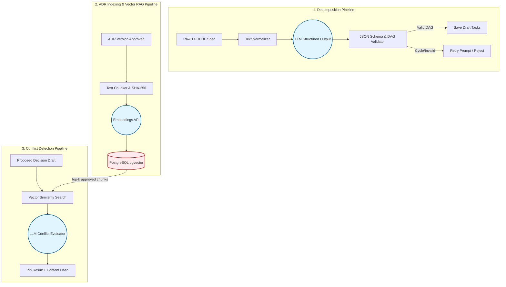

# AI System Design and JSON Schemas Specification

## Team AI Orchestrator

**Version:** 1.0  
**Target Backend:** Spring Boot 3.x (Java 21) / Spring AI / OpenAI REST API  
**Vector Engine:** PostgreSQL 16+ with `pgvector` extension  

---

## 1. AI System Overview & Pipeline Architecture

The AI subsystem of **Team AI Orchestrator** governs four primary operational workflows:
1. **Requirements Decomposition Pipeline:** Parses raw specification text into structured, acyclic task hierarchies (Epics, Tasks, Subtasks) with explicit acceptance criteria.
2. **Shared Memory RAG & Vector Indexing Pipeline:** Chunks, hashes, and indexes approved Architectural Decision Records (ADRs) for project-isolated semantic search.
3. **Grounded Context Retrieval Pipeline:** Retrieves active approved ADR passages to answer project questions with verifiable source references.
4. **Conflict Pre-Detection Pipeline:** Pre-checks new ADR proposals against existing approved knowledge to flag contradictions, pinning evaluations to specific content hashes.

---

## 2. Detailed Pipeline Specifications



### 2.1 Requirements Decomposition Pipeline
* **Input:** Raw text extracted from `.txt` or text-layer `.pdf` specification documents.
* **Process:**
  1. **Text Normalization:** Strips binary artifacts and limits context length to configured window limits (e.g., 32,000 tokens).
  2. **LLM Prompt Execution:** Sends system prompt with strict `json_schema` enforcement requesting Epics, Tasks, Subtasks, acceptance criteria, and dependency edges.
  3. **Backend Schema & DAG Validation:** Verifies JSON payload against `DecompositionResponseSchema`. Executes Depth-First Search (DFS) graph traversal to ensure no cyclic dependency exists (`blocking_task_id` $\rightarrow$ `blocked_task_id`).
  4. **Persistence:** Saves tasks in `DRAFT` status and logs execution metrics in `ai_operation_logs`.

### 2.2 Shared Memory RAG & Vector Indexing Pipeline
* **Trigger:** Asynchronous `AdrApprovedEvent` emitted upon `PROJECT_OWNER` approval of an ADR version.
* **Process:**
  1. **Supersede Prior Vectors:** Marks old version chunks as invalid or deletes superseded records.
  2. **Chunking Strategy:** Sliding window chunking ($500$ tokens per chunk with $50$-token overlap). Calculates SHA-256 hash per chunk (`chunk_hash`) for deduplication.
  3. **Embedding Generation:** Batch requests vector embeddings via OpenAI `text-embedding-3-small` (or configured embedding model).
  4. **Persistence:** Inserts into `memory_chunks` table with `chunk_index`, `chunk_hash`, and initial `indexing_status = 'INDEXED'`.

### 2.3 Grounded Context Retrieval Pipeline
* **Input:** User query scoped to a `project_id`.
* **Process:**
  1. **Vector Query:** Generates query embedding and executes similarity search against `memory_chunks` using `pgvector` HNSW index ($1 - \text{cosine\_distance}$).
  2. **Filtering:** Applies SQL filters: `WHERE project_id = :projectId AND status = 'APPROVED'`.
  3. **Context Assembly & Generation:** If max similarity score is below threshold (e.g., $< 0.70$), returns `INSUFFICIENT_CONTEXT`. Otherwise, passes top-$k$ chunks ($k=5$) to LLM for grounded answer generation with inline citations.

### 2.4 Conflict Detection Pipeline
* **Input:** Proposed ADR text or task draft.
* **Process:**
  1. **Context Fetch:** Performs RAG retrieval for top-$k$ matching active approved ADR passages.
  2. **Hash Pinning:** Computes SHA-256 hash of proposed content (`checked_content_hash`).
  3. **Evaluation Prompt:** LLM compares proposal against context, outputting `NO_CONFLICT`, `POSSIBLE_CONFLICT`, or `INSUFFICIENT_CONTEXT`.
  4. **Storage:** Saves result to `conflict_checks` along with `checked_content_hash`. Requires mandatory `conflict_overrides` record if Owner approves a `POSSIBLE_CONFLICT`.

---

## 3. Embedding & Vector Processing Rules

* **Embedding Model:** Configurable via application property `app.ai.embedding-model` (default: `text-embedding-3-small`, default dimensions: `1536`).
* **Distance Metric:** Cosine similarity (`vector_cosine_ops` in PostgreSQL).
* **Chunking Configuration:**
  - Max Chunk Size: $500$ tokens.
  - Chunk Overlap: $50$ tokens.
  - Tokenizer: `cl100k_base` (Tiktoken).
* **Isolation Query Standard:**
  ```sql
  SELECT mc.chunk_text, dv.decision_id, ad.decision_code, 
         1 - (mc.embedding <=> :queryEmbedding) AS similarity
  FROM memory_chunks mc
  JOIN decision_versions dv ON mc.decision_version_id = dv.id
  JOIN architecture_decisions ad ON dv.decision_id = ad.id
  WHERE mc.project_id = :projectId 
    AND dv.status = 'APPROVED'
  ORDER BY mc.embedding <=> :queryEmbedding
  LIMIT :topK;
  ```

---

## 4. LLM JSON Schemas

### 4.1 Task Decomposition Response Schema (`decomposition_schema.json`)

```json
{
  "$schema": "http://json-schema.org/draft-07/schema#",
  "title": "DecompositionResponse",
  "type": "object",
  "required": ["epics"],
  "additionalProperties": false,
  "properties": {
    "epics": {
      "type": "array",
      "items": {
        "type": "object",
        "required": ["temporary_id", "title", "description", "acceptance_criteria", "tasks"],
        "additionalProperties": false,
        "properties": {
          "temporary_id": { "type": "string" },
          "title": { "type": "string", "minLength": 3 },
          "description": { "type": "string" },
          "acceptance_criteria": { "type": "string", "minLength": 5 },
          "tasks": {
            "type": "array",
            "items": {
              "type": "object",
              "required": ["temporary_id", "title", "description", "acceptance_criteria", "blocked_by_temp_ids", "subtasks"],
              "additionalProperties": false,
              "properties": {
                "temporary_id": { "type": "string" },
                "title": { "type": "string", "minLength": 3 },
                "description": { "type": "string" },
                "acceptance_criteria": { "type": "string", "minLength": 5 },
                "blocked_by_temp_ids": {
                  "type": "array",
                  "items": { "type": "string" }
                },
                "subtasks": {
                  "type": "array",
                  "items": {
                    "type": "object",
                    "required": ["temporary_id", "title", "description", "acceptance_criteria", "blocked_by_temp_ids"],
                    "additionalProperties": false,
                    "properties": {
                      "temporary_id": { "type": "string" },
                      "title": { "type": "string", "minLength": 3 },
                      "description": { "type": "string" },
                      "acceptance_criteria": { "type": "string", "minLength": 5 },
                      "blocked_by_temp_ids": {
                        "type": "array",
                        "items": { "type": "string" }
                      }
                    }
                  }
                }
              }
            }
          }
        }
      }
    }
  }
}
```

### 4.2 Conflict Detection Response Schema (`conflict_check_schema.json`)

```json
{
  "$schema": "http://json-schema.org/draft-07/schema#",
  "title": "ConflictCheckResponse",
  "type": "object",
  "required": ["status", "reasoning", "evidence_source_codes"],
  "additionalProperties": false,
  "properties": {
    "status": {
      "type": "string",
      "enum": ["NO_CONFLICT", "POSSIBLE_CONFLICT", "INSUFFICIENT_CONTEXT"]
    },
    "reasoning": {
      "type": "string",
      "minLength": 10
    },
    "evidence_source_codes": {
      "type": "array",
      "items": {
        "type": "string",
        "description": "Decision codes cited as evidence (e.g. ADR-001)"
      }
    }
  }
}
```

### 4.3 Grounded Context Retrieval Response Schema (`grounded_qa_schema.json`)

```json
{
  "$schema": "http://json-schema.org/draft-07/schema#",
  "title": "GroundedQAResponse",
  "type": "object",
  "required": ["answer", "has_sufficient_context", "citations"],
  "additionalProperties": false,
  "properties": {
    "answer": { "type": "string" },
    "has_sufficient_context": { "type": "boolean" },
    "citations": {
      "type": "array",
      "items": {
        "type": "object",
        "required": ["decision_code", "decision_title", "quoted_passage"],
        "additionalProperties": false,
        "properties": {
          "decision_code": { "type": "string" },
          "decision_title": { "type": "string" },
          "quoted_passage": { "type": "string" }
        }
      }
    }
  }
}
```

---

## 5. Validation, Fallback & Error Handling Rules

1. **Schema Validation Failure:** If LLM output fails JSON Schema validation, the system triggers up to 2 automatic retries using a corrective prompt outlining validation errors. If retries fail, status `FAILED` is logged in `ai_operation_logs` and an actionable error is returned to the client.
2. **DAG Cycle Error Handling:** If the generated graph contains a cycle ($A \rightarrow B \rightarrow A$), the backend rejects entity creation, logs `operation_status = 'FAILED'` with error details, and instructs the user to manually edit edges or re-generate.
3. **External API Failures & Timeouts:** External LLM calls timeout after 30 seconds. Spring `@Retryable` executes exponential backoff (1s, 2s, 4s) for HTTP 503/429 errors.
4. **Non-Hallucination Fallback:** If RAG similarity search returns zero chunks exceeding threshold $0.70$, the pipeline skips the LLM generation call, directly returning `INSUFFICIENT_CONTEXT` to conserve tokens and prevent invented statements.
5. **Analytics Logging Guarantee:** All AI operations log model name, token consumption (`prompt_tokens`, `completion_tokens`), latency (`generation_duration_ms`), status (`SUCCESS`, `FAILED`, `TIMEOUT`), and review outcomes (`ACCEPTED`, `MODIFIED`, `REJECTED`).