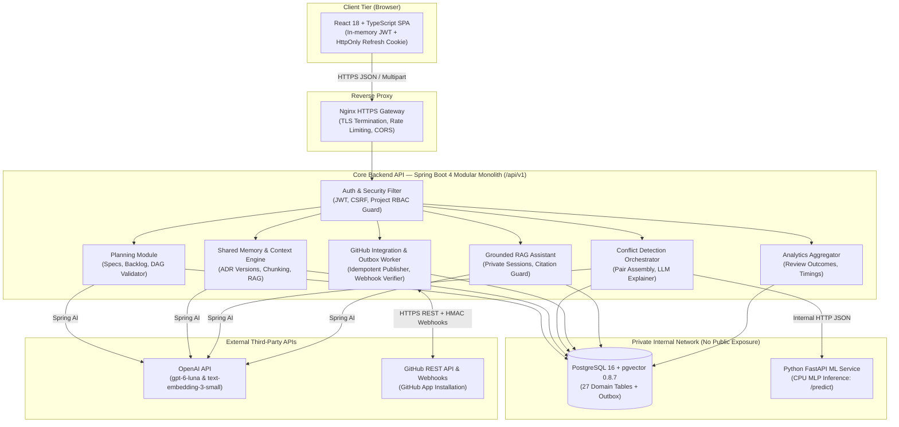
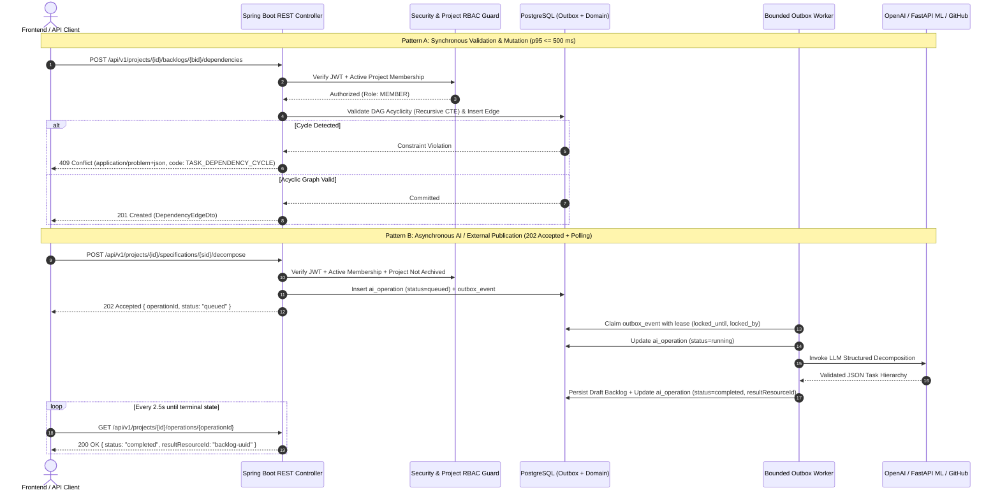

## Table of Contents

1. [Repository Information Architecture & Documentation Strategy](#1-repository-information-architecture--documentation-strategy)
2. [System & API Architecture Overview](#2-system--api-architecture-overview)
3. [Getting Started Guide (Quickstart)](#3-getting-started-guide-quickstart)
4. [Step-by-Step End-to-End Integration Tutorials](#4-step-by-step-end-to-end-integration-tutorials)
5. [Advanced API Design & Operational Guides](#5-advanced-api-design--operational-guides)
   - [5.1 Authentication, Token Rotation & RBAC Deep Dive](#51-authentication-token-rotation--rbac-deep-dive)
   - [5.2 Asynchronous Operations & Polling Lifecycle](#52-asynchronous-operations--polling-lifecycle)
   - [5.3 Idempotency & GitHub Publication Reconciliation](#53-idempotency--github-publication-reconciliation)
   - [5.4 Pagination, Filtering & Sorting Strategy](#54-pagination-filtering--sorting-strategy)
   - [5.5 Rate Limiting & Quota Headers](#55-rate-limiting--quota-headers)
   - [5.6 Error Taxonomy & Recovery Playbook (RFC 9457)](#56-error-taxonomy--recovery-playbook-rfc-9457)
   - [5.7 Versioning Policy & Changelog](#57-versioning-policy--changelog)
6. [Cross-Service Internal Contracts (Backend ↔ FastAPI ML & GitHub)](#6-cross-service-internal-contracts-backend--fastapi-ml--github)
7. [API Quality Governance: Linting, Mock Servers & Contract Testing](#7-api-quality-governance-linting-mock-servers--contract-testing)
8. [Complete Validated OpenAPI 3.1.0 Specification (`docs/api/schemas/openapi.yaml`)](#8-complete-validated-openapi-310-specification-docsapischemasopenapiyaml)

---

## 1. Repository Information Architecture & Documentation Strategy

### 1.1 Folder Structure (`docs/api/`)

To ensure maintainability, traceability to the SRS (`FR-*`, `NFR-*`, `DEC-01`–`DEC-16`), and compatibility with static documentation generators (Redocly, Swagger UI, Docusaurus) and CI linters, the API documentation set follows a strict modular directory convention:

```text
docs/api/
├── README.md                          # Landing page, navigation index, & quick links
├── guides/
│   ├── getting-started.md             # Environment setup, registration, auth, first project
│   ├── tutorial-backlog-to-github.md  # E2E flow: Spec upload -> AI decomposition -> DAG edit -> Approve -> GitHub
│   ├── tutorial-adr-conflict-flow.md  # E2E flow: Propose ADR -> ML conflict check -> Owner override -> RAG chat
│   ├── authentication-and-rbac.md     # JWT memory + HttpOnly refresh cookie + Owner/Member matrix
│   ├── async-and-idempotency.md       # 202 Accepted polling, outbox leases, & GitHub reconciliation
│   └── error-taxonomy.md              # RFC 9457 Problem Details catalog & client recovery steps
├── architecture/
│   ├── system-overview.md             # System context, component dependencies, & request lifecycles
│   └── internal-ml-contract.md        # Spring Boot <-> Python FastAPI internal REST contract
├── schemas/
│   ├── openapi.yaml                   # Single source of truth OpenAPI 3.1.0 specification (Public Core API)
│   └── ml-service-openapi.yaml        # Internal FastAPI ML inference OpenAPI 3.1.0 specification
├── examples/
│   ├── curl-smoke-suite.sh            # Runnable cURL verification script covering typical & edge cases
│   └── payloads/                      # Canonical JSON request/response fixtures for MSW & Pact tests
├── governance/
│   ├── .spectral.yaml                 # Spectral OpenAPI linting ruleset
│   ├── versioning-and-changelog.md    # URI versioning policy, deprecation rules, & release notes
│   └── documentation-report.md        # Methodology, tooling, & known documentation limitations
```

### 1.2 Documentation Strategy, Standards & Conventions

| Dimension | Standard / Rule Adopted |
|---|---|
| **Specification Standard** | **OpenAPI 3.1.0** (YAML format) with JSON Schema 2020-12 compatibility (`nullable` expressed via type arrays `["string", "null"]`). |
| **Error Format Standard** | **RFC 9457 (Problem Details for HTTP APIs)** (`application/problem+json`) with mandatory extension fields: `code`, `correlationId`, `retryable`, and optional `fieldErrors`. |
| **Naming Conventions** | • **URL Paths:** Kebab-case plural nouns (`/api/v1/projects/{projectId}/conflict-checks`), nested under `/projects/{projectId}` to enforce project-scoped authorization.<br>• **JSON Properties:** `camelCase` across all request/response DTOs.<br>• **Enum Values:** `lowercase_snake_case` matching PostgreSQL enum definitions (`SRS §10.1`: `possible_conflict`, `in_progress`, `revision_requested`).<br>• **Error Codes:** `UPPER_SNAKE_CASE` machine-readable constants (`TASK_DEPENDENCY_CYCLE`, `OVERRIDE_RATIONALE_REQUIRED`).<br>• **Timestamps & IDs:** ISO-8601 UTC strings (`2026-11-18T17:30:00Z`) and UUID v4 strings. |
| **Tooling & Automation** | • **Validation & Linting:** Redocly CLI (`redocly lint`) and Stoplight Spectral (`spectral lint`) executed in GitHub Actions PR CI.<br>• **Interactive Docs:** Swagger UI served locally via `springdoc-openapi` (`/swagger-ui.html`) in dev profile + static Redoc bundle.<br>• **Mocking & Contract Parity:** Prism mock server for parallel frontend development and MSW/Zod schema validation in Vitest. |
| **Known Gaps & Limitations** | 1. **Live Spike Alignment (`V-01`–`V-03`):** Exact GitHub App webhook payload fields and OpenAI token usage metadata headers depend on completing engineering spikes `V-01` and `V-02`.<br>2. **Post-MVP Endpoints (`Should`):** External MCP Server endpoints (`FR-MCP-001`–`003`) and structured handoff endpoints (`US-12`) are excluded from `v1` MVP OpenAPI until `Must` acceptance gates pass.<br>3. **No Public Sandbox:** Because LLM and GitHub calls incur external quotas (`DEC-16`), developers run an isolated local sandbox via Docker Compose with deterministic WireMock stubs rather than a shared public internet sandbox. |

---

## 2. System & API Architecture Overview

### 2.1 High-Level System Context & Boundary

The **Core Backend REST API** (Java 21 / Spring Boot 4 modular monolith) acts as the single security, orchestration, and persistence gateway. Neither the React SPA nor external clients communicate directly with PostgreSQL (`pgvector`), the Python FastAPI ML inference service, or OpenAI APIs.



### 2.2 API Resource & Module Map

| API Resource Group | Base URI | Owning Module | Core Responsibility & SRS Traceability |
|---|---|---|---|
| **Authentication** | `/api/v1/auth` | Core & Access | Registration, Argon2id login, 15m JWT + 7d HttpOnly refresh cookie rotation, logout revocation (`FR-AUTH-001`–`006`). |
| **Projects & Members** | `/api/v1/projects` | Core & Access | Workspace CRUD, Owner/Member RBAC, atomic ownership transfer, read-only archiving (`FR-PRJ-001`–`007`). |
| **Specifications** | `/api/v1/projects/{projectId}/specifications` | Planning | Multipart `.txt`/`.pdf` ingestion, PDFBox text extraction, immutable versioning (`FR-DEC-001`–`003`, `FR-DEC-010`). |
| **Backlogs & Tasks** | `/api/v1/projects/{projectId}/backlogs` | Planning | Async AI decomposition trigger, hierarchical task CRUD, DAG acyclicity validation, Owner approval (`FR-DEC-004`–`016`). |
| **Operations** | `/api/v1/projects/{projectId}/operations` | AI Orchestration | Unified polling endpoint for asynchronous background jobs (`queued`, `running`, `completed`, `failed`, `FR-AGT-004`). |
| **GitHub Integration** | `/api/v1/projects/{projectId}/github` | GitHub Integration | GitHub App repository binding, idempotent Issue/sub-issue/dependency export, manual reconciliation (`FR-GIT-001`–`012`). |
| **Decisions (ADRs)** | `/api/v1/projects/{projectId}/decisions` | Shared Memory | Immutable ADR version proposals, atomic Owner approval/supersession, RAG indexing retry (`FR-MEM-007`–`013`). |
| **Conflict Checks** | `/api/v1/projects/{projectId}/conflict-checks` | Conflict Detection | On-demand RAG retrieval + FastAPI MLP classification + LLM explanation (`FR-CON-001`–`011`). |
| **Grounded Chat** | `/api/v1/projects/{projectId}/chats` | AI & Chat | Private per-user chat sessions, Context Engine (`FR-CE-01`) retrieval, verifiable citations (`FR-CHAT-001`–`008`). |
| **Analytics** | `/api/v1/projects/{projectId}/analytics` | Analytics & Events | Final backlog review outcome ratios (`accepted`/`modified`/`rejected`), durations, `N/A` metrics (`FR-ANL-001`–`009`). |
| **GitHub Webhooks** | `/api/v1/webhooks/github` | GitHub Integration | Public receiver for `HMAC-SHA256` signed GitHub Issue open/closed webhook deliveries (`FR-GIT-007`). |

### 2.3 End-to-End Request Lifecycle (Synchronous vs. Asynchronous)



---

## 3. Getting Started Guide (Quickstart)

This guide walks a developer through starting the local environment, registering an account, authenticating, and creating their first project workspace in under 5 minutes.

### 3.1 Prerequisites
* **Docker & Docker Compose** (`v2.24+`)
* **cURL** or an API client (Postman / Insomnia / HTTPie)
* Local base URL: `http://localhost:8080/api/v1` (Swagger UI available at `http://localhost:8080/swagger-ui.html` in `dev` profile)

### 3.2 Step 1 — Start the Local Stack
```bash
# Clone the repository and start PostgreSQL (pgvector), Spring Boot Backend, and FastAPI ML service
cp .env.example .env
docker compose -f docker-compose.dev.yml up -d --build

# Verify backend health
curl -s http://localhost:8080/actuator/health | jq
```

### 3.3 Step 2 — Register a User Account (`FR-AUTH-001`)
```bash
curl -i -X POST http://localhost:8080/api/v1/auth/register \
  -H "Content-Type: application/json" \
  -d '{
    "email": "johnatan.lead@example.com",
    "displayName": "Johnatan Lead",
    "password": "StrongPassword#2026"
  }'
```
**Expected Response (`201 Created`):**
```json
{
  "user": {
    "id": "11111111-1111-4111-8111-111111111111",
    "email": "johnatan.lead@example.com",
    "displayName": "Johnatan Lead",
    "createdAt": "2026-11-18T17:00:00Z"
  }
}
```

### 3.4 Step 3 — Authenticate & Capture Access Token + Refresh Cookie (`DEC-02`)
Use `-c cookies.txt` to store the `HttpOnly` refresh token cookie (`7 days` TTL) and extract the short-lived `accessToken` (`15 minutes` TTL):
```bash
LOGIN_RES=$(curl -s -c cookies.txt -X POST http://localhost:8080/api/v1/auth/login \
  -H "Content-Type: application/json" \
  -d '{
    "email": "johnatan.lead@example.com",
    "password": "StrongPassword#2026"
  }')

ACCESS_TOKEN=$(echo "$LOGIN_RES" | jq -r '.accessToken')
echo "Access Token acquired: ${ACCESS_TOKEN:0:24}..."
```

### 3.5 Step 4 — Create Your First Project Workspace (`FR-PRJ-001`)
```bash
PROJECT_RES=$(curl -s -X POST http://localhost:8080/api/v1/projects \
  -H "Authorization: Bearer $ACCESS_TOKEN" \
  -H "Content-Type: application/json" \
  -d '{
    "name": "Payment Gateway MVP",
    "description": "Core checkout service and ledger reconciliation"
  }')

PROJECT_ID=$(echo "$PROJECT_RES" | jq -r '.id')
echo "$PROJECT_RES" | jq
```
**Expected Response (`201 Created`):**
```json
{
  "id": "22222222-2222-4222-8222-222222222222",
  "name": "Payment Gateway MVP",
  "description": "Core checkout service and ledger reconciliation",
  "status": "active",
  "currentUserRole": "OWNER",
  "memberCount": 1,
  "githubConnection": null,
  "createdAt": "2026-11-18T17:02:10Z",
  "updatedAt": "2026-11-18T17:02:10Z"
}
```

---

## 4. Step-by-Step End-to-End Integration Tutorials

### 4.1 Tutorial A: Specification Upload $\rightarrow$ AI Decomposition $\rightarrow$ DAG Edit $\rightarrow$ Owner Approval $\rightarrow$ GitHub Export (`UC-01`)

This tutorial demonstrates the primary planning workflow from raw specification ingestion to idempotent GitHub Issue creation.

#### Step 1: Upload a UTF-8 TXT or Text-Layer PDF Specification
```bash
SPEC_RES=$(curl -s -X POST "http://localhost:8080/api/v1/projects/$PROJECT_ID/specifications" \
  -H "Authorization: Bearer $ACCESS_TOKEN" \
  -F "file=@./fixtures/payment-spec.txt;type=text/plain" \
  -F "title=Payment Gateway Technical Specification v1")

SPEC_ID=$(echo "$SPEC_RES" | jq -r '.id')
```

#### Step 2: Trigger Asynchronous AI Backlog Decomposition
```bash
OP_RES=$(curl -s -X POST "http://localhost:8080/api/v1/projects/$PROJECT_ID/specifications/$SPEC_ID/decompose" \
  -H "Authorization: Bearer $ACCESS_TOKEN" \
  -H "Content-Type: application/json" \
  -d '{"instructions": "Group backend API tasks under a dedicated Epic."}')

OP_ID=$(echo "$OP_RES" | jq -r '.operationId')
```

#### Step 3: Poll the Asynchronous Operation Until `completed`
```bash
while true; do
  STATUS_JSON=$(curl -s "http://localhost:8080/api/v1/projects/$PROJECT_ID/operations/$OP_ID" \
    -H "Authorization: Bearer $ACCESS_TOKEN")
  STATUS=$(echo "$STATUS_JSON" | jq -r '.status')
  echo "Operation status: $STATUS"
  if [[ "$STATUS" == "completed" || "$STATUS" == "failed" ]]; then
    BACKLOG_ID=$(echo "$STATUS_JSON" | jq -r '.resultResourceId')
    break
  fi
  sleep 2
done
```

#### Step 4: Inspect Draft Backlog, Edit a Task, and Validate DAG Acyclicity
```bash
# Fetch the generated draft backlog (includes optimistic locking revision)
BACKLOG_JSON=$(curl -s "http://localhost:8080/api/v1/projects/$PROJECT_ID/backlogs/current" \
  -H "Authorization: Bearer $ACCESS_TOKEN")

REVISION=$(echo "$BACKLOG_JSON" | jq -r '.revision')
FIRST_TASK_ID=$(echo "$BACKLOG_JSON" | jq -r '.tasks[0].id')

# Refine task priority and acceptance criteria (increments revision)
PATCH_RES=$(curl -s -X PATCH "http://localhost:8080/api/v1/projects/$PROJECT_ID/backlogs/$BACKLOG_ID/tasks/$FIRST_TASK_ID" \
  -H "Authorization: Bearer $ACCESS_TOKEN" \
  -H "Content-Type: application/json" \
  -d "{
    \"revision\": $REVISION,
    \"priority\": 1,
    \"acceptanceCriteria\": [
      \"POST /payments returns 201 with idempotency key validation\",
      \"Unit and Testcontainers integration tests pass\"
    ]
  }")

NEW_REVISION=$(echo "$PATCH_RES" | jq -r '.revision')
```

#### Step 5: Explicitly Approve the Backlog (`Owner` Role Required)
```bash
curl -s -X POST "http://localhost:8080/api/v1/projects/$PROJECT_ID/backlogs/$BACKLOG_ID/approve" \
  -H "Authorization: Bearer $ACCESS_TOKEN" \
  -H "Content-Type: application/json" \
  -d "{
    \"revision\": $NEW_REVISION,
    \"activeReviewDurationMs\": 48000
  }" | jq
```

#### Step 6: Publish Approved Tasks to Connected GitHub Repository
```bash
curl -s -X POST "http://localhost:8080/api/v1/projects/$PROJECT_ID/github/publish" \
  -H "Authorization: Bearer $ACCESS_TOKEN" \
  -H "Content-Type: application/json" \
  -d "{
    \"backlogId\": \"$BACKLOG_ID\",
    \"taskIds\": [\"$FIRST_TASK_ID\"]
  }" | jq
```

---

### 4.2 Tutorial B: Architectural Decision Proposal $\rightarrow$ ML Conflict Detection $\rightarrow$ Owner Override $\rightarrow$ Grounded RAG Chat (`UC-02`, `UC-03`)

#### Step 1: Submit a New Decision Proposal
```bash
DECISION_RES=$(curl -s -X POST "http://localhost:8080/api/v1/projects/$PROJECT_ID/decisions" \
  -H "Authorization: Bearer $ACCESS_TOKEN" \
  -H "Content-Type: application/json" \
  -d '{
    "title": "Use MongoDB for Transaction Ledger Storage",
    "context": "High write throughput expected during flash sales.",
    "decisionText": "Replace PostgreSQL with MongoDB as the primary transaction store.",
    "rationale": "Flexible document schema for payment provider payloads.",
    "sourceRef": "RFC-2026-04"
  }')

VERSION_ID=$(echo "$DECISION_RES" | jq -r '.versionId')
```

#### Step 2: Run On-Demand Semantic Conflict Check Against Current Approved Memory
```bash
CHECK_RES=$(curl -s -X POST "http://localhost:8080/api/v1/projects/$PROJECT_ID/conflict-checks" \
  -H "Authorization: Bearer $ACCESS_TOKEN" \
  -H "Content-Type: application/json" \
  -d "{\"decisionVersionId\": \"$VERSION_ID\"}")

CHECK_ID=$(echo "$CHECK_RES" | jq -r '.checkId')
echo "$CHECK_RES" | jq
```
**Example Response (`possible_conflict`):**
```json
{
  "checkId": "99999999-9999-4999-8999-999999999999",
  "decisionVersionId": "88888888-8888-4888-8888-888888888888",
  "result": "possible_conflict",
  "modelVersion": "scdm-mlp-v1.0.0",
  "explanation": "The proposal to use MongoDB as primary store conflicts with ADR-001 v1, which mandates PostgreSQL for ACID transactional integrity.",
  "explanationError": null,
  "evidence": [
    {
      "comparedDecisionVersionId": "77777777-7777-4777-8777-777777777777",
      "decisionCode": "ADR-001",
      "versionNumber": 1,
      "title": "Primary Relational Database Selection",
      "snippet": "The project must use PostgreSQL 16 as its primary transactional database.",
      "predictedLabel": "conflict",
      "score": 0.91,
      "threshold": 0.75
    }
  ],
  "checkedAt": "2026-11-18T17:15:00Z"
}
```

#### Step 3: Owner Approves with Mandatory Written Override Justification (`GAP-04`)
```bash
curl -s -X POST "http://localhost:8080/api/v1/projects/$PROJECT_ID/decisions/versions/$VERSION_ID/resolve" \
  -H "Authorization: Bearer $ACCESS_TOKEN" \
  -H "Content-Type: application/json" \
  -d "{
    \"action\": \"approve\",
    \"conflictCheckId\": \"$CHECK_ID\",
    \"overrideRationale\": \"Approved strictly for non-ledger webhook payload archiving; core ledger remains on PostgreSQL per updated scope.\"
  }" | jq
```

---

## 5. Advanced API Design & Operational Guides

### 5.1 Authentication, Token Rotation & RBAC Deep Dive (`DEC-02`, `DEC-03`)

1. **Dual-Token Security Architecture:**
   * **Access Token:** Stateless JWT (`HS256`/`RS256`), `15-minute` TTL, transmitted via `Authorization: Bearer <token>`. Stored exclusively in browser RAM (`Zustand`), never in `localStorage`.
   * **Refresh Token:** Opaque cryptographically random token (`7-day` TTL), stored in an `HttpOnly; Secure; SameSite=Strict; Path=/api/v1/auth` cookie. The backend stores only its **SHA-256 hash** in `refresh_sessions` (`Migration 013`).
   * **Token Rotation & Reuse Detection:** Calling `POST /api/v1/auth/refresh` invalidates the presented refresh token and issues a new pair. Presenting an already-rotated token triggers immediate revocation of the entire session family (`401 REFRESH_TOKEN_REUSE_DETECTED`).
   * **CSRF Protection:** Cookie-authenticated endpoints (`/auth/refresh`, `/auth/logout`) require a matching double-submit `X-CSRF-TOKEN` header alongside strict `CORS` origin allowlisting.
2. **Two-Tier Authorization Guard (`GAP-09`):**
   * **Tier 1 (Authentication):** Spring Security validates JWT signature, expiration, and active user status.
   * **Tier 2 (Project & Object Guard):** Every `/api/v1/projects/{projectId}/**` handler verifies via `@ProjectSecurity.hasRole(...)` that the caller is an active member of `{projectId}`, that any nested resource (`backlogId`, `taskId`, `decisionId`, `sessionId`) belongs to `{projectId}`, and that the project is not `archived` on mutating requests. Non-members receive `403 Forbidden` (or `404` where existence concealment applies).

### 5.2 Asynchronous Operations & Polling Lifecycle (`DEC-10`)

Long-running AI and external integration tasks never block HTTP threads (`NFR-PER-003`). Endpoints that initiate background work return `202 Accepted` with an `OperationStatusDto`:
* **Supported `type` values:** `BACKLOG_DECOMPOSITION`, `GITHUB_PUBLICATION`, `ADR_INDEXING`, `CONFLICT_CHECK`.
* **Lifecycle States:** `queued` $\rightarrow$ `running` $\rightarrow$ `completed` | `failed`.
* **Client Polling Guidance:** Poll `GET /api/v1/projects/{projectId}/operations/{operationId}` every `2,500 ms` (backing off to `5,000 ms` after 30 seconds). Terminate polling immediately upon reaching `completed` or `failed`, or when navigating away from the view. Technical completion (`status: "completed"`) **never** implies human approval (`FR-AGT-007`).

### 5.3 Idempotency & GitHub Publication Reconciliation (`GAP-08`)

Because external GitHub REST calls and local PostgreSQL commits cannot share a single ACID transaction:
1. **Deterministic Task Marker:** When creating a GitHub Issue for local task `UUID`, the backend embeds `<!-- team-ai-orchestrator-task-id: <UUID> -->` inside the Issue body and records a durable reservation in `github_issues` (`sync_status = 'pending'`).
2. **Timeout / Uncertain Outcome Handling:** If GitHub times out after creating the Issue remotely, the local mapping transitions to `unknown` rather than blindly retrying `POST /issues`.
3. **Safe Retry & Manual Reconciliation:** Calling `POST /github/publish` again or invoking `POST /github/reconcile` queries the connected GitHub repository for existing Issues containing the task's UUID marker before creating any new Issue, preventing duplicate Issues (`FR-GIT-008`).

### 5.4 Pagination, Filtering & Sorting Strategy (`NFR-PER-006`)

All collection endpoints enforce bounded offset pagination to prevent unbounded memory/payload responses:
* **Query Parameters:** `page` (0-indexed integer, default `0`), `size` (integer `1..100`, default `20`), `sort` (e.g., `updatedAt,desc`).
* **Standard Envelope:**
```json
{
  "items": [ ... ],
  "page": 0,
  "size": 20,
  "totalElements": 42,
  "totalPages": 3,
  "hasNext": true
}
```

### 5.5 Rate Limiting & Quota Headers (`NFR-SEC-013`)

To protect authentication endpoints from brute-force attacks and prevent unbounded OpenAI API token consumption, the API enforces sliding-window rate limits per user/IP and per project:
* **Auth Endpoints (`/auth/login`, `/auth/register`):** `10 requests / minute` per IP.
* **AI Generation Endpoints (`/decompose`, `/chats/*/messages`, `/conflict-checks`):** `20 requests / hour` per project (configurable via `DEC-05`).
* **Response Headers:** `X-RateLimit-Limit`, `X-RateLimit-Remaining`, `X-RateLimit-Reset` (Unix epoch seconds). Exceeding a limit returns `429 Too Many Requests` with `Retry-After` header and `code: "RATE_LIMIT_EXCEEDED"`.

### 5.6 Error Taxonomy & Recovery Playbook (RFC 9457)

All error responses return `Content-Type: application/problem+json`. Clients **must** branch on the machine-readable `code` field rather than matching English `detail` text.

| HTTP Status | Machine `code` | Retryable | Cause | Client Recovery Action |
|---|---|:---:|---|---|
| `400` | `VALIDATION_FAILED` | `false` | Missing/invalid fields or constraints (`fieldErrors` populated). | Highlight offending form fields using `fieldErrors[].field`. |
| `400` | `SCANNED_PDF_NO_TEXT` | `false` | Uploaded PDF contains only raster images (no text layer, `DEC-05`). | Prompt user to upload a text-layer PDF or UTF-8 `.txt` file. |
| `400` | `OVERRIDE_RATIONALE_REQUIRED` | `false` | Owner attempted to approve a `possible_conflict` ADR without rationale. | Keep override modal open and require non-empty justification text. |
| `401` | `ACCESS_TOKEN_EXPIRED` | `true` | Short-lived 15m JWT has expired. | Execute single-flight `POST /auth/refresh` and retry original request. |
| `401` | `INVALID_CREDENTIALS` | `false` | Incorrect email or password on login. | Clear password field and display authentication error message. |
| `403` | `INSUFFICIENT_PROJECT_ROLE` | `false` | `Member` attempted an `Owner`-only action (approve, connect GitHub, archive). | Hide/disable control and display *"Requires Project Owner role"*. |
| `403` | `PROJECT_ACCESS_DENIED` | `false` | Caller is not a member of `{projectId}` or target chat belongs to another user. | Redirect user to `/projects` workspace selector. |
| `404` | `RESOURCE_NOT_FOUND` | `false` | Target project, specification, backlog, or ADR UUID does not exist. | Render controlled 404 empty/error view with navigation back. |
| `409` | `TASK_DEPENDENCY_CYCLE` | `false` | Proposed `blocked-by` or parent link introduces a cycle in the task graph. | Highlight conflicting tasks in red and preserve prior valid DAG. |
| `409` | `STALE_REVISION` | `true` | Optimistic lock mismatch (`revision` changed due to concurrent edit). | Re-fetch `GET /backlogs/current`, merge/warn user, and resubmit. |
| `409` | `STALE_CONFLICT_CHECK` | `true` | Active approved ADRs changed after the conflict check was executed (`FR-CON-011`). | Prompt user to click `Re-run conflict check` before approving. |
| `409` | `PROJECT_ARCHIVED` | `false` | Mutation attempted on an `archived` read-only project (`FR-PRJ-006`). | Switch UI into read-only mode and display archived banner. |
| `413` | `PAYLOAD_TOO_LARGE` | `false` | Uploaded file exceeds `10 MiB` (`DEC-05`). | Reject file client/server-side and display `10 MiB` limit notice. |
| `415` | `UNSUPPORTED_MEDIA_TYPE` | `false` | File MIME type is neither `text/plain` nor `application/pdf`. | Restrict file picker to `.txt` and `.pdf`. |
| `429` | `RATE_LIMIT_EXCEEDED` | `true` | Per-IP auth limit or per-project AI token/request quota reached. | Wait `Retry-After` seconds before re-enabling submit button. |
| `502` | `EXTERNAL_PROVIDER_ERROR` | `true` | OpenAI API, GitHub API, or internal FastAPI ML service timed out or returned `5xx`. | Preserve user input, display `correlationId`, and expose safe `Retry` button. |

### 5.7 Versioning Policy & Changelog

* **URI Versioning:** Major breaking changes are versioned in the URI prefix (`/api/v1/...`).
* **Additive Non-Breaking Changes:** Adding optional JSON response properties, optional query parameters, or new enum values is permitted within `v1` without incrementing the major version; clients must ignore unknown JSON fields.
* **Changelog (`1.0.0-rc.1` — 18 Nov 2026):** Initial release candidate specification aligning all 16 Team Lead decisions (`DEC-01`–`DEC-16`) and database gap remediations (`GAP-01`–`GAP-12`).

---

## 6. Cross-Service Internal Contracts (Backend ↔ FastAPI ML & GitHub)

### 6.1 Spring Boot Backend ↔ Python FastAPI ML Service (`SRS §8.5`)

The Python ML service runs on a private Docker network (`http://ml-service:8000`) with **zero public exposure** (`NFR-SEC-007`). Spring Boot handles authentication, PostgreSQL retrieval, and OpenAI embedding generation (`text-embedding-3-small`, 1,536 dimensions), passing precomputed vectors to FastAPI.

* **`GET /health`:** Liveness probe $\rightarrow$ `200 OK { "status": "ok" }`.
* **`GET /ready`:** Readiness probe verifying MLP weights are loaded and feature schema matches $\rightarrow$ `200 OK { "status": "ready", "modelVersion": "scdm-mlp-v1.0.0", "featureSchemaVersion": "v1-6145" }` (or `503 Service Unavailable` if weights failed checksum validation).
* **`POST /predict`:** Evaluates a single pair of statement embeddings ($1,536$ floats each). FastAPI computes the $6,145$-dimensional feature vector $[A, B, |A-B|, A \odot B, \cos(A, B)]$ on CPU (`NFR-ML-007`, p95 $\le 200\text{ ms}$):

```json
// Request: POST http://ml-service:8000/predict
{
  "featureSchemaVersion": "v1-6145",
  "embeddingModel": "text-embedding-3-small",
  "vectorA": [0.0123, -0.0451, "... (1536 floats)"],
  "vectorB": [-0.0089, 0.0312, "... (1536 floats)"]
}

// Response: 200 OK
{
  "modelVersion": "scdm-mlp-v1.0.0",
  "featureSchemaVersion": "v1-6145",
  "prediction": "conflict",
  "score": 0.874,
  "threshold": 0.75
}
```

### 6.2 GitHub App Integration & Webhook Contract (`SRS §8.4`, `DEC-06`)

* **Outbound Publication:** Spring Boot authenticates as a GitHub App installation using short-lived installation tokens (`POST /app/installations/{installation_id}/access_tokens`) and creates Issues (`POST /repos/{owner}/{repo}/issues`), sub-issue links, and dependency links.
* **Inbound Webhook (`POST /api/v1/webhooks/github`):**
  * Validates `X-Hub-Signature-256` (`HMAC-SHA256` over raw request bytes using the configured webhook secret) before parsing JSON (`NFR-SEC-012`).
  * Deduplicates deliveries using `X-GitHub-Delivery` UUID header.
  * Synchronizes external Issue `open` / `closed` state without overwriting internal Orchestrator workflow states (`in_progress`, `in_review`, `FR-GIT-006`).

---

## 7. API Quality Governance: Linting, Mock Servers & Contract Testing

### 7.1 Automated OpenAPI Validation & Spectral Linting
Every Pull Request modifying `docs/api/schemas/openapi.yaml` executes automated validation in GitHub Actions:
```bash
# 1. Validate OpenAPI 3.1 syntax & schema references via Redocly CLI
npx @redocly/cli lint docs/api/schemas/openapi.yaml

# 2. Enforce team API style rules (Problem Details errors, operationIds, examples) via Spectral
npx @stoplight/spectral-cli lint docs/api/schemas/openapi.yaml --ruleset docs/api/governance/.spectral.yaml
```

### 7.2 Local Mock Server & Consumer-Driven Contract Parity
* **Prism Mock Server:** Frontend developers can run a spec-accurate mock server directly from `openapi.yaml` before backend endpoints are merged:
  ```bash
  npx @stoplight/prism-http-cli mock docs/api/schemas/openapi.yaml -p 4010
  ```
* **Backend ↔ Frontend Contract Verification:**
  * Backend `MockMvc` / `REST Assured` integration tests validate responses against `openapi.yaml` using `openapi-request-validator` / JSON Schema assertions.
  * Frontend `Vitest` + `MSW` tests validate mock fixtures against shared TypeScript interfaces and Zod schemas (`docs/frontend/frontend-architecture.md §9`).

---

## 8. Complete Validated OpenAPI 3.1.0 Specification (`docs/api/schemas/openapi.yaml`)

> The specification below conforms to **OpenAPI 3.1.0**, defines security schemes (`bearerAuth`, `refreshCookieAuth`, `csrfTokenAuth`), reusable RFC 9457 Problem Details responses, pagination envelopes, and complete schemas/examples across all MVP endpoints.

```yaml
openapi: 3.1.0
info:
  title: Team AI Orchestrator REST API
  version: 1.0.0-rc.1
  description: |
    Human-supervised collaborative software engineering platform API.
    Supports workspace RBAC (Owner/Member), specification ingestion, asynchronous AI task decomposition,
    DAG validation, GitHub Issues synchronization, Shared Project Memory (versioned ADRs + pgvector RAG),
    ML-assisted semantic conflict detection, grounded chat, and review analytics.
  contact:
    name: Team AI Orchestrator Engineering Team
    url: https://github.com/cherrySunset/Team-AI-Orchestrator
  license:
    name: MIT
    url: https://opensource.org/licenses/MIT

servers:
  - url: http://localhost:8080/api/v1
    description: Local Docker Compose Development Server
  - url: https://orchestrator.example.edu/api/v1
    description: Academic Pilot VPS Deployment (HTTPS)

tags:
  - name: Auth
    description: Registration, JWT login, HttpOnly refresh cookie rotation, and session management
  - name: Projects
    description: Project workspaces, Owner/Member management, ownership transfer, and archiving
  - name: Specifications
    description: UTF-8 TXT and text-layer PDF specification upload and versioning
  - name: Backlogs & Tasks
    description: AI backlog generation, task hierarchy editing, DAG validation, and Owner approval
  - name: Operations
    description: Asynchronous background job status polling
  - name: GitHub
    description: GitHub App repository binding, idempotent Issue publication, reconciliation, and webhooks
  - name: Decisions
    description: Shared Project Memory — versioned Architectural Decision Records (ADRs)
  - name: Conflict Detection
    description: On-demand RAG + ML semantic conflict detection and evidence retrieval
  - name: Chat
    description: Private user chat sessions with grounded RAG citations
  - name: Analytics
    description: AI operation metrics and human backlog review outcome analytics

security:
  - bearerAuth: []

paths:
  /auth/register:
    post:
      tags: [Auth]
      summary: Register a new user account
      operationId: registerUser
      security: []
      requestBody:
        required: true
        content:
          application/json:
            schema:
              $ref: '#/components/schemas/RegisterRequest'
            example:
              email: developer@example.com
              displayName: Richard Dev
              password: SecurePassword#2026
      responses:
        '201':
          description: User account created successfully
          content:
            application/json:
              schema:
                $ref: '#/components/schemas/RegisterResponse'
        '400':
          $ref: '#/components/responses/BadRequest'
        '409':
          $ref: '#/components/responses/Conflict'
        '429':
          $ref: '#/components/responses/TooManyRequests'

  /auth/login:
    post:
      tags: [Auth]
      summary: Authenticate user and issue in-memory JWT + HttpOnly refresh cookie
      operationId: loginUser
      security: []
      requestBody:
        required: true
        content:
          application/json:
            schema:
              $ref: '#/components/schemas/LoginRequest'
            example:
              email: developer@example.com
              password: SecurePassword#2026
      responses:
        '200':
          description: Authentication successful; sets HttpOnly refresh_token cookie
          headers:
            Set-Cookie:
              description: HttpOnly, Secure, SameSite=Strict refresh token (7-day TTL)
              schema:
                type: string
          content:
            application/json:
              schema:
                $ref: '#/components/schemas/AuthSessionResponse'
        '401':
          $ref: '#/components/responses/Unauthorized'
        '429':
          $ref: '#/components/responses/TooManyRequests'

  /auth/refresh:
    post:
      tags: [Auth]
      summary: Rotate refresh cookie and obtain a fresh 15-minute access JWT
      operationId: refreshSession
      security:
        - refreshCookieAuth: []
          csrfTokenAuth: []
      responses:
        '200':
          description: Token rotated successfully
          content:
            application/json:
              schema:
                $ref: '#/components/schemas/AuthSessionResponse'
        '401':
          $ref: '#/components/responses/Unauthorized'

  /auth/logout:
    post:
      tags: [Auth]
      summary: Revoke refresh session and clear cookie
      operationId: logoutUser
      security:
        - bearerAuth: []
          refreshCookieAuth: []
      responses:
        '204':
          description: Logged out and refresh token revoked
        '401':
          $ref: '#/components/responses/Unauthorized'

  /auth/me:
    get:
      tags: [Auth]
      summary: Get current authenticated user profile
      operationId: getCurrentUser
      responses:
        '200':
          description: Authenticated user details
          content:
            application/json:
              schema:
                $ref: '#/components/schemas/UserSummary'
        '401':
          $ref: '#/components/responses/Unauthorized'

  /projects:
    get:
      tags: [Projects]
      summary: List projects accessible to the authenticated user
      operationId: listProjects
      parameters:
        - name: search
          in: query
          schema:
            type: string
            maxLength: 100
        - $ref: '#/components/parameters/PageParam'
        - $ref: '#/components/parameters/SizeParam'
      responses:
        '200':
          description: Paginated list of user projects
          content:
            application/json:
              schema:
                $ref: '#/components/schemas/ProjectPageResponse'
        '401':
          $ref: '#/components/responses/Unauthorized'
    post:
      tags: [Projects]
      summary: Create a new project with the caller as sole Owner
      operationId: createProject
      requestBody:
        required: true
        content:
          application/json:
            schema:
              $ref: '#/components/schemas/CreateProjectRequest'
            example:
              name: Core Checkout Service
              description: Microservice handling payment intents and refunds
      responses:
        '201':
          description: Project created atomically with Owner membership
          content:
            application/json:
              schema:
                $ref: '#/components/schemas/ProjectDto'
        '400':
          $ref: '#/components/responses/BadRequest'
        '401':
          $ref: '#/components/responses/Unauthorized'

  /projects/{projectId}:
    parameters:
      - $ref: '#/components/parameters/ProjectIdParam'
    get:
      tags: [Projects]
      summary: Get project metadata, caller role, and GitHub connection status
      operationId: getProject
      responses:
        '200':
          description: Project details
          content:
            application/json:
              schema:
                $ref: '#/components/schemas/ProjectDto'
        '403':
          $ref: '#/components/responses/Forbidden'
        '404':
          $ref: '#/components/responses/NotFound'
    patch:
      tags: [Projects]
      summary: Update project name or description (Owner only)
      operationId: updateProject
      requestBody:
        required: true
        content:
          application/json:
            schema:
              $ref: '#/components/schemas/UpdateProjectRequest'
      responses:
        '200':
          description: Updated project
          content:
            application/json:
              schema:
                $ref: '#/components/schemas/ProjectDto'
        '403':
          $ref: '#/components/responses/Forbidden'
        '409':
          $ref: '#/components/responses/Conflict'

  /projects/{projectId}/archive:
    parameters:
      - $ref: '#/components/parameters/ProjectIdParam'
    post:
      tags: [Projects]
      summary: Archive project into read-only mode (Owner only)
      operationId: archiveProject
      responses:
        '200':
          description: Project archived
          content:
            application/json:
              schema:
                $ref: '#/components/schemas/ProjectDto'
        '403':
          $ref: '#/components/responses/Forbidden'

  /projects/{projectId}/members:
    parameters:
      - $ref: '#/components/parameters/ProjectIdParam'
    get:
      tags: [Projects]
      summary: List project members and their roles
      operationId: listProjectMembers
      responses:
        '200':
          description: Member list
          content:
            application/json:
              schema:
                type: object
                required: [items]
                properties:
                  items:
                    type: array
                    items:
                      $ref: '#/components/schemas/ProjectMemberDto'
        '403':
          $ref: '#/components/responses/Forbidden'
    post:
      tags: [Projects]
      summary: Add an existing registered user to the project by email (Owner only)
      operationId: addProjectMember
      requestBody:
        required: true
        content:
          application/json:
            schema:
              type: object
              required: [email]
              properties:
                email:
                  type: string
                  format: email
            example:
              email: richard.dev@example.com
      responses:
        '201':
          description: Member added
          content:
            application/json:
              schema:
                $ref: '#/components/schemas/ProjectMemberDto'
        '403':
          $ref: '#/components/responses/Forbidden'
        '404':
          $ref: '#/components/responses/NotFound'
        '409':
          $ref: '#/components/responses/Conflict'

  /projects/{projectId}/members/{userId}:
    parameters:
      - $ref: '#/components/parameters/ProjectIdParam'
      - name: userId
        in: path
        required: true
        schema:
          type: string
          format: uuid
    delete:
      tags: [Projects]
      summary: Remove a Member from the project (Owner only; cannot remove sole Owner)
      operationId: removeProjectMember
      responses:
        '204':
          description: Member removed
        '403':
          $ref: '#/components/responses/Forbidden'
        '409':
          $ref: '#/components/responses/Conflict'

  /projects/{projectId}/transfer-ownership:
    parameters:
      - $ref: '#/components/parameters/ProjectIdParam'
    post:
      tags: [Projects]
      summary: Atomically transfer Owner role to another active Member (Owner only)
      operationId: transferProjectOwnership
      requestBody:
        required: true
        content:
          application/json:
            schema:
              type: object
              required: [newOwnerUserId]
              properties:
                newOwnerUserId:
                  type: string
                  format: uuid
      responses:
        '200':
          description: Ownership transferred atomically
          content:
            application/json:
              schema:
                type: object
                required: [previousOwnerId, newOwnerId]
                properties:
                  previousOwnerId:
                    type: string
                    format: uuid
                  newOwnerId:
                    type: string
                    format: uuid
        '400':
          $ref: '#/components/responses/BadRequest'
        '403':
          $ref: '#/components/responses/Forbidden'

  /projects/{projectId}/specifications:
    parameters:
      - $ref: '#/components/parameters/ProjectIdParam'
    get:
      tags: [Specifications]
      summary: List all specification versions uploaded to the project
      operationId: listSpecifications
      responses:
        '200':
          description: List of specifications
          content:
            application/json:
              schema:
                type: object
                required: [items]
                properties:
                  items:
                    type: array
                    items:
                      $ref: '#/components/schemas/SpecificationDto'
        '403':
          $ref: '#/components/responses/Forbidden'
    post:
      tags: [Specifications]
      summary: Upload a UTF-8 TXT or text-layer PDF specification (max 10 MiB, 200k chars)
      operationId: uploadSpecification
      requestBody:
        required: true
        content:
          multipart/form-data:
            schema:
              type: object
              required: [file]
              properties:
                file:
                  type: string
                  format: binary
                title:
                  type: string
                  maxLength: 200
      responses:
        '201':
          description: Specification extracted and versioned
          content:
            application/json:
              schema:
                $ref: '#/components/schemas/SpecificationDto'
        '400':
          $ref: '#/components/responses/BadRequest'
        '413':
          $ref: '#/components/responses/PayloadTooLarge'
        '415':
          $ref: '#/components/responses/UnsupportedMediaType'

  /projects/{projectId}/specifications/{specId}/decompose:
    parameters:
      - $ref: '#/components/parameters/ProjectIdParam'
      - name: specId
        in: path
        required: true
        schema:
          type: string
          format: uuid
    post:
      tags: [Backlogs & Tasks]
      summary: Start asynchronous AI task decomposition for a specification
      operationId: decomposeSpecification
      requestBody:
        required: false
        content:
          application/json:
            schema:
              type: object
              properties:
                instructions:
                  type: string
                  maxLength: 1000
      responses:
        '202':
          description: Asynchronous decomposition job queued
          content:
            application/json:
              schema:
                $ref: '#/components/schemas/AsyncOperationAcceptedResponse'
        '409':
          $ref: '#/components/responses/Conflict'
        '429':
          $ref: '#/components/responses/TooManyRequests'

  /projects/{projectId}/operations/{operationId}:
    parameters:
      - $ref: '#/components/parameters/ProjectIdParam'
      - name: operationId
        in: path
        required: true
        schema:
          type: string
          format: uuid
    get:
      tags: [Operations]
      summary: Poll status and result reference of an asynchronous operation
      operationId: getOperationStatus
      responses:
        '200':
          description: Current operation status
          content:
            application/json:
              schema:
                $ref: '#/components/schemas/OperationStatusDto'
        '403':
          $ref: '#/components/responses/Forbidden'
        '404':
          $ref: '#/components/responses/NotFound'

  /projects/{projectId}/backlogs/current:
    parameters:
      - $ref: '#/components/parameters/ProjectIdParam'
    get:
      tags: [Backlogs & Tasks]
      summary: Retrieve the active draft, approved, or published backlog with full task hierarchy
      operationId: getCurrentBacklog
      responses:
        '200':
          description: Current project backlog
          content:
            application/json:
              schema:
                $ref: '#/components/schemas/BacklogDto'
        '404':
          $ref: '#/components/responses/NotFound'

  /projects/{projectId}/backlogs/{backlogId}/tasks:
    parameters:
      - $ref: '#/components/parameters/ProjectIdParam'
      - name: backlogId
        in: path
        required: true
        schema:
          type: string
          format: uuid
    post:
      tags: [Backlogs & Tasks]
      summary: Add a new task/story/epic to an unpublished backlog
      operationId: createTask
      requestBody:
        required: true
        content:
          application/json:
            schema:
              $ref: '#/components/schemas/CreateTaskRequest'
      responses:
        '201':
          description: Task created
          content:
            application/json:
              schema:
                $ref: '#/components/schemas/TaskMutationResponse'
        '400':
          $ref: '#/components/responses/BadRequest'
        '409':
          $ref: '#/components/responses/Conflict'

  /projects/{projectId}/backlogs/{backlogId}/tasks/{taskId}:
    parameters:
      - $ref: '#/components/parameters/ProjectIdParam'
      - name: backlogId
        in: path
        required: true
        schema:
          type: string
          format: uuid
      - name: taskId
        in: path
        required: true
        schema:
          type: string
          format: uuid
    patch:
      tags: [Backlogs & Tasks]
      summary: Edit a task (invalidates prior approval if backlog was approved but unpublished)
      operationId: updateTask
      requestBody:
        required: true
        content:
          application/json:
            schema:
              $ref: '#/components/schemas/UpdateTaskRequest'
      responses:
        '200':
          description: Task updated
          content:
            application/json:
              schema:
                $ref: '#/components/schemas/TaskMutationResponse'
        '409':
          $ref: '#/components/responses/Conflict'
    delete:
      tags: [Backlogs & Tasks]
      summary: Delete a task from an unpublished backlog
      operationId: deleteTask
      parameters:
        - name: revision
          in: query
          required: true
          schema:
            type: integer
      responses:
        '204':
          description: Task deleted
        '409':
          $ref: '#/components/responses/Conflict'

  /projects/{projectId}/backlogs/{backlogId}/dependencies:
    parameters:
      - $ref: '#/components/parameters/ProjectIdParam'
      - name: backlogId
        in: path
        required: true
        schema:
          type: string
          format: uuid
    post:
      tags: [Backlogs & Tasks]
      summary: Add a directed blocked-by dependency edge (enforces DAG acyclicity)
      operationId: addTaskDependency
      requestBody:
        required: true
        content:
          application/json:
            schema:
              type: object
              required: [taskId, blockedByTaskId, revision]
              properties:
                taskId:
                  type: string
                  format: uuid
                blockedByTaskId:
                  type: string
                  format: uuid
                revision:
                  type: integer
      responses:
        '201':
          description: Dependency added; DAG remains acyclic
          content:
            application/json:
              schema:
                type: object
                required: [taskId, blockedByTaskId, dagValid, revision]
                properties:
                  taskId:
                    type: string
                    format: uuid
                  blockedByTaskId:
                    type: string
                    format: uuid
                  dagValid:
                    type: boolean
                  revision:
                    type: integer
        '409':
          $ref: '#/components/responses/Conflict'
    delete:
      tags: [Backlogs & Tasks]
      summary: Remove a dependency edge between two tasks
      operationId: removeTaskDependency
      parameters:
        - name: taskId
          in: query
          required: true
          schema:
            type: string
            format: uuid
        - name: blockedByTaskId
          in: query
          required: true
          schema:
            type: string
            format: uuid
      responses:
        '204':
          description: Dependency removed

  /projects/{projectId}/backlogs/{backlogId}/approve:
    parameters:
      - $ref: '#/components/parameters/ProjectIdParam'
      - name: backlogId
        in: path
        required: true
        schema:
          type: string
          format: uuid
    post:
      tags: [Backlogs & Tasks]
      summary: Explicitly approve a valid draft backlog and record final review analytics (Owner only)
      operationId: approveBacklog
      requestBody:
        required: true
        content:
          application/json:
            schema:
              type: object
              required: [revision]
              properties:
                revision:
                  type: integer
                activeReviewDurationMs:
                  type: ['integer', 'null']
                  minimum: 0
      responses:
        '200':
          description: Backlog approved and ready for GitHub publication
          content:
            application/json:
              schema:
                $ref: '#/components/schemas/BacklogDto'
        '403':
          $ref: '#/components/responses/Forbidden'
        '409':
          $ref: '#/components/responses/Conflict'

  /projects/{projectId}/github/connect:
    parameters:
      - $ref: '#/components/parameters/ProjectIdParam'
    post:
      tags: [GitHub]
      summary: Connect a single GitHub repository via GitHub App installation (Owner only)
      operationId: connectGithubRepository
      requestBody:
        required: true
        content:
          application/json:
            schema:
              type: object
              required: [installationId, repositoryFullName]
              properties:
                installationId:
                  type: integer
                  format: int64
                repositoryFullName:
                  type: string
                  pattern: '^[a-zA-Z0-9_.-]+/[a-zA-Z0-9_.-]+$'
            example:
              installationId: 98765432
              repositoryFullName: cherrySunset/payment-gateway
      responses:
        '200':
          description: Repository connected and permissions verified
          content:
            application/json:
              schema:
                $ref: '#/components/schemas/GithubConnectionDto'
        '400':
          $ref: '#/components/responses/BadRequest'
        '403':
          $ref: '#/components/responses/Forbidden'

  /projects/{projectId}/github/publish:
    parameters:
      - $ref: '#/components/parameters/ProjectIdParam'
    post:
      tags: [GitHub]
      summary: Idempotently publish selected approved tasks to GitHub Issues (Owner or Member)
      operationId: publishTasksToGithub
      requestBody:
        required: true
        content:
          application/json:
            schema:
              type: object
              required: [backlogId, taskIds]
              properties:
                backlogId:
                  type: string
                  format: uuid
                taskIds:
                  type: array
                  minItems: 1
                  items:
                    type: string
                    format: uuid
      responses:
        '202':
          description: GitHub publication job queued
          content:
            application/json:
              schema:
                $ref: '#/components/schemas/AsyncOperationAcceptedResponse'
        '403':
          $ref: '#/components/responses/Forbidden'
        '409':
          $ref: '#/components/responses/Conflict'

  /projects/{projectId}/github/reconcile:
    parameters:
      - $ref: '#/components/parameters/ProjectIdParam'
    post:
      tags: [GitHub]
      summary: Reconcile uncertain/unknown publication states and remote open/closed statuses with GitHub
      operationId: reconcileGithubIssues
      responses:
        '200':
          description: Reconciliation completed
          content:
            application/json:
              schema:
                type: object
                required: [reconciledCount, unknownCount, failedCount]
                properties:
                  reconciledCount:
                    type: integer
                  unknownCount:
                    type: integer
                  failedCount:
                    type: integer
        '502':
          $ref: '#/components/responses/BadGateway'

  /projects/{projectId}/decisions:
    parameters:
      - $ref: '#/components/parameters/ProjectIdParam'
    get:
      tags: [Decisions]
      summary: List architectural decisions in Shared Project Memory
      operationId: listDecisions
      parameters:
        - name: status
          in: query
          schema:
            type: string
            enum: [proposed, accepted, rejected, superseded]
      responses:
        '200':
          description: List of architectural decisions
          content:
            application/json:
              schema:
                type: object
                required: [items]
                properties:
                  items:
                    type: array
                    items:
                      $ref: '#/components/schemas/DecisionSummaryDto'
    post:
      tags: [Decisions]
      summary: Propose a new architectural decision or a new version of an existing ADR
      operationId: createDecisionProposal
      requestBody:
        required: true
        content:
          application/json:
            schema:
              $ref: '#/components/schemas/CreateDecisionRequest'
      responses:
        '201':
          description: Decision proposal created with status=proposed
          content:
            application/json:
              schema:
                $ref: '#/components/schemas/DecisionVersionDto'
        '400':
          $ref: '#/components/responses/BadRequest'

  /projects/{projectId}/decisions/{decisionId}:
    parameters:
      - $ref: '#/components/parameters/ProjectIdParam'
      - name: decisionId
        in: path
        required: true
        schema:
          type: string
          format: uuid
    get:
      tags: [Decisions]
      summary: Get an architectural decision and all its immutable historical versions
      operationId: getDecisionHistory
      responses:
        '200':
          description: Full ADR version history
          content:
            application/json:
              schema:
                $ref: '#/components/schemas/DecisionDetailDto'
        '404':
          $ref: '#/components/responses/NotFound'

  /projects/{projectId}/conflict-checks:
    parameters:
      - $ref: '#/components/parameters/ProjectIdParam'
    post:
      tags: [Conflict Detection]
      summary: Run semantic conflict check of a decision proposal against current approved ADRs
      operationId: runConflictCheck
      requestBody:
        required: true
        content:
          application/json:
            schema:
              type: object
              required: [decisionVersionId]
              properties:
                decisionVersionId:
                  type: string
                  format: uuid
      responses:
        '200':
          description: Conflict check completed (possible_conflict, no_conflict, or insufficient_context)
          content:
            application/json:
              schema:
                $ref: '#/components/schemas/ConflictCheckDto'
        '502':
          $ref: '#/components/responses/BadGateway'

  /projects/{projectId}/decisions/versions/{versionId}/resolve:
    parameters:
      - $ref: '#/components/parameters/ProjectIdParam'
      - name: versionId
        in: path
        required: true
        schema:
          type: string
          format: uuid
    post:
      tags: [Decisions]
      summary: Approve (atomically superseding prior active ADR), reject, or request revision (Owner only)
      operationId: resolveDecisionVersion
      requestBody:
        required: true
        content:
          application/json:
            schema:
              $ref: '#/components/schemas/ResolveDecisionRequest'
      responses:
        '200':
          description: Decision version resolved
          content:
            application/json:
              schema:
                $ref: '#/components/schemas/DecisionVersionDto'
        '400':
          $ref: '#/components/responses/BadRequest'
        '403':
          $ref: '#/components/responses/Forbidden'
        '409':
          $ref: '#/components/responses/Conflict'

  /projects/{projectId}/chats:
    parameters:
      - $ref: '#/components/parameters/ProjectIdParam'
    get:
      tags: [Chat]
      summary: List caller's private RAG chat sessions within the project
      operationId: listChatSessions
      responses:
        '200':
          description: Private chat sessions
          content:
            application/json:
              schema:
                type: object
                required: [items]
                properties:
                  items:
                    type: array
                    items:
                      $ref: '#/components/schemas/ChatSessionDto'
    post:
      tags: [Chat]
      summary: Create a new private RAG chat session
      operationId: createChatSession
      requestBody:
        required: false
        content:
          application/json:
            schema:
              type: object
              properties:
                title:
                  type: string
                  maxLength: 150
      responses:
        '201':
          description: Chat session created
          content:
            application/json:
              schema:
                $ref: '#/components/schemas/ChatSessionDto'

  /projects/{projectId}/chats/{sessionId}/messages:
    parameters:
      - $ref: '#/components/parameters/ProjectIdParam'
      - name: sessionId
        in: path
        required: true
        schema:
          type: string
          format: uuid
    get:
      tags: [Chat]
      summary: Retrieve message history and source citations for caller's private chat session
      operationId: getChatMessages
      responses:
        '200':
          description: Ordered chat messages
          content:
            application/json:
              schema:
                type: object
                required: [items]
                properties:
                  items:
                    type: array
                    items:
                      $ref: '#/components/schemas/ChatMessageDto'
        '403':
          $ref: '#/components/responses/Forbidden'
    post:
      tags: [Chat]
      summary: Send a question to the grounded RAG assistant and receive a source-cited answer
      operationId: sendChatMessage
      requestBody:
        required: true
        content:
          application/json:
            schema:
              type: object
              required: [content]
              properties:
                content:
                  type: string
                  minLength: 1
                  maxLength: 4000
                specificationIds:
                  type: array
                  items:
                    type: string
                    format: uuid
      responses:
        '200':
          description: Grounded assistant response with verifiable source citations
          content:
            application/json:
              schema:
                $ref: '#/components/schemas/ChatMessageDto'
        '502':
          $ref: '#/components/responses/BadGateway'

  /projects/{projectId}/analytics:
    parameters:
      - $ref: '#/components/parameters/ProjectIdParam'
      - name: period
        in: query
        schema:
          type: string
          enum: [7d, 30d, all]
          default: 30d
    get:
      tags: [Analytics]
      summary: Retrieve project-scoped AI operation metrics and human backlog review outcomes
      operationId: getProjectAnalytics
      responses:
        '200':
          description: Aggregated analytics metrics (unmeasured fields returned as null for N/A display)
          content:
            application/json:
              schema:
                $ref: '#/components/schemas/ProjectAnalyticsDto'
        '403':
          $ref: '#/components/responses/Forbidden'

  /webhooks/github:
    post:
      tags: [GitHub]
      summary: Receive HMAC-SHA256 signed GitHub Issue open/closed webhook events
      operationId: handleGithubWebhook
      security: []
      parameters:
        - name: X-Hub-Signature-256
          in: header
          required: true
          schema:
            type: string
        - name: X-GitHub-Delivery
          in: header
          required: true
          schema:
            type: string
            format: uuid
        - name: X-GitHub-Event
          in: header
          required: true
          schema:
            type: string
      requestBody:
        required: true
        content:
          application/json:
            schema:
              type: object
      responses:
        '202':
          description: Webhook verified and accepted
        '401':
          $ref: '#/components/responses/Unauthorized'

components:
  securitySchemes:
    bearerAuth:
      type: http
      scheme: bearer
      bearerFormat: JWT
      description: Short-lived (15 min) access JWT stored in frontend memory
    refreshCookieAuth:
      type: apiKey
      in: cookie
      name: refresh_token
      description: Long-lived (7 days) HttpOnly Secure refresh token cookie
    csrfTokenAuth:
      type: apiKey
      in: header
      name: X-CSRF-TOKEN

  parameters:
    ProjectIdParam:
      name: projectId
      in: path
      required: true
      description: UUID of the target project workspace
      schema:
        type: string
        format: uuid
    PageParam:
      name: page
      in: query
      schema:
        type: integer
        minimum: 0
        default: 0
    SizeParam:
      name: size
      in: query
      schema:
        type: integer
        minimum: 1
        maximum: 100
        default: 20

  responses:
    BadRequest:
      description: Validation or business input error (RFC 9457)
      content:
        application/problem+json:
          schema:
            $ref: '#/components/schemas/ProblemDetails'
    Unauthorized:
      description: Missing, expired, or invalid authentication credentials
      content:
        application/problem+json:
          schema:
            $ref: '#/components/schemas/ProblemDetails'
    Forbidden:
      description: Caller lacks required project membership or Owner role
      content:
        application/problem+json:
          schema:
            $ref: '#/components/schemas/ProblemDetails'
    NotFound:
      description: Requested resource was not found
      content:
        application/problem+json:
          schema:
            $ref: '#/components/schemas/ProblemDetails'
    Conflict:
      description: State conflict (DAG cycle, stale revision, duplicate record, archived project)
      content:
        application/problem+json:
          schema:
            $ref: '#/components/schemas/ProblemDetails'
    PayloadTooLarge:
      description: File exceeds maximum allowed size (10 MiB)
      content:
        application/problem+json:
          schema:
            $ref: '#/components/schemas/ProblemDetails'
    UnsupportedMediaType:
      description: Unsupported file format (only UTF-8 TXT and text-layer PDF allowed)
      content:
        application/problem+json:
          schema:
            $ref: '#/components/schemas/ProblemDetails'
    TooManyRequests:
      description: Rate limit or AI token budget exceeded
      headers:
        Retry-After:
          schema:
            type: integer
      content:
        application/problem+json:
          schema:
            $ref: '#/components/schemas/ProblemDetails'
    BadGateway:
      description: External AI, embedding, ML inference, or GitHub provider failure
      content:
        application/problem+json:
          schema:
            $ref: '#/components/schemas/ProblemDetails'

  schemas:
    ProblemDetails:
      type: object
      required: [type, title, status, detail, code, correlationId, retryable]
      properties:
        type:
          type: string
          format: uri
        title:
          type: string
        status:
          type: integer
        detail:
          type: string
        instance:
          type: string
        code:
          type: string
        correlationId:
          type: string
        retryable:
          type: boolean
        fieldErrors:
          type: array
          items:
            type: object
            required: [field, message]
            properties:
              field:
                type: string
              message:
                type: string

    RegisterRequest:
      type: object
      required: [email, displayName, password]
      properties:
        email:
          type: string
          format: email
          maxLength: 255
        displayName:
          type: string
          minLength: 2
          maxLength: 100
        password:
          type: string
          minLength: 8
          maxLength: 128

    RegisterResponse:
      type: object
      required: [user]
      properties:
        user:
          $ref: '#/components/schemas/UserSummary'

    LoginRequest:
      type: object
      required: [email, password]
      properties:
        email:
          type: string
          format: email
        password:
          type: string

    AuthSessionResponse:
      type: object
      required: [accessToken, expiresInSeconds, user]
      properties:
        accessToken:
          type: string
        expiresInSeconds:
          type: integer
          example: 900
        user:
          $ref: '#/components/schemas/UserSummary'

    UserSummary:
      type: object
      required: [id, email, displayName]
      properties:
        id:
          type: string
          format: uuid
        email:
          type: string
          format: email
        displayName:
          type: string
        createdAt:
          type: string
          format: date-time

    CreateProjectRequest:
      type: object
      required: [name]
      properties:
        name:
          type: string
          minLength: 1
          maxLength: 120
        description:
          type: string
          maxLength: 1000

    UpdateProjectRequest:
      type: object
      properties:
        name:
          type: string
          minLength: 1
          maxLength: 120
        description:
          type: string
          maxLength: 1000

    GithubConnectionDto:
      type: object
      required: [status, repositoryFullName]
      properties:
        status:
          type: string
          enum: [active, disconnected, error]
        repositoryFullName:
          type: string
        connectedAt:
          type: string
          format: date-time

    ProjectDto:
      type: object
      required: [id, name, status, currentUserRole, memberCount, createdAt, updatedAt]
      properties:
        id:
          type: string
          format: uuid
        name:
          type: string
        description:
          type: ['string', 'null']
        status:
          type: string
          enum: [active, archived]
        currentUserRole:
          type: string
          enum: [OWNER, MEMBER]
        memberCount:
          type: integer
        githubConnection:
          oneOf:
            - $ref: '#/components/schemas/GithubConnectionDto'
            - type: 'null'
        createdAt:
          type: string
          format: date-time
        updatedAt:
          type: string
          format: date-time

    ProjectPageResponse:
      type: object
      required: [items, page, size, totalElements, totalPages, hasNext]
      properties:
        items:
          type: array
          items:
            $ref: '#/components/schemas/ProjectDto'
        page:
          type: integer
        size:
          type: integer
        totalElements:
          type: integer
        totalPages:
          type: integer
        hasNext:
          type: boolean

    ProjectMemberDto:
      type: object
      required: [userId, email, displayName, role, joinedAt]
      properties:
        userId:
          type: string
          format: uuid
        email:
          type: string
          format: email
        displayName:
          type: string
        role:
          type: string
          enum: [OWNER, MEMBER]
        joinedAt:
          type: string
          format: date-time

    SpecificationDto:
      type: object
      required: [id, version, fileName, status, charCount, uploadedBy, createdAt]
      properties:
        id:
          type: string
          format: uuid
        version:
          type: integer
        fileName:
          type: string
        title:
          type: ['string', 'null']
        status:
          type: string
          enum: [uploaded, processing, processed, failed]
        charCount:
          type: integer
        uploadedBy:
          $ref: '#/components/schemas/UserSummary'
        createdAt:
          type: string
          format: date-time

    AsyncOperationAcceptedResponse:
      type: object
      required: [operationId, type, status]
      properties:
        operationId:
          type: string
          format: uuid
        type:
          type: string
        status:
          type: string
          enum: [queued, running]

    OperationStatusDto:
      type: object
      required: [operationId, type, status, startedAt]
      properties:
        operationId:
          type: string
          format: uuid
        type:
          type: string
        status:
          type: string
          enum: [queued, running, completed, failed]
        stageLabel:
          type: ['string', 'null']
        resultResourceId:
          type: ['string', 'null']
          format: uuid
        error:
          type: ['object', 'null']
          properties:
            code:
              type: string
            detail:
              type: string
            retryable:
              type: boolean
        startedAt:
          type: string
          format: date-time
        completedAt:
          type: ['string', 'null']
          format: date-time

    TaskDto:
      type: object
      required: [id, type, title, description, acceptanceCriteria, priority, status, blockedByTaskIds]
      properties:
        id:
          type: string
          format: uuid
        parentId:
          type: ['string', 'null']
          format: uuid
        type:
          type: string
          enum: [epic, story, task]
        title:
          type: string
        description:
          type: string
        acceptanceCriteria:
          type: array
          items:
            type: string
        priority:
          type: integer
          minimum: 1
          maximum: 5
        status:
          type: string
          enum: [draft, ready, in_progress, in_review, done, cancelled]
        blockedByTaskIds:
          type: array
          items:
            type: string
            format: uuid
        githubIssue:
          type: ['object', 'null']
          properties:
            number:
              type: integer
            url:
              type: string
              format: uri
            syncStatus:
              type: string
              enum: [pending, synced, failed, unknown]

    BacklogDto:
      type: object
      required: [id, status, revision, dagValid, tasks]
      properties:
        id:
          type: string
          format: uuid
        specificationId:
          type: ['string', 'null']
          format: uuid
        specificationVersion:
          type: ['integer', 'null']
        status:
          type: string
          enum: [draft, approved, published]
        revision:
          type: integer
        dagValid:
          type: boolean
        tasks:
          type: array
          items:
            $ref: '#/components/schemas/TaskDto'

    CreateTaskRequest:
      type: object
      required: [type, title, description, acceptanceCriteria, priority, revision]
      properties:
        parentId:
          type: ['string', 'null']
          format: uuid
        type:
          type: string
          enum: [epic, story, task]
        title:
          type: string
          minLength: 1
          maxLength: 200
        description:
          type: string
        acceptanceCriteria:
          type: array
          items:
            type: string
        priority:
          type: integer
          minimum: 1
          maximum: 5
        revision:
          type: integer

    UpdateTaskRequest:
      type: object
      required: [revision]
      properties:
        revision:
          type: integer
        parentId:
          type: ['string', 'null']
          format: uuid
        title:
          type: string
        description:
          type: string
        acceptanceCriteria:
          type: array
          items:
            type: string
        priority:
          type: integer
          minimum: 1
          maximum: 5
        status:
          type: string
          enum: [draft, ready, in_progress, in_review, done, cancelled]

    TaskMutationResponse:
      type: object
      required: [task, approvalInvalidated, revision]
      properties:
        task:
          $ref: '#/components/schemas/TaskDto'
        approvalInvalidated:
          type: boolean
        revision:
          type: integer

    DecisionSummaryDto:
      type: object
      required: [decisionId, code, currentVersionId, versionNumber, title, status, indexingStatus, author, updatedAt]
      properties:
        decisionId:
          type: string
          format: uuid
        code:
          type: string
          example: ADR-001
        currentVersionId:
          type: string
          format: uuid
        versionNumber:
          type: integer
        title:
          type: string
        status:
          type: string
          enum: [proposed, accepted, rejected, superseded]
        indexingStatus:
          type: string
          enum: [pending, processing, indexed, failed]
        author:
          $ref: '#/components/schemas/UserSummary'
        updatedAt:
          type: string
          format: date-time

    DecisionVersionDto:
      type: object
      required: [versionId, decisionId, versionNumber, title, context, decisionText, rationale, status, indexingStatus, createdAt]
      properties:
        versionId:
          type: string
          format: uuid
        decisionId:
          type: string
          format: uuid
        versionNumber:
          type: integer
        title:
          type: string
        context:
          type: string
        decisionText:
          type: string
        rationale:
          type: string
        sourceRef:
          type: ['string', 'null']
        status:
          type: string
          enum: [proposed, accepted, rejected, superseded, revision_requested]
        indexingStatus:
          type: string
          enum: [pending, processing, indexed, failed]
        approvedBy:
          oneOf:
            - $ref: '#/components/schemas/UserSummary'
            - type: 'null'
        createdAt:
          type: string
          format: date-time

    DecisionDetailDto:
      type: object
      required: [decisionId, code, versions]
      properties:
        decisionId:
          type: string
          format: uuid
        code:
          type: string
        versions:
          type: array
          items:
            $ref: '#/components/schemas/DecisionVersionDto'

    CreateDecisionRequest:
      type: object
      required: [title, context, decisionText, rationale]
      properties:
        decisionId:
          type: ['string', 'null']
          format: uuid
        title:
          type: string
          minLength: 3
          maxLength: 200
        context:
          type: string
        decisionText:
          type: string
        rationale:
          type: string
        sourceRef:
          type: ['string', 'null']

    ConflictCheckDto:
      type: object
      required: [checkId, decisionVersionId, result, modelVersion, evidence, checkedAt]
      properties:
        checkId:
          type: string
          format: uuid
        decisionVersionId:
          type: string
          format: uuid
        result:
          type: string
          enum: [possible_conflict, no_conflict, insufficient_context]
        modelVersion:
          type: string
        explanation:
          type: ['string', 'null']
        explanationError:
          type: ['string', 'null']
        evidence:
          type: array
          items:
            type: object
            required: [comparedDecisionVersionId, decisionCode, versionNumber, title, snippet, predictedLabel, score, threshold]
            properties:
              comparedDecisionVersionId:
                type: string
                format: uuid
              decisionCode:
                type: string
              versionNumber:
                type: integer
              title:
                type: string
              snippet:
                type: string
              predictedLabel:
                type: string
                enum: [conflict, no_conflict]
              score:
                type: number
                format: float
              threshold:
                type: number
                format: float
        checkedAt:
          type: string
          format: date-time

    ResolveDecisionRequest:
      type: object
      required: [action]
      properties:
        action:
          type: string
          enum: [approve, reject, request_revision]
        conflictCheckId:
          type: ['string', 'null']
          format: uuid
        overrideRationale:
          type: ['string', 'null']
          minLength: 10
        acknowledgeInsufficientContext:
          type: boolean
        reviewComment:
          type: ['string', 'null']

    ChatSessionDto:
      type: object
      required: [sessionId, title, updatedAt]
      properties:
        sessionId:
          type: string
          format: uuid
        title:
          type: string
        updatedAt:
          type: string
          format: date-time

    ChatMessageDto:
      type: object
      required: [messageId, role, content, insufficientContext, citations, createdAt]
      properties:
        messageId:
          type: string
          format: uuid
        role:
          type: string
          enum: [user, assistant]
        content:
          type: string
        insufficientContext:
          type: boolean
        citations:
          type: array
          items:
            type: object
            required: [sourceType, sourceId, chunkId, label, excerpt]
            properties:
              sourceType:
                type: string
                enum: [ADR_VERSION, SPECIFICATION, TASK]
              sourceId:
                type: string
                format: uuid
              versionId:
                type: ['string', 'null']
                format: uuid
              chunkId:
                type: string
                format: uuid
              label:
                type: string
              excerpt:
                type: string
        createdAt:
          type: string
          format: date-time

    ProjectAnalyticsDto:
      type: object
      required: [period, backlogReviews, aiOperations]
      properties:
        period:
          type: string
        backlogReviews:
          type: object
          required: [totalCompleted, acceptedCount, modifiedCount, rejectedCount]
          properties:
            totalCompleted:
              type: integer
            acceptedCount:
              type: integer
            modifiedCount:
              type: integer
            rejectedCount:
              type: integer
            acceptedRatio:
              type: ['number', 'null']
            modifiedRatio:
              type: ['number', 'null']
            rejectedRatio:
              type: ['number', 'null']
            meanCorrectionsCount:
              type: ['number', 'null']
            meanActiveReviewDurationMs:
              type: ['integer', 'null']
        aiOperations:
          type: object
          required: [totalCount, completedCount, failedCount]
          properties:
            totalCount:
              type: integer
            completedCount:
              type: integer
            failedCount:
              type: integer
            meanDurationMs:
              type: ['integer', 'null']
            totalTokensUsed:
              type: ['integer', 'null']
```