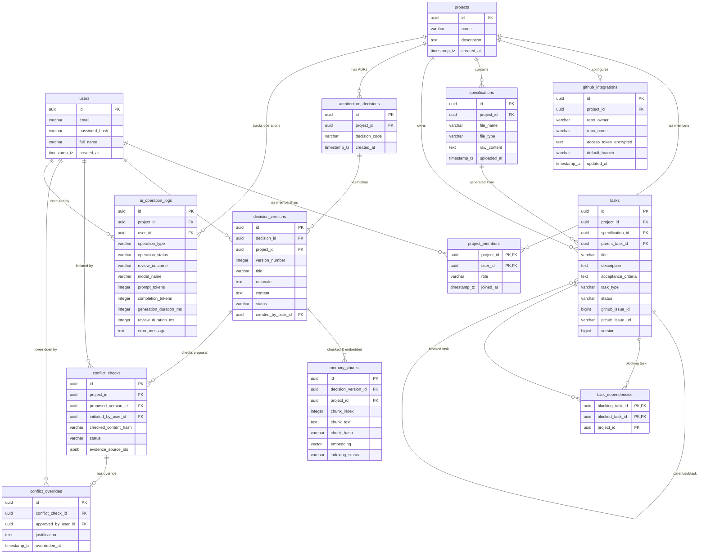

### Main entities and their relation description
## RBAC and project isolation (US-01, NFR-01)

- users: system users.
- projects: their projects.
- project_members: intermediate table with roles (OWNER, MEMBER, INVITED). All the other entities are tied to project_id to ensure data isolation between two projects.

## Specifications and decomposition (EP-01, US-02 - US-04, US-09)

- specifications: imported text of PDF documents.
- tasks: task structure hierarchy (Epics, tasks, subtasks). There is implemented support of parent relations (parent_task_id) and external identificators GitHub (github_issue_id, github_issue_url).
- task_dependencies: locking dependency tables (blocking_task_id is blocking blocked_task_id) with check for absence of cycles and similar project_id.

## Shared project memory: Architectural decisions (ADR) and versioning (EP-02, US-05, US-06)

- architecture_decisions: ADR logical container, connected with the project.
- decision_versions: decisions versions table (PROPOSED, APPROVED, SUPERSEDED, REJECTED statuses supported).
- memory_chunks: vector fragments (pgvector embeddings) for RAG search, strictly tied to decision_version_id. Only fragments from active versions with APPROVED statusgo to RAG.

## Conflicts check and justification for redefinitions (EP-03, US-07, US-08)

- conflict_checks: log of automatic AI or user proposal check for contradictions with approved ADR (status: NO_CONFLICT, POSSIBLE_CONFLICT, INSUFFICIENT_CONTEXT).
- conflict_overrides: stipulates a mandatory written justification of Team lead / Project owner in case AI warning is ignored or overridden.

## AI operations and checks analytics (EP-04, US-13)

- ai_operation_logs: storing metrics of generation time, active human review time and final statuses of approved AI proposals (ACCEPTED, MODIFIED, REJECTED).

## ER-diagram

