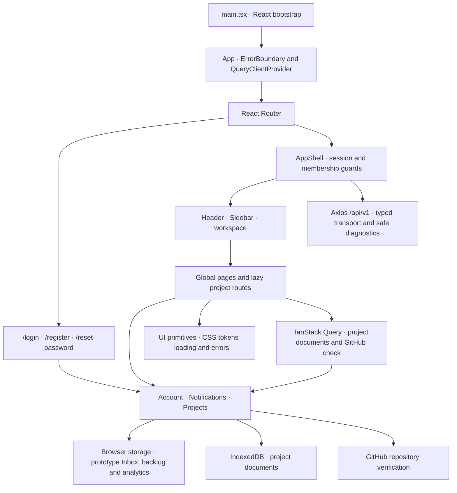
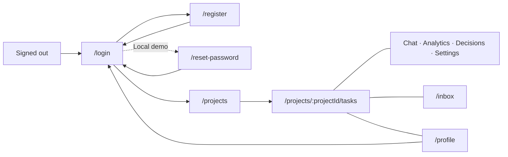

# Team AI Orchestrator - Frontend Architecture Specification

## FE-01 Current architecture

Team AI Orchestrator is a React 18 SPA built with strict TypeScript and Vite. The component-based layout separates application composition, route views, layout widgets, feature logic and reusable infrastructure. The frontend can run on its own alongside the browser-backed prototype data. Startup and verification commands are documented in the [frontend guide](../../frontend/README.md).



| Layer | Current responsibility |
| --- | --- |
| `src/app` | Router, global providers, render boundary and route errors |
| `src/pages` | Screens and their UI workflows |
| `src/widgets/layout` | Workspace shell, header, project and chat sidebars |
| `src/features/account` and `src/features/notifications` | Server session, opt-in demo account state and unread Inbox state |
| `src/features/projects/model` | Project documents, backlog, decisions, analytics and runtime schemas |
| `src/features/projects/api` | GitHub repository verification |
| `src/shared/{ui,styles,api,lib}` | UI primitives, CSS variables, request tracking and structured diagnostics |
| `tests/` and colocated `*.test.ts` | Route integration tests and feature unit tests |

Local interaction state uses React state. Account and unread state use shared stores with `useSyncExternalStore`. TanStack Query handles document reads and GitHub verification, including pending state. The router holds project context. A separate UI state library is unnecessary for the current state boundaries. Local account records contain salted password hashes, and project documents live in IndexedDB. The GitHub token stays in page memory.

React provides the component model, React Router links directly to project sections, and Vite supports fast local startup and lazy chunks. Zod validates data crossing browser-storage and API boundaries. The custom UI uses Poppins, shared palette tokens, standard controls and native dialogs to match the project designs. Global CSS supplies breakpoints and keyboard focus styling. The task document parser uses a lazily loaded PDF.js worker.

### Navigation and runtime states



Opening a project lands on Tasks. Server-mode project creation opens Tasks. The browser-only demo still opens Settings. Inbox and Profile have global routes. The workspace preserves the header and sidebar during lazy loading. Unmatched routes show a 404, while route and render exceptions use a shared failure panel.

### API and diagnostics

The local demo uses a separate GitHub HTTP client for repository verification. `verifyGitHubRepository` makes a read-only `GET https://api.github.com/repos/{owner}/{repo}` request with the provided bearer token and a 15-second timeout. The controller uses the HTTP status and optional quota headers. It does not read or persist the response body. The backend-mode settings keep the GitHub controls disabled until the GitHub App API is available.

```http
GET /repos/example/project HTTP/1.1
Host: api.github.com
Accept: application/vnd.github+json
Authorization: Bearer <supplied-at-runtime>

HTTP/1.1 200 OK
X-RateLimit-Limit: 5000
X-RateLimit-Remaining: 4999
X-RateLimit-Reset: 1795554000
```

The settings page displays distinct feedback for credential and permissions errors, missing repositories, quota limits and request failures. Axios is configured for same-origin `/api/v1` through the Vite proxy. Its interceptor extracts validated diagnostic IDs from Problem Details responses. The frontend consumes the auth and project contracts described in the next section. Logs use fixed event names and allowlisted status and diagnostic IDs. Headers, passwords, tokens, request bodies and document contents are excluded.

Validation commands are in the [frontend guide](../../frontend/README.md#checks). ESLint checks Hooks, import cycles, layer direction and explicit `any`. External data should use `unknown` and be narrowed before use. An exception requires a line-scoped explanation.

### Auth and project access

The client follows the [OpenAPI contract checked into this branch](../api/openapi.yaml) and DEC-02. All paths below are relative to `/api/v1`.

| Method and path | Request | Response |
| --- | --- | --- |
| `GET /auth/csrf` | Same-origin credentials | `200` with `{"headerName":"X-CSRF-Token","token":"<csrf>"}` and a scoped CSRF cookie |
| `POST /auth/register` | CSRF header, `{"email":"name@example.test","displayName":"Name","password":"<user input>"}` | `201` with a User DTO. The UI returns to sign-in. |
| `POST /auth/login` | CSRF header, email and password | `200` with `{"accessToken":"<jwt>","tokenType":"Bearer","expiresIn":900,"user":{…}}` and refresh cookie |
| `POST /auth/refresh` | CSRF header and refresh cookie, empty body | `200` with the session DTO and rotated cookie, or `401 REFRESH_INVALID` |
| `POST /auth/logout` | CSRF cookie and header, exact allowed Origin, empty body. The browser sends the refresh cookie when present. | `204` with cookies cleared |
| `GET /users/me` | Access bearer token | `200` with the current User DTO. The current profile UI uses the User DTO from login or refresh. |
| `GET /projects`, `GET /projects/{id}` | Access bearer token | Page of project entries or a project entry containing `id`, `name`, `status` and `myRole`. Unavailable projects return `404`. |
| `POST /projects` | Access bearer token, `{"name":"Example project"}` | `201` with the newly created project |

The User DTO includes `id`, `email`, `displayName`, `isActive`, `createdAt` and `updatedAt`. Zod validates responses used by the UI. Registration accepts 12–128 Unicode code points and at most 512 UTF-8 bytes, as specified by the auth contract.

The auth store holds the access JWT in memory and reads no refresh cookie from JavaScript. The browser sends the backend-issued HttpOnly, Secure, SameSite=Lax cookie. Startup refresh blocks protected UI, and an in-tab single flight deduplicates refreshes. Where Web Locks are available, cookie-changing auth operations are serialized across tabs. Logout removes private UI and cached queries immediately, then requests revocation. Failed refresh closes the session. Private routes preserve a validated internal return location, and project pages wait for a successful project access response. Owner/member controls derive from the backend's `myRole`. Tasks, chat and other prototype data still use account-scoped browser stores.

Problem Details code, field identifiers and diagnostic IDs are parsed centrally. UI copy is selected locally for 401, 403, 404, 409, 429, 5xx, timeouts and connectivity errors. The auth store replays at most one GET or HEAD after a successful refresh. Mutations are never automatically replayed. The transport exposes Retry-After as a deadline and does not automatically retry throttled or failed requests. Unmounted route operations cancel with an AbortSignal.

`npm run dev:mock` starts the opt-in loopback HTTP mock. It exercises the frontend contract using in-memory fixtures. The browser-only demo is a separate mode for prototype flows. Password recovery, account updates and account deletion have no backend contract in this revision.
### Project workspace and lifecycle

The dashboard at `/projects` loads the membership-filtered project list through the paginated API and shows role and status. Users can search by name, filter Active or Archived, sort names, and create a project from the dashboard or sidebar. Selecting a sidebar project preserves the top-level Tasks, Decisions, Chat, Analytics or Settings module. Deep actions, search parameters and drafts do not carry over to another project. The project index opens Tasks.

The shared shell preflights `GET /projects/{id}` before mounting a lazy feature. It uses the returned `myRole` and `status`, shows an archive banner, and presents distinct permission and hidden-resource errors. Project ID changes cancel previous reads and remount feature state. Document query keys include account and project ID. IndexedDB reads use the query cancellation signal.

| Operation | Contract |
| --- | --- |
| Edit project name and description | `PATCH /projects/{id}` with `name` and nullable `description` |
| List project members | `GET /projects/{id}/members?page=0` and subsequent pages. DTO contains user ID, display name, role and join time. |
| Add or remove a registered member | `POST /projects/{id}/members` with `email`, or `DELETE /projects/{id}/members/{userId}` |
| Transfer ownership | `POST /projects/{id}/transfer-ownership` with `newOwnerUserId`. The response reflects the caller's new role. |
| Archive project | `POST /projects/{id}/archive` with no request body. The response updates the current shell and list. |

Owner controls require an active project for metadata, membership, transfer and archive. GitHub settings are Owner-only and the preview controls are disabled for archived projects. The checked OpenAPI contract has no project GitHub configuration endpoint. The frontend uses the existing repository verification preview. Archived routes keep member lists, task details, decision filters, existing chat views and analytics available. The frontend blocks new content, editing, generation and publication, including direct links to task creation or proposal submission. API authorization remains the final enforcement for server-backed data.

### Planning and Tasks

The checked OpenAPI has no specification, decomposition operation, backlog or publication endpoints. The API tables for these capabilities below are proposals for future integration. The Tasks screen explicitly labels its browser-backed Planning preview. Decomposition uses a local text parser. The preview presents three timed stages for text extraction, decomposition and graph validation, with an elapsed timer. It displays the saved result or an error when finished. It pauses while the document is hidden and cancels scheduled work when the route unmounts. No server polling or percentage is displayed. When a server operation contract becomes available, polling should start at 2 seconds, back off to at most 5 seconds, and stop on terminal status, navigation or hidden-page policy.

In backend mode, the Tasks screen uploads UTF-8 TXT and text-layer PDF through the Specification API, loads the latest server version and reads the selected version's extracted text for local decomposition. The local demo saves versions and files in one IndexedDB transaction per upload, with account/project isolation. Both modes limit files to 10 MiB and extracted text to 200,000 characters. A new local decomposition references its source version and retains the previous backlog in history. The local editor checks the local revision before writing. The Tasks screen highlights cycles in the saved draft and disables confirmation until the graph is valid. The server will still need transactional revision checks and structured DAG problem details.

The local task editor follows DEC-07: an epic can contain stories or tasks, a story can contain tasks, and a task can contain subtasks. The UI stores `subtask` as a display kind. The Planning schema represents it as a `task` with a task parent.

Local owner confirmation applies to the current valid revision. Edits to a confirmed unpublished backlog clear approval. The future Planning API must enforce permissions, revision checks, dependency validation and approval when saving. Archived projects are read-only. Local records with publication already started lock structural editing and retain existing status badges and safe GitHub issue links. The publication button displays connection feedback inline while the publishing API is unavailable. Publishing, reconciling and retrying remote issues require an API contract.

## Target architecture and planned API contracts

The remaining sections describe the intended server-backed system. They are retained as implementation contracts for subsequent tasks.

---

## 1. Architectural Overview & Design Principles

The frontend of Team AI Orchestrator is a desktop-first Single-Page Application (SPA) built with React 18 and TypeScript. It serves as the human-in-the-loop (HITL) control plane where software teams upload specifications, review and edit AI-proposed backlogs, inspect architectural decision conflicts, query grounded project knowledge, and monitor AI operation metrics.

### Core Architectural Principles
1. **Strict Separation of Server State and Client State:** Asynchronous backend resources (projects, backlogs, tasks, ADRs, chat messages, analytics) are managed exclusively by TanStack Query, while synchronous ephemeral UI state (in-memory JWT access token, sidebar collapse state, active modals/drawers) is managed by Zustand.
2. **Backend-Authoritative Security & Validation:** UI role checks (`Owner` vs. `Member`) and Zod form schemas improve usability and prevent invalid submissions, but the backend remains the sole authority for RBAC, DAG acyclicity, and state transitions.
3. **Domain-Aligned Feature Modules:** Code is organized by business domain (`planning`, `decisions`, `chat`, `github`, `analytics`) mirroring the Spring Boot modular monolith (`SRS §11.2`), avoiding monolithic `components/` or `utils/` folders.
4. **Explicit Four-State UI Contract:** Every data-fetching view implements `Loading`, `Empty`, `Error` (RFC 9457 Problem Details), and `Populated` states (`NFR-UX-001`).
5. **Zero-Persistence Token Security:** In compliance with `DEC-02`, JWT access tokens (`15 min` TTL) live strictly in JavaScript memory; refresh tokens (`7 days` TTL) are handled via `HttpOnly; Secure; SameSite=Lax` cookies.

---

## 2. Technology Stack & Libraries (`DEC-11`)

| Layer / Concern | Library / Tool | Version | Justification & Usage |
|---|---|---|---|
| **Build Tool & Bundler** | Vite | `^5.4` | Fast HMR in development, optimized ESM production bundles, environment variable injection (`VITE_*`). |
| **UI Framework** | React + React DOM | `^18.3` | Component-based declarative UI with concurrent rendering support. |
| **Language** | TypeScript | `^5.6` (`strict: true`) | End-to-end compile-time type safety for API DTOs, domain enums, and component props. |
| **Routing** | React Router DOM | `^6.28` | Nested layouts, URL-driven project context (`/projects/:projectId/...`), and protected route guards. |
| **Server State & Polling** | TanStack Query (`@tanstack/react-query`) | `^5.60` | Declarative caching, request deduplication, optimistic/invalidated mutations, and conditional `refetchInterval` polling for async AI jobs (`FR-DEC-011`, `FR-ANL-007`). |
| **Client UI State** | Zustand | `^5.0` | Lightweight store for in-memory `accessToken`, current user profile, and global layout/drawer toggles. |
| **HTTP Client** | Axios | `^1.7` | Request/response interceptors for `Authorization: Bearer` injection, automatic `401` single-flight token refresh, and Problem Details normalization. |
| **Forms & Validation** | React Hook Form + `@hookform/resolvers` + Zod | `^7.53` / `^3.23` | Performant uncontrolled forms with schema-based validation matching backend DTO constraints (`FR-DEC-003`, `FR-CON-009`). |
| **Styling & UI Primitives** | Tailwind CSS + Radix UI Primitives + Lucide React | `^3.4` / `^1.1` | Utility-first styling with design tokens (`Poppins` font, WCAG AA contrast), accessible headless dialogs/tooltips/tabs (`NFR-UX-004`), and consistent iconography. |
| **Data Visualization** | Recharts | `^2.13` | Responsive bar/pie/line charts for AI review outcomes (`Accepted` / `Modified` / `Rejected`) and operation durations (`SCR-04`). |
| **Markdown & Citations** | `react-markdown` + `remark-gfm` | `^9.0` | Safe, XSS-free rendering of assistant responses and ADR descriptions without `dangerouslySetInnerHTML` (`NFR-SEC-006`). |
| **Testing & Quality** | Vitest, React Testing Library, MSW, Playwright, ESLint, Prettier | Latest | Unit/component tests, API contract mocking, E2E browser flows, and static code analysis (`DEC-15`). |

---

## 3. Directory and Component Structure

The frontend codebase resides in `/frontend` and follows a Feature-Sliced / Domain-Modular layout:

```text
frontend/
├── public/                         # Static favicon and assets
├── src/
│   ├── app/                        # Application bootstrap & global providers
│   │   ├── App.tsx                 # Root component composing providers & Router
│   │   ├── providers.tsx           # QueryClientProvider, AuthInitializer, ToastProvider
│   │   └── router.tsx              # Route definitions, ProtectedRoute, ProjectLayout
│   │
│   ├── shared/                     # Reusable cross-domain primitives (no business logic)
│   │   ├── api/
│   │   │   ├── httpClient.ts       # Axios instance, Bearer interceptor, 401 refresh queue
│   │   │   ├── problemDetails.ts   # RFC 9457 ProblemDetails TypeScript type & parser
│   │   │   └── queryKeys.ts        # Centralized hierarchical TanStack Query key factory
│   │   ├── components/
│   │   │   ├── layout/
│   │   │   │   ├── AppShell.tsx            # 3-tier layout (Sidebar + Header + Workspace)
│   │   │   │   ├── ProjectSidebar.tsx      # Collapsible project list, search, "+ New project"
│   │   │   │   ├── ModuleTopBar.tsx        # Tabs: [TASKS], [DECISIONS], [CHAT], [ANALYTICS], [SETTINGS]
│   │   │   │   └── ArchivedProjectBanner.tsx # Persistent read-only warning banner
│   │   │   ├── feedback/
│   │   │   │   ├── AsyncOperationBar.tsx   # Multi-step progress bar + live timer for AI jobs
│   │   │   │   ├── EmptyStateCard.tsx      # Standardized zero-data card with icon & CTA
│   │   │   │   ├── ErrorBanner.tsx         # ProblemDetails alert with correlationId & Retry
│   │   │   │   ├── SkeletonList.tsx        # Loading placeholders
│   │   │   │   └── StatusBadge.tsx         # Accessible icon+text badges for all domain enums
│   │   │   └── ui/                         # Base atomic UI elements (Button, Input, Modal, Drawer, Tooltip, Tabs)
│   │   ├── hooks/
│   │   │   ├── useOperationPolling.ts      # Reusable TanStack Query hook for GET /operations/{id}
│   │   │   ├── useProjectRole.ts           # Computes { isOwner, isMember, isArchived, canApprove, canMutate }
│   │   │   └── useUnsavedChangesGuard.ts   # Warns before navigating away from dirty forms
│   │   └── utils/
│   │       ├── dateFormat.ts               # ISO-8601 UTC to local display + UTC tooltip formatter
│   │       └── metricFormat.ts             # Renders null/undefined metrics as "N/A" (never 0)
│   │
│   ├── features/                   # Business domain modules (aligned with SRS §2.4 & §11.2)
│   │   ├── auth/                   # LoginPage, RegisterPage, authStore (Zustand), authApi
│   │   ├── projects/               # ProjectDashboardPage (SCR-01), CreateProjectModal, MemberTable, OwnershipTransferModal
│   │   ├── planning/               # TasksWorkspacePage (SCR-02), SpecUploadDropzone, BacklogTree, TaskDetailDrawer, DependencyEditor, CycleErrorAlert
│   │   ├── decisions/              # DecisionsPage (SCR-06), DecisionList, DecisionVersionDrawer, ProposeDecisionModal, ConflictCheckPanel, OverrideJustificationModal
│   │   ├── chat/                   # ChatWorkspacePage (SCR-03), ChatSessionList, MessageFeed, CitationChip, CitationPreviewDrawer, DocumentScopeSidebar
│   │   ├── github/                 # GithubSettingsCard (SCR-05), PublishTasksModal, IssueSyncBadge, ReconcileButton
│   │   └── analytics/              # AnalyticsDashboardPage (SCR-04), OutcomePieChart, DurationBarChart, ReviewMetricsTable
│   │
│   ├── main.tsx                    # ReactDOM.createRoot entry point
│   └── index.css                   # Tailwind directives & CSS custom properties
├── tests/
│   ├── setup.ts                    # Vitest setup, jest-dom matchers, MSW server lifecycle
│   ├── mocks/                      # MSW handlers & realistic domain fixtures
│   └── e2e/                        # Playwright end-to-end specs
├── index.html
├── package.json
├── tsconfig.json
├── vite.config.ts
└── playwright.config.ts
```

### How to Add a New Feature Module (Developer Guide)
1. Create a folder `src/features/<domain>/` with `api/`, `components/`, `hooks/`, `schemas/` (Zod), and `types.ts`.
2. Register query keys in `src/shared/api/queryKeys.ts`.
3. Define typed request/response DTOs matching `docs/api/openapi.yaml`.
4. Add a lazy-loaded route entry in `src/app/router.tsx` under `/projects/:projectId/<domain>` and add a tab in `ModuleTopBar.tsx` if top-level.
5. Enforce permissions via `useProjectRole()` and implement all four UI states (`Loading`, `Empty`, `Error`, `Populated`).

---

## 4. Routing Architecture

Routing is managed by React Router v6 (`createBrowserRouter`). The active `projectId` is encoded directly in the URL path so deep links, browser back/forward buttons, and citation links preserve exact project context.

| Route Path | Component | Access Guard | Screen ID | Description |
|---|---|---|---|---|
| `/login` | `LoginPage` | `PublicOnlyRoute` | - | Email/password login; redirects authenticated users to `/projects`. |
| `/register` | `RegisterPage` | `PublicOnlyRoute` | - | New account registration (`FR-AUTH-001`). |
| `/` | `Navigate to="/projects"` | `ProtectedRoute` | - | Root entry redirect. |
| `/projects` | `ProjectsEmptyOrRedirectPage` | `ProtectedRoute` | `SCR-01` | Auto-redirects to the user's most recent project or shows the "Create First Project" empty state. |
| `/projects/:projectId` | `ProjectLayout` (`AppShell`) | `ProtectedRoute` + `ProjectMemberGuard` | - | Loads project metadata & user's project role (`Owner`/`Member`); renders persistent Sidebar + Top Bar. |
| `/projects/:projectId/overview` | `ProjectDashboardPage` | Project Member | `SCR-01` | Project summary, member list, and member invitation/removal (`Owner`). |
| `/projects/:projectId/tasks` | `TasksWorkspacePage` | Project Member | `SCR-02` | Spec upload, AI decomposition progress, task tree editor, DAG validation, and GitHub export. |
| `/projects/:projectId/decisions` | `DecisionsPage` | Project Member | `SCR-06` | Active ADRs, version history, decision proposal, ML conflict check, and Owner approval/override. |
| `/projects/:projectId/chat` | `ChatWorkspacePage` | Project Member | `SCR-03` | Private RAG chat sessions, grounded Q&A, citation drawer, and spec scope filter. |
| `/projects/:projectId/analytics` | `AnalyticsDashboardPage` | Project Member | `SCR-04` | AI operation metrics, review outcome ratios, durations, and `N/A` handling. |
| `/projects/:projectId/settings` | `ProjectSettingsPage` | Project Member (`Owner` for writes) | `SCR-05` | General project settings, GitHub App repository connection/status, ownership transfer, and archiving. |
| `*` | `NotFoundPage` | Any | - | Controlled 404 fallback page with link back to workspace. |

---

## 5. State Management Strategy

Application state is strictly partitioned into three tiers to avoid synchronization bugs and stale data:

### 5.1 Server Cache State (TanStack Query v5)
All REST API data lives in TanStack Query's normalized cache, keyed hierarchically via `queryKeys.ts`:
- `['auth', 'me']` - Current authenticated user profile.
- `['projects']` - List of projects accessible to the user.
- `['projects', projectId]` - Project details, `status` (`active`/`archived`), and `currentUserRole` (`OWNER`/`MEMBER`).
- `['projects', projectId, 'backlogs', 'current']` - Active backlog draft/approved/published structure and task tree.
- `['projects', projectId, 'decisions']` - List of ADRs and version histories.
- `['projects', projectId, 'conflict-checks', checkId]` - Specific conflict check result and evidence.
- `['projects', projectId, 'chats', sessionId, 'messages']` - Private chat message feed.
- `['projects', projectId, 'operations', operationId]` - Asynchronous job state (`queued`, `running`, `completed`, `failed`).
- `['projects', projectId, 'analytics', period]` - Aggregated review and operation metrics.

**Polling & Invalidation Rules:**
- **Async Operations (`useOperationPolling`):** Uses `refetchInterval: (query) => (query.state.data?.status === 'queued' || query.state.data?.status === 'running' ? 2500 : false)`. Upon transitioning to `completed`, `onSuccess` invalidates the dependent domain query (e.g., `['projects', projectId, 'backlogs']` or `['projects', projectId, 'decisions']`).
- **Analytics Live Freshness (`NFR-PER-005`):** On `SCR-04`, `refetchInterval: 5000` with `refetchIntervalInBackground: false` ensures new events appear within $\le 5\text{ s}$ while the tab is focused.

### 5.2 Ephemeral Client & Auth Store (Zustand)
`useAuthStore` holds:
- `accessToken: string | null` (in memory only - cleared on page refresh and restored via silent `POST /api/v1/auth/refresh` before rendering protected routes).
- `user: UserSummary | null`
- `isInitializing: boolean`
- Actions: `setSession(token, user)`, `clearSession()`.

`useUiStore` holds:
- `isSidebarCollapsed: boolean`
- `selectedTaskId: string | null` (controls `TaskDetailDrawer`)
- `activeCitation: CitationPreview | null` (controls `CitationPreviewDrawer`)

### 5.3 Form & Local Draft State (React Hook Form + Zod)
- Complex forms (Decision Proposal, Task Edit Drawer, Override Justification Modal, Member Invite) use React Hook Form with Zod resolvers.
- Dirty state (`formState.isDirty`) feeds `useUnsavedChangesGuard` (`NFR-UX-006`) so users are warned before losing unsaved edits.

---

## 6. Backend REST API Interaction & Agreed Contracts

The [checked-in OpenAPI contract](../api/openapi.yaml) defines the implemented Auth, Core and Specification operations. The remaining module tables describe planned contracts.

### 6.1 Common Conventions & Error Contract (RFC 9457 Problem Details)
- **Base Path:** `/api/v1`
- **Headers:**
  - `Authorization: Bearer <accessToken>` (on all protected endpoints)
  - `Content-Type: application/json` (or `multipart/form-data` for specification upload)
  - `X-CSRF-Token: <token>`, CSRF cookie and exact allowed Origin for all four auth POST operations per `DEC-02`.
- **Standard Error Payload (`application/problem+json`):**
```json
{
  "type": "https://team-ai-orchestrator.local/errors/cyclic-dependency",
  "title": "Cyclic Task Dependency Detected",
  "status": 409,
  "detail": "Adding dependency Task B -> Task A creates a cycle: A -> B -> A.",
  "instance": "/api/v1/projects/550e8400.../backlogs/770e8400.../dependencies",
  "code": "TASK_DEPENDENCY_CYCLE",
  "correlationId": "req-9f8a7b6c",
  "retryable": false,
  "fieldErrors": [
    { "field": "blockedByTaskId", "message": "Creates a circular dependency chain" }
  ]
}
```

---

### 6.2 Authentication & Session

| Method & Endpoint | Request Payload | Expected Success Response | Error Codes |
|---|---|---|---|
| `GET /auth/csrf` | Browser request with credentials | `200` with `headerName: X-CSRF-Token`, `token` and the CSRF cookie | `403`, `429` |
| `POST /auth/register` | `email`, `displayName`, `password` (12–128 Unicode code points and at most 512 UTF-8 bytes) | `201` with a User DTO directly | `400`, `403`, `409`, `429` |
| `POST /auth/login` | `email`, `password` (1–128 code points and at most 512 UTF-8 bytes) | `200` with `accessToken`, `tokenType: Bearer`, `expiresIn: 900`, `user` and the Secure, HttpOnly, SameSite=Lax refresh cookie | `400`, `401 INVALID_CREDENTIALS`, `403`, `429`, `503` |
| `POST /auth/refresh` | Empty body and refresh cookie | `200` with the same session DTO and a rotated refresh cookie | `400`, `401 REFRESH_INVALID`, `403`, `429`, `503` |
| `POST /auth/logout` | Empty body; refresh cookie when present | `204`, clears cookies and revokes the associated refresh family when present | `400`, `403`, `429`, `503` |
| `GET /users/me` | Access bearer token | `200` with a User DTO | `401`, `429` |

---

### 6.3 Projects & Membership (`/api/v1/projects`)

| Method & Endpoint | Request Payload | Expected Success Response | Error Codes |
|---|---|---|---|
| `GET /projects` | Query `page`, `size`, optional `status` (`active` or `archived`) | `200` with a page of projects visible to the caller | `400`, `401` |
| `POST /projects` | Required `name` (1–150 code points) and optional nullable `description` (up to 4,000 code points) | `201` with a Project DTO and `Location`. The caller is the owner. | `400`, `401` |
| `GET /projects/{projectId}` | Access bearer token | `200` with a Project DTO | `401`, `404` |
| `PATCH /projects/{projectId}` | At least one of `name` or `description`; explicit `null` clears the description | `200` with the updated Project DTO | `400`, `403`, `404`, `409 PROJECT_ARCHIVED` |
| `POST /projects/{projectId}/archive` | Empty body | `200` with a Project DTO whose status is `archived` | `400`, `403`, `404` |
| `GET /projects/{projectId}/members` | Query `page` and `size` | `200` with a page of Member DTOs | `400`, `401`, `404` |
| `POST /projects/{projectId}/members` | Registered account `email` | `201` with a Member DTO | `403`, `404 USER_OR_PROJECT_NOT_FOUND`, `409 MEMBERSHIP_CONFLICT` |
| `DELETE /projects/{projectId}/members/{userId}` | Access bearer token | `204` | `403`, `404`, `409 MEMBERSHIP_CONFLICT` |
| `POST /projects/{projectId}/transfer-ownership` | `newOwnerUserId` | `200` with a Project DTO reflecting the caller's new `myRole: member` | `400`, `403`, `404`, `409 OWNERSHIP_CONFLICT` |

A Project DTO contains `id`, `name`, nullable `description`, `createdBy`, `status`, `myRole` (`owner` or `member`), `createdAt` and `updatedAt`. A Member DTO contains `userId`, `displayName`, `role` and `joinedAt`. Page responses use `items`, `page`, `size`, `totalElements` and `totalPages`. The dashboard applies its name filter in the browser. See OpenAPI for the complete set of error responses.

---

### 6.4 Specifications, AI Decomposition & Backlog (`/api/v1/projects/{projectId}/...`)

The four specification operations below are implemented. The decomposition, operations and backlog rows describe planned contracts. The checked-in [OpenAPI contract](../api/openapi.yaml) is authoritative for the implemented operations.

| Method & Endpoint | Request Payload | Expected Success Response | Error Codes |
|---|---|---|---|
| `POST /specifications` | Multipart `file` (TXT or PDF, at most 10 MiB) and required `title` | `201 Created` with version metadata including `id`, `originalFilename`, `version`, `uploadedBy` and `createdAt` | `400`, `401`, `404`, `409`, `413`, `415`, `422`, `429` |
| `GET /specifications` | Query parameters `page` and `size` | `200 OK` with paginated version metadata, newest first | `400`, `401`, `404` |
| `GET /specifications/{specId}` | - | `200 OK` with version metadata | `401`, `404` |
| `GET /specifications/{specId}/text` | - | `200 OK` with UTF-8 plain text | `401`, `404` |
| `POST /specifications/{specId}/decompose` | `{ "instructions"?: "string" }` | `202 Accepted`: `{ "operationId": "uuid", "type": "BACKLOG_DECOMPOSITION", "status": "queued" }` | `409` (`PROJECT_ARCHIVED`), `429` (`AI_QUOTA_EXCEEDED`) |
| `GET /operations/{operationId}` | - | `200 OK`: `{ "operationId": "uuid", "type": "string", "status": "queued\|running\|completed\|failed", "stageLabel": "Validating DAG...", "resultResourceId": "uuid \| null", "error"?: { "code": "string", "detail": "string", "retryable": true }, "startedAt": "iso-utc", "completedAt": "iso-utc \| null" }` | `403`, `404` |
| `GET /backlogs/current` | - | `200 OK`: `{ "id": "uuid", "specificationId": "uuid \| null", "specificationVersion": 1, "status": "draft\|approved\|published", "revision": 3, "dagValid": true, "tasks": [ { "id": "uuid", "parentId": "uuid \| null", "type": "epic\|story\|task", "title": "string", "description": "string", "acceptanceCriteria": ["string"], "priority": 2, "status": "draft\|ready\|in_progress\|in_review\|done\|cancelled", "blockedByTaskIds": ["uuid"], "githubIssue": { "number": 42, "url": "https://github.com/...", "syncStatus": "pending\|synced\|failed\|unknown" } \| null } ] }` | `404` (`NO_BACKLOG_YET` $\rightarrow$ renders Empty State) |
| `POST /backlogs/{backlogId}/tasks` | `{ "parentId": "uuid \| null", "type": "epic\|story\|task", "title": "string", "description": "string", "acceptanceCriteria": ["string"], "priority": 1..5 }` | `201 Created`: created Task DTO + updated backlog `revision` | `400` (`INVALID_PARENT_TYPE`), `409` (`BACKLOG_PUBLISHED_IMMUTABLE`) |
| `PATCH /backlogs/{backlogId}/tasks/{taskId}` | `{ "revision": 3, "title"?: "string", "description"?: "string", "acceptanceCriteria"?: ["string"], "priority"?: 1..5, "status"?: "string", "parentId"?: "uuid \| null" }` | `200 OK`: updated Task DTO + `{ "approvalInvalidated": boolean, "revision": 4 }` | `409` (`STALE_REVISION`, `PARENT_CYCLE_DETECTED`) |
| `DELETE /backlogs/{backlogId}/tasks/{taskId}` | Query: `?revision=3` | `204 No Content` | `409` (`BACKLOG_PUBLISHED_IMMUTABLE`) |
| `POST /backlogs/{backlogId}/dependencies` | `{ "taskId": "uuid", "blockedByTaskId": "uuid", "revision": 4 }` | `201 Created`: `{ "taskId": "uuid", "blockedByTaskId": "uuid", "dagValid": true }` | `409` (`TASK_DEPENDENCY_CYCLE`, `SELF_DEPENDENCY`) |
| `DELETE /backlogs/{backlogId}/dependencies` | `{ "taskId": "uuid", "blockedByTaskId": "uuid" }` | `204 No Content` | `409` |
| `POST /backlogs/{backlogId}/approve` | `{ "revision": 4, "activeReviewDurationMs"?: 42000 }` | `200 OK`: `{ "id": "uuid", "status": "approved", "reviewOutcome": "accepted\|modified", "correctionsCount": 2, "approvedAt": "iso-utc" }` | `403` (Member), `409` (`STALE_REVISION`, `INVALID_DAG`) |

---

### 6.5 GitHub Integration (`/api/v1/projects/{projectId}/github`)

These GitHub App operations describe the planned backend contract.

| Method & Endpoint | Request Payload | Expected Success Response | Error Codes |
|---|---|---|---|
| `POST /github/connect` | `{ "installationId": 123456, "repositoryFullName": "owner/repo" }` | `200 OK`: `{ "status": "active", "repositoryFullName": "owner/repo", "connectedAt": "iso-utc" }` | `403` (Member), `400` (`GITHUB_PERMISSION_DENIED`) |
| `DELETE /github/disconnect` | - | `204 No Content` (preserves historical issue mappings per `DEC-06`) | `403` (Member) |
| `POST /github/publish` | `{ "backlogId": "uuid", "taskIds": ["uuid"] }` | `202 Accepted`: `{ "operationId": "uuid", "status": "queued" }` (or `200 OK` summary with per-task `synced` / `failed` / `unknown` statuses) | `403` (non-member), `409` (`BACKLOG_NOT_APPROVED`, `GITHUB_NOT_CONNECTED`) |
| `POST /github/reconcile` | `{ "backlogId": "uuid" }` | `200 OK`: `{ "reconciledCount": 4, "unknownCount": 0, "failedCount": 0 }` | `502` (`GITHUB_API_UNAVAILABLE`) |

---

### 6.6 Shared Project Memory & Semantic Conflict Detection (`/api/v1/projects/{projectId}/...`)

| Method & Endpoint | Request Payload | Expected Success Response | Error Codes |
|---|---|---|---|
| `GET /decisions` | Query: `?status=accepted\|proposed\|rejected\|superseded` | `200 OK`: `{ "items": [ { "decisionId": "uuid", "code": "ADR-001", "currentVersionId": "uuid", "versionNumber": 1, "title": "string", "status": "accepted\|proposed\|rejected\|superseded", "indexingStatus": "pending\|processing\|indexed\|failed", "author": { "id": "uuid", "displayName": "string" }, "updatedAt": "iso-utc" } ] }` | `403` |
| `GET /decisions/{decisionId}` | - | `200 OK`: `{ "decisionId": "uuid", "code": "ADR-001", "versions": [ { "versionId": "uuid", "versionNumber": 2, "title": "string", "context": "string", "decisionText": "string", "rationale": "string", "sourceRef": "string", "status": "accepted", "indexingStatus": "indexed", "approvedBy": { "id": "uuid", "displayName": "string" } \| null, "createdAt": "iso-utc" } ] }` | `403`, `404` |
| `POST /decisions` | `{ "decisionId"?: "uuid (if proposing v2 of existing ADR)", "title": "string", "context": "string", "decisionText": "string", "rationale": "string", "sourceRef"?: "string" }` | `201 Created`: Decision version DTO (`status: "proposed"`) | `400`, `409` (`PROJECT_ARCHIVED`) |
| `POST /conflict-checks` | `{ "decisionVersionId": "uuid" }` | `200 OK` (or `202` + poll): `{ "checkId": "uuid", "decisionVersionId": "uuid", "result": "possible_conflict\|no_conflict\|insufficient_context", "modelVersion": "scdm-mlp-v1", "explanation": "string \| null", "explanationError": "string \| null", "evidence": [ { "comparedDecisionVersionId": "uuid", "decisionCode": "ADR-001", "versionNumber": 1, "title": "string", "snippet": "string", "predictedLabel": "conflict\|no_conflict", "score": 0.84, "threshold": 0.75 } ], "checkedAt": "iso-utc" }` | `502` (`ML_OR_EMBEDDING_UNAVAILABLE` - never returns `no_conflict`) |
| `POST /decisions/versions/{versionId}/resolve` | `{ "action": "approve\|reject\|request_revision", "conflictCheckId"?: "uuid", "overrideRationale"?: "string (required if possible_conflict + approve)", "acknowledgeInsufficientContext"?: boolean, "reviewComment"?: "string" }` | `200 OK`: `{ "versionId": "uuid", "status": "accepted\|rejected\|revision_requested", "supersededVersionId": "uuid \| null", "indexingStatus": "pending\|processing\|indexed\|failed" }` | `403` (Member), `400` (`OVERRIDE_RATIONALE_REQUIRED`), `409` (`STALE_CONFLICT_CHECK`) |
| `POST /decisions/versions/{versionId}/reindex` | Empty body | `202 Accepted`: `{ "versionId": "uuid", "indexingStatus": "processing" }` | `403` |

---

### 6.7 Grounded RAG Chat & Analytics (`/api/v1/projects/{projectId}/...`)

These operations describe the planned server contract. The current chat generates demo replies in the browser. The Analytics screen displays browser-local metrics from the prototype.

| Method & Endpoint | Request Payload | Expected Success Response | Error Codes |
|---|---|---|---|
| `GET /chats` | - | `200 OK`: `{ "items": [ { "sessionId": "uuid", "title": "string", "updatedAt": "iso-utc" } ] }` (strictly caller's private sessions) | `403` |
| `POST /chats` | `{ "title"?: "string" }` | `201 Created`: `{ "sessionId": "uuid", "title": "New Chat", "createdAt": "iso-utc" }` | `403` |
| `GET /chats/{sessionId}/messages` | - | `200 OK`: `{ "items": [ { "messageId": "uuid", "role": "user\|assistant", "content": "string", "insufficientContext": false, "citations": [ { "sourceType": "ADR_VERSION\|SPECIFICATION\|TASK", "sourceId": "uuid", "versionId": "uuid \| null", "chunkId": "uuid", "label": "ADR-001 v1", "excerpt": "string" } ], "createdAt": "iso-utc" } ] }` | `403` (even Owner cannot access another user's session), `404` |
| `POST /chats/{sessionId}/messages` | `{ "content": "string (1..4000)", "specificationIds"?: ["uuid"] }` | `200 OK`: Assistant Message DTO with `citations` and `insufficientContext` flag | `502` (`LLM_PROVIDER_ERROR`), `429` |
| `GET /analytics` | Query: `?period=7d\|30d\|all` | `200 OK`: `{ "period": "30d", "backlogReviews": { "totalCompleted": 5, "acceptedCount": 2, "modifiedCount": 2, "rejectedCount": 1, "acceptedRatio": 0.40, "modifiedRatio": 0.40, "rejectedRatio": 0.20, "meanCorrectionsCount": 3.5, "meanActiveReviewDurationMs": 85000 \| null }, "aiOperations": { "totalCount": 18, "completedCount": 16, "failedCount": 2, "meanDurationMs": 4200, "totalTokensUsed": 48200 \| null } }` | `403` |

---

## 7. Authentication, Error Handling, and Loading UX

### 7.1 Single-Flight Silent Token Refresh Flow

`authSession.request` refreshes an expired JWT before sending a protected request. Concurrent requests share the same in-tab refresh. After a protected request receives `401`, the session can refresh and replay a GET or HEAD once with the new Bearer token. Failed writes are surfaced to the caller for an explicit user retry. If refresh fails, the session closes and the route guard returns the user to sign-in.

### 7.2 Standardized Error Mapping
- **`400 Bad Request` with `fieldErrors`:** Mapped directly into React Hook Form via `setError(field, { message })` so users see validation messages next to the offending input.
- **`403 Forbidden`:** Renders an inline permission banner or redirects to `/projects` if the user was removed from the project.
- **`409 Conflict`:** Handled contextually (e.g., `TASK_DEPENDENCY_CYCLE` opens the red DAG cycle banner; `STALE_REVISION` prompts the user to reload the latest backlog revision; `STALE_CONFLICT_CHECK` enables the `Re-run conflict check` button).
- **`429 Too Many Requests` / `502` / `503` / Network Timeout:** Renders `<ErrorBanner retryable={problem.retryable} correlationId={problem.correlationId} />` without clearing user-entered form text or chat drafts.

---

## 8. Reusable UI Components & Design System

To maintain visual consistency with `Ilya_Yakubski_UX_specification.docx` and meet `NFR-UX-001`–`005`:
- **Typography & Tokens:** `Poppins` font family with explicit scale (`h1` 24px/600, `h2` 18px/600, `body` 14px/400, `caption` 12px/500).
- **Semantic Color + Icon Pairing (`NFR-UX-005`):**
  - Active navigation / selection: **Orange** (`#EA580C` on light neutral surface, contrast $> 4.5:1$).
  - Primary constructive actions (`+ New project`, `Generate`, `Approve`): **Blue** (`#2563EB`) with explicit verb labels.
  - Warnings (`possible_conflict`, `Indexing pending`, `archived`): **Amber** (`#B45309`) + `AlertTriangle` icon.
  - Errors (`DAG Cycle`, `failed`, `rejected`): **Red** (`#DC2626`) + `XCircle` icon.
  - Verified success (`no_conflict`, `synced`, `Approved & Indexed`): **Emerald** (`#047857`) + `CheckCircle2` icon.
  - Neutral / Missing context (`insufficient_context`, `N/A`): **Slate** (`#475569`) + `Info` icon.
- **Accessibility Built-In:** All modals and slide-over drawers use Radix UI `Dialog` (automatic focus trap, `aria-labelledby`, `Escape` dismissal, and focus restoration on close).

---

## 9. Frontend Testing Organization

The `Frontend quality` workflow is configured for PRs into `develop`, pushes to `FE` and `develop`, and manual dispatch. See the [testing strategy](../testing/testing-strategy.md#frontend-verification-implemented-in-fe) for execution evidence and commands.

| Test Type | Location | Tools | Scope & Mocking Strategy |
|---|---|---|---|
| **Unit** | `src/**/*.test.ts`, `tests/authSession.test.ts` | Vitest | Session state, file validation, backlog rules and API request payloads. |
| **Component and integration** | `tests/*.test.tsx`, `tests/authMock.test.ts` | Vitest, React Testing Library, Axios fixtures and Vite mock HTTP server | Routing, role-dependent controls, session refresh, membership errors and specification uploads. |
| **Browser E2E** | `e2e/*.spec.ts` | Playwright and Chromium | Registration, project creation, two specification uploads, reload and sign-out in local demo. An isolated HTTPS backend can be selected explicitly. |

MSW, accessibility automation, the complete Docker Compose E2E suite and browser tests for pending server modules are planned.
