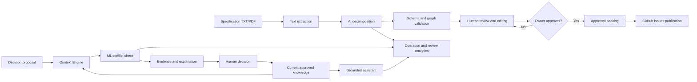
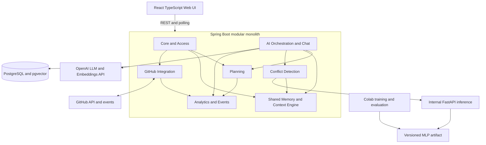

# Team AI Orchestrator — Software Requirements Specification (SRS)

## Table of contents

1. [Introduction](#1-introduction)
2. [Product Overview](#2-product-overview)
3. [Project Scope](#3-project-scope)
4. [User Roles and Stakeholders](#4-user-roles-and-stakeholders)
5. [Use Cases and User Stories](#5-use-cases-and-user-stories)
6. [Functional Requirements](#6-functional-requirements)
7. [Non-functional Requirements](#7-non-functional-requirements)
8. [External Interface Requirements](#8-external-interface-requirements)
9. [Data Requirements](#9-data-requirements)
10. [Business Rules and Lifecycles](#10-business-rules-and-lifecycles)
11. [System Constraints and Architecture](#11-system-constraints-and-architecture)
12. [Assumptions and Dependencies](#12-assumptions-and-dependencies)
13. [Acceptance Criteria and Verification](#13-acceptance-criteria-and-verification)
14. [Glossary](#14-glossary)
15. [Legal, Ethical and Licensing Requirements](#15-legal-ethical-and-licensing-requirements)
16. [Risks and Mitigation](#16-risks-and-mitigation)
17. [Requirements Traceability](#17-requirements-traceability)
18. [Evaluation Plan and Delivery](#18-evaluation-plan-and-delivery)
19. [References and Document Control](#19-references-and-document-control)

## 1. Introduction

### 1.1 Purpose

This specification defines the purpose, scope, functional and non-functional requirements, interfaces, data processing rules, constraints and acceptance criteria of Team AI Orchestrator. It serves as the basis for system design, backlog preparation, contract agreement, development and verification. Detailed implementations, the complete OpenAPI contract, technical ADRs and the ML protocol are maintained separately; the SRS defines mandatory observable behaviour.

### 1.2 Intended audience

Backend and frontend developers, those responsible for ML and QA, the project lead and academic reviewers. The primary product audience is small software development teams; it is not a general-purpose enterprise project management platform.

### 1.3 Objectives and evidence

The objective is to develop and evaluate a human-supervised prototype that enables more coordinated AI-assisted development: preparing a verifiable backlog, reusing current project knowledge, warning about potential technical inconsistencies and observing the effort required to review AI proposals.

The BA is based on a retrospective student project case, one independent professional interview, a literature review and practical evaluations of GitHub/Copilot, Linear and Plane. The observed problems are not considered universal, and anticipated improvements have not yet been demonstrated. The comparative analysis does not establish that competing products lack similar capabilities.

### 1.4 Document conventions

- `BG-xx`, `KPI-xx`, `EP-xx`, `US-xx`, `NFR-xx`, `FR-CE-01` retain their BA identifiers.
- `FR-<module>-nnn`, `NFR-<category>-nnn`, `BR-nnn` identify detailed requirements in this SRS. `AC-...` denotes acceptance scenarios; `DEC-xx` denotes approved decisions; `GAP-xx` denotes implementation findings.
- In the FR tables, `M` means Must (minimum MVP requirement), and `S` means Should (extension). Settings to be verified and technical details appear in §11.4; experimental parameters are not achieved results.
- Approved technical decisions are binding; API examples and pilot parameters are refined following verification without silently changing requirements. Changes to scope or quality thresholds are recorded through document review, not after test results are obtained.

## 2. Product Overview

### 2.1 Vision

Team AI Orchestrator is a web application for organising and supporting AI-assisted collaborative software development. The workflow begins with specification upload, task preparation and human approval, and continues with task publication to GitHub and work with project knowledge. The system provides context for AI operations, checks new proposals for potential inconsistencies and makes generation and human review metrics observable. It does not autonomously generate or merge production code, replace GitHub or monitor all third-party IDE sessions.

### 2.2 Business goals and KPIs

| Goal | KPI | Verification method / target condition |
|---|---|---|
| BG-01 — reduce the time required to prepare a usable backlog | KPI-01 | Median total preparation time, including human corrections, is lower with the prototype than with manual planning of comparable specifications; dependency validity is no worse. |
| BG-02 — provide reliable access to knowledge | KPI-02 | Context is retrieved for labelled questions; relevant passages and correct source-version references are returned; retrieval performance is evaluated. A numerical relevance threshold is calibrated on pilot/validation data before frozen evaluation (DEC-12). |
| BG-03 — identify potential inconsistencies under human supervision | KPI-03 | Labelled conflict/non-conflict pairs, confusion matrix and end-to-end verification results; empty context is never reported as absence of conflict. |
| BG-04 — make AI operations and reviews observable | KPI-04 | Status and available durations are recorded for all supported AI operations; final review outcomes are counted per generated backlog. Other operation types are excluded from the backlog review denominator; support for other review units requires an extension and verification against KPI-04 in the BA. Missing measurements are explicitly indicated. |

Historical quantitative baselines are unavailable; they will be established through a controlled experiment. Task acceptance or token counts alone must not be treated as evidence of increased productivity.

### 2.3 Product workflow



### 2.4 Main modules

Core & Access; Planning; Shared Project Memory/Context Engine; GitHub Integration; AI & Chat; Conflict Detection & ML; Analytics & Events; logical AI Orchestration layer (within the Java backend, not a separate database).

## 3. Project Scope

### 3.1 MVP — Must

| Component | Minimum deliverable |
|---|---|
| Project Management | User account, authentication, project creation, Owner/Member roles and access management. |
| Specification & Planning | TXT and text-layer PDF import; specification version; decomposition into epics/tasks/subtasks, acceptance criteria; editable dependencies; validation and human confirmation. |
| GitHub Integration | One repository connection per project; publication of selected approved tasks with identifiers and duplicate protection; errors and retries. Basic open/closed synchronisation through webhooks, manual reconciliation and publication of task relationships. |
| Shared Project Memory | Proposals and approved versioned decisions; history and verifiable currency; project-scoped retrieval with sources. |
| Semantic Conflict Detection | Check a new decision version against current approved decisions; three system outcomes; explanation/evidence; human approval and justified override. |
| Custom ML | Independently trained MLP, comparison with Logistic Regression, dataset, report and reproducible inference. This is a later approved diploma requirement, not an algorithm choice from the BA. |
| AI Assistant | Chat, history, answers based on relevant project context, verifiable citations and explicit indication of missing information. |
| Analytics | Basic metrics for supported AI operations, accepted/modified/rejected outcomes, durations and correction counts; updates through polling. |
| UI & verification | Web interface for core scenarios, loading/empty/error/success states; automated tests, documentation, reproducible deployment and prototype evaluation. |

### 3.2 Should / Post-MVP

US-12 — structured handoff of selected tasks and decisions between team members with human review. MCP Server for external AI clients; advanced graph visualisation; advanced dashboards and predictive analytics; labels/milestones, extended GitHub Projects synchronisation; additional diagrams and import formats. These do not block the MVP; inclusion depends on time and approval.

### 3.3 Out of scope

Autonomous modification/merging/deployment of production code; automatic synchronisation of local source code; guaranteed detection of every conflict; monitoring all external IDE/AI sessions; OCR of scanned documents; enterprise RBAC/SSO; automatic staff and schedule optimisation; native mobile applications; billing; GitLab/Bitbucket integration; LLM training from scratch.

### 3.4 Delivery slices (development order, not a change in scope)

D1: Core & Access → import → decomposition → human review → Issues publication (first end-to-end slice). D2: decisions, versions and retrieval → conflict model → chat. D3: basic analytics, complete UI, integration verification and academic evaluation. The ML dataset and contracts are developed in parallel with D1. Extensions follow mandatory work only.

## 4. User Roles and Stakeholders

### 4.1 Actors

**Project Owner** — the sole project owner; manages members and settings, approves the backlog and decisions, and resolves inconsistencies. **Member** — a project participant who edits tasks, uploads specifications, proposes decisions, retrieves context and uses the assistant. A user may have different roles across projects. A guest can access only public registration/login operations. GitHub and OpenAI providers and the ML service are external systems/components, not user roles. An academic reviewer is a stakeholder, not automatically a separate product role.

| Capability | Owner | Member |
|---|:---:|:---:|
| View project, tasks, context and chat | Yes | Yes |
| Manage membership and settings, transfer ownership, archive | Yes | No |
| Connect GitHub | Yes | No |
| Import, generate and edit drafts | Yes | Yes |
| Approve backlog | Yes | No |
| Publish approved tasks | Yes | Yes |
| Propose decisions and check conflicts | Yes | Yes |
| Approve/reject/override decisions | Yes | No |
| View basic analytics | Yes | Yes |
| Read other members' conversations | No | No |

Permissions are checked server-side at project and object level, including nested resources, background operations and source links. The database roles `team_ai_app`, `app_read`, `app_write` are not Team AI Orchestrator user roles.

#### 4.1.1 Role-Based UI Permissions and Client-Side Visibility Matrix

While server-side authorization (`FR-AUTH-004`, `FR-AUTH-005`, `GAP-09`) is the binding security boundary, the web interface dynamically adapts navigation controls, action buttons, and visual indicators based on the authenticated user's project-level role (`Owner` or `Member`) and the project's lifecycle status (`active` vs. `archived`).

| UI Feature / User Action | Project Owner | Team Member | Unauthenticated Guest | UI Behavior When Unauthorized or Archived |
|---|:---:|:---:|:---:|---|
| Register & Log In / Log Out | Yes | Yes | Register/Login only | Redirects unauthenticated users from protected routes to `/login`. |
| Create New Workspace Project | Yes | Yes | No | Available in the persistent Left Sidebar (`+ New project`). |
| View Project Dashboard, Tasks, Decisions, Chat, Analytics | Yes | Yes | No | Non-members receive a `403/404` access error state and are redirected to their project list. |
| Manage Members (Add Existing User by Email, Remove Member) | Yes | Read-Only | No | "Add new user" button and remove icons are hidden for `Member`; disabled when `archived`. |
| Transfer Project Ownership / Archive Project | Yes | No | No | Controls in `[SETTINGS]` (`SCR-05`) are hidden for `Member`; disabled when `archived`. |
| Connect / Reconnect / Disconnect GitHub App Repository | Yes | No | No | GitHub connection controls in `[SETTINGS]` (`SCR-05`) are disabled with tooltip: *"Requires Project Owner role"*. |
| Upload Specification (`.txt`, `.pdf`) & Trigger AI Decomposition | Yes | Yes | No | Enabled for both roles in active projects; disabled when `archived`. |
| Edit Draft Backlog (Tasks, Subtasks, AC, Priorities, `blocked-by` Edges) | Yes | Yes | No | Editable while backlog status is `draft` or `approved` (with invalidation warning); locked once `published`. |
| Confirm / Approve Draft Backlog | Yes | No | No | "Confirm Backlog" button in `[TASKS]` (`SCR-02`) is disabled with tooltip: *"Requires Project Owner role"*. |
| Publish Approved Tasks to GitHub Issues & Manual Reconcile | Yes | Yes | No | Enabled for both `Owner` and `Member` (`DEC-03`, `FR-GIT-010`) once backlog is `approved` and GitHub is `active`. |
| Propose Architectural Decision (ADR) & Run Conflict Check | Yes | Yes | No | Accessible to both roles in `[DECISIONS]` (`SCR-06`) for active projects. |
| Approve, Reject, or Request Revision on ADR Proposals | Yes | No | No | Decision resolution action bar is hidden/disabled for `Member` with tooltip: *"Requires Project Owner role"*. |
| Override `possible_conflict` Warning / Acknowledge `insufficient_context` | Yes | No | No | Opens mandatory rationale modal exclusively for `Owner`; blocked for `Member`. |
| Retry Failed RAG Indexing on Approved Decision | Yes | Yes | No | "Retry indexing" button displayed on `Indexing pending` badge in `SCR-06`. |
| Query Grounded RAG Chat Assistant & Toggle Document Scope | Yes | Yes | No | Private per-user sessions (`DEC-04`, `FR-CHAT-001`); no user can view another user's chat history. |
| View AI Operations & Human Review Analytics | Yes | Yes | No | Accessible to both `Owner` and `Member` (`DEC-03`, `FR-ANL-006`) in `[ANALYTICS]` (`SCR-04`). |

### 4.2 Stakeholders

Project Owner (task management, approval); Member (planning and current decisions); two diploma project developers (implementable and testable scope); GitHub/OpenAI (API availability and limits); supervisor/reviewer (evidence, requirements and reproducible experiments).

## 5. Use Cases and User Stories

### 5.1 End-to-End Use Cases

All use cases trace directly to the Business Analysis (`UC-01`, `UC-02`, `US-01`–`US-15`) and UX Design Specification (`SCR-01`–`SCR-06`).

#### UC-01: Workspace Setup, Specification Import, AI Decomposition, Review, and GitHub Publication
* **Primary Actor:** Project Owner (and Team Member for drafting/editing/publishing)
* **Traceability:** `BG-01`, `KPI-01`, `EP-01`, `EP-04`, `US-01`–`US-04`, `US-09`, `US-10`, `US-14`
* **Preconditions:**
  1. The user is registered, authenticated, and holds an active session.
  2. For the publication step, the Project Owner has connected a valid GitHub repository via the GitHub App (`SCR-05`).
* **Main Success Flow:**
  1. **Create Project:** User clicks `+ New project` in the Left Sidebar, enters a project name and description, and submits. The system creates the project with the user as `Owner` and loads `SCR-01`.
  2. **Upload Specification:** User navigates to `[TASKS]` (`SCR-02`) and uploads a valid UTF-8 `.txt` or text-layer `.pdf` file ($\le 10\text{ MiB}$, $\le 200,000$ characters).
  3. **Trigger AI Decomposition:** User clicks `Generate Backlog`. The backend accepts the asynchronous job (`202 Accepted`), and the UI displays only backend-reported progress stages (or an indeterminate state) (*"Extracting text..."* $\rightarrow$ *"Generating task graph..."* $\rightarrow$ *"Validating DAG..."*) with an elapsed timer.
  4. **Inspect & Edit Draft:** Once completed, the UI renders the hierarchical draft (`Epic` $\rightarrow$ `Story` $\rightarrow$ `Task` (subtask = nested `task`)) with acceptance criteria, priorities (`1`–`5`), and `blocked-by` edges. The user edits titles, descriptions, acceptance criteria, or dependencies; the system validates DAG acyclicity on each save.
  5. **Review Backlog:** The Project Owner either confirms the current revision (`accepted` if unchanged, `modified` if edits were made) or explicitly rejects the generated proposal (`rejected`). Only confirmed backlogs become approved. A final review record is created exactly once per AI-generated backlog.
  6. **Export to GitHub:** An authorized user (`Owner` or `Member`) selects confirmed tasks and clicks `Publish to GitHub`. Structural edits are frozen when publication begins and remain frozen once any task is published. The system creates GitHub Issues, sub-issue links, and dependency links, displaying remote Issue numbers (`#123`) and clickable GitHub URLs; partial results remain explicit.
* **Alternative & Exception Flows:**
  * **A1 — Manual-Only Backlog (Should / deferred):** Starting a complete backlog without a specification is not required for the Must MVP. Users can add or edit tasks in an existing generated draft.
  * **E1 — Invalid File Upload:** If the user selects a scanned-only PDF (no extractable text), corrupt file, unsupported extension, or file $> 10\text{ MiB}$, the UI/backend rejects the upload with an inline error alert explaining the constraint before invoking the LLM.
  * **E2 — Cyclic Dependency Detected:** If an edit introduces a cycle (e.g., `Task A` blocks `Task B` and `Task B` blocks `Task A`), the backend rejects the mutation (`409 Conflict`), the UI highlights the conflicting nodes in red, displays *"Cyclic dependency detected"*, and disables `Confirm Backlog`.
  * **E3 — GitHub Partial Failure / Timeout:** If GitHub API returns a timeout or rate limit (`429`), local task data remains intact; failed or `unknown` items display a `Retry / Reconcile` button without creating duplicate Issues.

---

#### UC-02: Architectural Decision Proposal, ML Conflict Check, and Owner Resolution
* **Primary Actor:** Team Member (Proposer) and Project Owner (Approver)
* **Traceability:** `BG-02`, `BG-03`, `KPI-02`, `KPI-03`, `EP-02`, `EP-03`, `US-05`–`US-08`, `FR-CE-01`
* **Preconditions:**
  1. Both users are active members of the same project.
  2. Approved project decisions may or may not exist yet in Shared Project Memory.
* **Main Success Flow:**
  1. **Draft Proposal:** A `Member` opens `[DECISIONS]` (`SCR-06`), clicks `+ Propose decision`, and enters a title, context, decision statement, rationale, and source reference.
  2. **Persist Proposal Version:** The Member submits a versioned proposal in `proposed` status; it is not active project knowledge. The backend returns the immutable `decisionVersionId`.
  3. **Execute Conflict Check:** Using that saved version ID, the user starts an on-demand check against current accepted ADR versions. The result links to the exact checked proposal and evidence versions; pending/failed provider work must not appear as `no_conflict`.
  4. **Inspect Warning:** The UI shows `possible_conflict` with exact citations, a bounded score disclaimer, and the checked context version; the Member can propose a new version after revisions.
  5. **Owner Review & Override:** The `Project Owner` opens the pending proposal in `SCR-06`, reviews the attached conflict check evidence, and clicks `Approve`. Because a `possible_conflict` warning is active, a modal prompts for a mandatory written **Override Justification**.
  6. **Atomic Approval & Indexing:** The backend checks the conflict result is current, approves the saved version and, **when replacing the previous version of that same ADR**, supersedes its former accepted version atomically; any change to a different ADR requires an explicit Owner selection and separate resolution record. It then queues indexing, which can succeed or fail independently of approval.
* **Alternative & Exception Flows:**
  * **A1 — No Conflict Found:** If no pair exceeds the positive threshold and active decisions were checked, the UI displays a scoped `No conflict found among checked evidence` indicator listing the checked active ADRs.
  * **A2 — Empty Knowledge Base (`insufficient_context`):** If no active approved decisions exist in the project, the system displays a neutral `Insufficient context` badge (*"No active approved decisions found to compare against. Conflict absence cannot be guaranteed"*). The `Owner` must acknowledge insufficient context during approval.
  * **A3 — Request Revision or Reject:** The `Owner` clicks `Request revision` with feedback notes (returning the draft to the `Member`) or `Reject` (archiving the proposal without altering active memory).
  * **E1 — Stale Context Before Approval:** If another decision was approved while the proposal was awaiting review, the system blocks approval and prompts the `Owner` to click `Re-run conflict check`.
  * **E2 — Post-Approval Indexing Failure:** If the embedding provider fails after approval, the decision remains `accepted`, and the UI displays an amber `Indexing pending` badge with a `Retry indexing` button.

---

#### UC-03: Grounded RAG Assistant Query and Source Verification
* **Primary Actor:** Project Owner or Team Member
* **Traceability:** `BG-02`, `KPI-02`, `EP-04`, `US-11`, `FR-CE-01`, `FR-CHAT-001`–`008`
* **Preconditions:** User is an authenticated member of the active project.
* **Main Success Flow:**
  1. **Open Private Chat:** User navigates to `[CHAT]` (`SCR-03`), selects an existing private session or clicks `+ New chat`. Filtering by selected document is an optional UI enhancement; the required Context Engine remains project-scoped.
  2. **Submit Question:** User enters a technical question (e.g., *"Which database and authentication token TTL are approved?"*) and submits.
  3. **Grounded Generation:** While showing a loading state, the backend queries `FR-CE-01` (scoped to the project, excluding `superseded`/`proposed` ADRs) and generates a grounded answer.
  4. **Inspect Citations:** The UI renders the assistant's response with inline clickable source badges (e.g., `[ADR-001 v1]`, `[Spec v2]`). Clicking a badge opens a preview drawer displaying the exact retrieved text passage and version metadata.
* **Alternative & Exception Flows:**
  * **E1 — Insufficient Project Evidence:** When retrieval yields no relevant passages above the calibrated similarity threshold, the assistant explicitly states that no verified project records cover the query and does not fabricate an answer.
  * **E2 — Provider Timeout / Error:** If the LLM or embedding service fails, the UI preserves the user's input text in the prompt box and displays an inline error alert with a `Retry` button.

---

#### UC-04: Project Team & GitHub Repository Administration
* **Primary Actor:** Project Owner
* **Traceability:** `EP-01`, `EP-04`, `US-01`, `US-10`, `FR-PRJ-003`–`007`, `FR-GIT-001`–`002`
* **Preconditions:** User holds the `Owner` role in an `active` project.
* **Main Success Flow:**
  1. **Manage Members:** On `SCR-01` (or `[SETTINGS]` `SCR-05`), the `Owner` enters a registered user's email and clicks `Add member`. The user is added with the `Member` role.
  2. **Connect GitHub App:** In `[SETTINGS]` (`SCR-05`), the `Owner` initiates GitHub App installation, selects the target repository, and confirms connection status (`active`).
  3. **Archive Project (End of Lifecycle):** When the project concludes, the `Owner` clicks `Archive project` and confirms in a modal. The project transitions to `archived`, and all mutation controls across the UI become read-only.
* **Alternative & Exception Flows:**
  * **A1 — Ownership Transfer:** The `Owner` selects an active `Member` and clicks `Transfer ownership`. Upon confirmation, roles swap atomically (`Owner` $\leftrightarrow$ `Member`).
  * **E1 — Unregistered Email or Duplicate Member:** The backend returns `404` or `409`, and the form displays an inline validation error.

---

#### UC-05: AI Operations & Human Review Analytics Inspection
* **Primary Actor:** Project Owner or Team Member
* **Traceability:** `BG-04`, `KPI-04`, `EP-04`, `US-13`, `US-14`, `FR-ANL-001`–`009`
* **Preconditions:** User is an active member of the project.
* **Main Success Flow:**
  1. **View Metrics:** User opens `[ANALYTICS]` (`SCR-04`) and selects a time range filter.
  2. **Inspect Breakdown:** The dashboard displays KPI summary cards and Recharts visualizations: final backlog review outcomes (`Accepted`, `Modified`, `Rejected` with explicit denominator), mean/median AI generation duration, active human review time, `corrections_count`, and token usage.
  3. **Live Polling Update:** When a background AI job finishes, the dashboard automatically polls and refreshes metrics within $\le 5\text{ s}$ (`NFR-PER-005`) without requiring a full page reload.
* **Alternative & Exception Flows:**
  * **A1 — Missing / Unmeasured Metrics:** When an AI provider does not return token counts or active review time was not instrumented, the UI renders `N/A` rather than `0`, with a tooltip explaining that unrecorded measurements are excluded from averages (`FR-ANL-008`).

---

#### UC-06: Manually Added Knowledge Source & Provenance (Must)
* **Primary Actor:** Project Owner or Member authorised for the project.
* **Traceability:** `FR-MEM-001`–`006`, `FR-MEM-012`–`015`, `FR-UI-011`, `FR-CE-01`.
* **Preconditions:** An active project and a permitted source format.
* **Main Flow:** User adds a supported project knowledge source; system validates ownership and content, creates a versioned source reference, queues bounded indexing, and displays the status (`pending`/`processing`/`indexed`/`failed`). On success, a knowledge search or chat citation resolves to the exact source/version. An indexing failure is visible and can be retried without replacing the original source history.
* **Exceptions:** Unsupported or unsafe input is rejected; a nonmember cannot create, retrieve or index a source; an archived project is read-only. A failed embedding provider is never treated as empty project knowledge.

---

### 5.2 User Stories Summary Register (Frontend Traceability)

Full Given/When/Then criteria remain anchored in Appendix A of the Business Analysis (`US-01`–`US-15`):

| Story ID | Epic | Title | Priority | Primary UI Screen(s) |
|---|---|---|---|---|
| `US-01` | `EP-01` | Project setup and Owner/Member roles | Must | Left Sidebar, `SCR-01`, `SCR-05` |
| `US-02` | `EP-01` | TXT/PDF specification import | Must | `SCR-02` (`[TASKS]`) |
| `US-03` | `EP-01` | AI task hierarchy & dependency proposal | Must | `SCR-02` (`[TASKS]`) |
| `US-04` | `EP-01` | Human review and explicit backlog approval | Must | `SCR-02` (`[TASKS]`) |
| `US-05` | `EP-02` | Create proposed architectural decision | Must | `SCR-06` (`[DECISIONS]`) |
| `US-06` | `EP-02` | Approve and supersede decision versions | Must | `SCR-06` (`[DECISIONS]`) |
| `US-07` | `EP-03` | On-demand semantic conflict warning | Must | `SCR-06` (`[DECISIONS]`) |
| `US-08` | `EP-03` | Human conflict resolution & justified override | Must | `SCR-06` (`[DECISIONS]`) |
| `US-09` | `EP-04` | Task editing and DAG cycle validation | Must | `SCR-02` (`[TASKS]`) |
| `US-10` | `EP-04` | GitHub Issue publication & sync status | Must | `SCR-02` (`[TASKS]`), `SCR-05` (`[SETTINGS]`) |
| `US-11` | `EP-04` | Grounded contextual RAG assistant | Must | `SCR-03` (`[CHAT]`) |
| `US-12` | `EP-04` | Structured handoff draft export | Should | Post-MVP extension |
| `US-13` | `EP-04` | AI-operation & human review analytics | Must | `SCR-04` (`[ANALYTICS]`) |
| `US-14` | `EP-04` | Clear async feedback, loading, empty & error states | Must | Global Layout, `SCR-01`–`SCR-06` |
| `US-15` | Eval | Controlled usability evaluation protocol | Should | Academic evaluation protocol |

## 6. Functional Requirements

Each ID is retained in the backlog and tests. The Verification column defines the minimum observable result. Complete test cases and specific DTOs/endpoints will be documented separately. Details extending the BA are indicated by priority or in the register.

### 6.1 Authentication and Authorization (US-01, NFR-01)

| ID | Priority | Requirement | Verification / acceptance |
|---|---|---|---|
| FR-AUTH-001 | M | Register using email, name and password. | Valid registration creates one account; a duplicate email with different casing is rejected. |
| FR-AUTH-002 | M | Authenticate active users; issue a JWT access token valid for 15 minutes and a refresh token valid for 7 days. | Valid credentials grant access; invalid credentials and inactive accounts are rejected; refresh token rotation occurs. |
| FR-AUTH-003 | M | Logout revokes the refresh session; expired and revoked refresh tokens are not accepted. | Refresh fails after logout; a previously issued access token expires within 15 minutes; the frontend removes it from memory. |
| FR-AUTH-004 | M | Enforce server-side Owner/Member authorisation in each project. | A Member cannot perform Owner-only operations; roles in one project do not apply to another. |
| FR-AUTH-005 | M | Each protected resource and corresponding job checks identity and permissions. | A request with a substituted projectId or nested ID neither exposes nor modifies data. |
| FR-AUTH-006 | M | Validate and securely store credentials; do not return passwords/hashes to clients. | Invalid data is rejected; DTOs and logs contain no password/hash. |
| FR-AUTH-007 | S | Email verification and account recovery. | A secure, verifiable workflow if the extension is implemented. |

### 6.2 Project Management (US-01)

| ID | Priority | Requirement | Verification / acceptance |
|---|---|---|---|
| FR-PRJ-001 | M | Create a project with a unique ID and a sole Owner atomically. | A membership failure does not leave an ownerless project. |
| FR-PRJ-002 | M | Retrieve the list and details of projects accessible to the user. | Other projects are absent; an empty list is explicit. |
| FR-PRJ-003 | M | The Owner edits the project name/description. | Valid changes are saved; Member access is denied. |
| FR-PRJ-004 | M | The Owner adds an existing user by email and removes members. | Duplicate membership is rejected; the sole Owner cannot be removed. |
| FR-PRJ-005 | M | The Owner transfers ownership atomically to another active member. | Exactly one new Owner exists after commit; concurrent operations cannot produce two owners. |
| FR-PRJ-006 | M | The Owner archives a project while retaining history; archived projects are read-only. | Mutations and new background operations on an archived project are prohibited. |
| FR-PRJ-007 | M | Display members and their roles with a minimum amount of personal data. | The list is restricted to the corresponding project. |

### 6.3 AI Task Decomposition and Planning (US-02/03/04/09)

| ID | Priority | Requirement | Verification / acceptance |
|---|---|---|---|
| FR-DEC-001 | M | Import TXT and PDF with extractable text. | Both formats are processed; a scanned document without text is rejected. |
| FR-DEC-002 | M | Store the specification version and author. | A subsequent upload does not overwrite the previous version. |
| FR-DEC-003 | M | Accept UTF-8 TXT and text-layer PDF up to 10 MiB and 200,000 extracted characters; PDFBox, no OCR. | Empty, corrupt, scanned and oversized files are rejected. |
| FR-DEC-004 | M | Generate a structured draft backlog through an LLM. | Valid JSON becomes a reviewable draft, not an approved backlog. |
| FR-DEC-005 | M | Generate task names, descriptions, acceptance criteria and local IDs. | Each generated executable task has a description and verifiable AC. |
| FR-DEC-006 | M | Propose task dependencies and execution order. | Each edge refers to existing tasks in the same draft; its direction is unambiguous. |
| FR-DEC-007 | M | Validate the JSON schema, required fields, hierarchy and graph. | Unknown IDs, self-loops, cycles and malformed output block confirmation. |
| FR-DEC-008 | M | An authorised user adds, edits and deletes tasks in the draft. | A valid edit persists the local version; a rejected edit leaves the original graph unchanged. |
| FR-DEC-009 | M | The Owner explicitly confirms the reviewed backlog. | Lack of explicit confirmation or rejection does not transition the draft to approved. |
| FR-DEC-010 | M | Link the backlog to a specific specification version. | History survives regeneration and specification updates. |
| FR-DEC-011 | M | Display decomposition status and available result/error. | The asynchronous operation has an ID and visible queued/running/completed/failed status. |
| FR-DEC-012 | M | Support epic, story and task; a subtask is a task with a task parent. Validate allowed types and acyclicity. | A valid tree is saved; cycles and invalid parent types are rejected. |
| FR-DEC-013 | M | Edit blocked-by edges and revalidate the DAG. | An edge introducing a cycle is rejected; existing edges are preserved. |
| FR-DEC-014 | M | Support draft/ready/in_progress/in_review/done/cancelled states and priorities 1–5 (1 is highest). | Invalid transitions are rejected; dependencies and blockers are visible. |
| FR-DEC-015 | M | Edit drafts; changes to an approved unpublished backlog require renewed approval. The published structure is immutable in the MVP, but statuses may change. | No publication of a stale revision or silent modification of published structure. |
| FR-DEC-016 | M | Do not present a partial or invalid result as an approved backlog. | Failed generation is explicit; existing valid versions are preserved. |

### 6.4 GitHub Integration (US-10)

| ID | Priority | Requirement | Verification / acceptance |
|---|---|---|---|
| FR-GIT-001 | M | The Owner connects one GitHub repository through a GitHub App. | Installation/repository IDs are saved; there is no second active connection. |
| FR-GIT-002 | M | Verify repository existence, permissions and GitHub API availability. | Insufficient permissions or an invalid installation do not constitute a connection. |
| FR-GIT-003 | M | Publish selected tasks only from an approved backlog. | Drafts are not sent; each successfully published task has an Issue. |
| FR-GIT-004 | S | Assign labels and milestones as an extension. | If implemented, metadata is reused without duplication. |
| FR-GIT-005 | M | Store the mapping between internal tasks and external IDs, numbers and URLs. | Local mapping is correct for the repository; repeated publication reuses it. |
| FR-GIT-006 | M | Retrieve remote Issue open/closed state and support manual resynchronisation; maintain local progress separately. | Open does not replace in_progress/in_review; an unknown status is explicit. |
| FR-GIT-007 | M | Handle signed GitHub webhooks with repository verification and deduplication. | An invalid signature or repeated delivery does not cause incorrect side effects. |
| FR-GIT-008 | M | Prevent duplication on repeated publication, including uncertain remote outcomes. | After a timeout, a retry first reconciles an existing Issue; concurrent requests do not intentionally publish twice. |
| FR-GIT-009 | M | Display publication and synchronisation errors and permitted retries. | Success/failure is visible for each task; local data is preserved. |
| FR-GIT-010 | M | The Owner and any active Member may publish approved tasks. | A non-member is denied; Owner-only approval cannot be bypassed. |
| FR-GIT-011 | M | Publish the sub-issue hierarchy and blocking relationships through the GitHub API. | Relationships are reconciled; partial failures are reported explicitly; the local graph is preserved. |
| FR-GIT-012 | M | Store confidential GitHub data outside ordinary project records. | Neither tokens nor keys appear in the client, logs, exports or Git. |

### 6.5 Shared Project Memory and Context Engine (US-05/06, FR-CE-01)

| ID | Priority | Requirement | Verification / acceptance |
|---|---|---|---|
| FR-MEM-001 | M | Store project-scoped sources of project knowledge. | Each source belongs to a project and is accessible only to authorised users. |
| FR-MEM-002 | M | Index specifications, tasks, approved ADR versions and manually added documents. | Each source has project/version/provenance metadata; unsupported types are rejected. |
| FR-MEM-003 | M | Extract text from supported sources. | The extracted passage is traceable to its original source. |
| FR-MEM-004 | M | Split text into indexable chunks. | Chunks have stable identifiers/order; boundaries and reprocessing are controlled. |
| FR-MEM-005 | M | Generate and store embeddings with their model ID and dimensionality. | Missing or incompatible embeddings are not included in search as ready. |
| FR-MEM-006 | M | Perform semantic search within a single project. | Results are ranked and bounded by Top-K/budget; records from other projects are excluded before generation. |
| FR-MEM-007 | M | Store decisions, versions, authors and history. | Editing text does not overwrite a historical version. |
| FR-MEM-008 | M | A Member/Owner creates a proposal with context, text, rationale and source. | The proposal is not treated as approved knowledge. |
| FR-MEM-009 | M | Only the Owner approves, rejects or requests revision of a decision. | Permissions are checked server-side; history is preserved. |
| FR-MEM-010 | M | Use only current approved ADR versions when retrieving active decisions. | A newly approved version supersedes the previous one; proposed/superseded versions are not presented as current decisions. |
| FR-MEM-011 | M | Provide bounded task-/query-specific context to AI components. | Only necessary passages, metadata and source IDs are supplied. |
| FR-MEM-012 | M | Preserve verifiable references to the exact source/version of the knowledge used. | A reference resolves to the correct project and version after subsequent updates (GAP-02). |
| FR-MEM-013 | M | Display pending/processing/indexed/failed states and support retry/re-indexing. | Failed indexing is not treated as ready; existing citations retain their meaning. |
| FR-MEM-014 | M | Return an explicit empty/insufficient_context result when accessible records are insufficient. | Empty memory does not result in fabricated sources. |
| FR-MEM-015 | M | Restrict indexing/search by model and permitted versions. | Vectors from incompatible models are not compared, even if dimensionality is identical. |

### 6.6 AI Assistant (US-11)

| ID | Priority | Requirement | Verification / acceptance |
|---|---|---|---|
| FR-CHAT-001 | M | Create private conversations within a project; the user owns the conversation. | Even the Project Owner cannot read other users' conversations; access ceases when membership is lost. |
| FR-CHAT-002 | M | Store question and answer history in message order. | History is visible when reopened; unauthorised users cannot retrieve it. |
| FR-CHAT-003 | M | Answer questions about the project, including technical decisions. | A relevant project answer is available without uploading the specification again. |
| FR-CHAT-004 | M | Use Context Engine results and bounded conversation history. | Current approved knowledge is prioritised; context is isolated. |
| FR-CHAT-005 | M | Return verifiable references to the sources used. | Nonexistent or foreign-project references are not displayed as verified. |
| FR-CHAT-006 | M | Provide recommendations concerning potential inconsistencies without automatically modifying data. | The response identifies recommendations as such and does not change decisions or code. |
| FR-CHAT-007 | M | Explicitly indicate when context is insufficient to provide a factual answer about the project. | A question about missing information does not produce a fabricated approved decision. |
| FR-CHAT-008 | M | Display waiting and generation failure states with a safe retry option. | A timeout does not produce a false successful answer; a retry does not intentionally duplicate a saved result. |

### 6.7 AI Orchestration (cross-cutting)

| ID | Priority | Requirement | Verification / acceptance |
|---|---|---|---|
| FR-AGT-001 | M | Execute specialised AI components through a controlled Spring Boot workflow. | Each operation has defined stages, inputs/outputs and a result. |
| FR-AGT-002 | M | Use appropriate instructions and data schemas for each component. | Different operations do not substitute for one another; configurations/versions are traceable. |
| FR-AGT-003 | M | Transfer structured results and verified context between internal components. | An erroneous result is not treated as valid by the next step; only authorised context is transferred. |
| FR-AGT-004 | M | Record the AI operation ID, type, status, duration and available metrics. | The status sequence can be reconstructed for test operations. |
| FR-AGT-005 | M | Handle timeouts, provider errors and invalid output; limit retries. | Failure is recorded; attempts are bounded; valid data is preserved. |
| FR-AGT-006 | M | Require human approval when changing approved data and publishing externally. | Neither the LLM nor the retrieval service has direct approval or publication authority. |
| FR-AGT-007 | M | Distinguish successful AI operation completion from approval of its result. | Completed denotes technical success; approval remains a separate action. |
| FR-AGT-008 | S | Generate a verifiable handoff summary after the MVP (US-12). | A draft contains decisions, risks and next steps; it is sent only after approval. |

### 6.8 Semantic Conflict Detection (US-07/08)

| ID | Priority | Requirement | Verification / acceptance |
|---|---|---|---|
| FR-CON-001 | M | Run an on-demand check of a new technical decision version. | Input includes the project ID and exact proposal version ID; the check is stored. |
| FR-CON-002 | M | Retrieve relevant current approved decisions for comparison. | Records from other projects and superseded/unapproved decisions are excluded; the scope of the check is visible. |
| FR-CON-003 | M | Apply an independently trained ML model to pairs of technical statements. | The model, version and predicted class are stored for each compared pair. |
| FR-CON-004 | M | Store classification results and the available model score. | A value in [0,1] is recorded if available; an uncalibrated score is not presented as a reliable probability. |
| FR-CON-005 | M | Display possible_conflict/no_conflict/insufficient_context, evidence and sources. | All three scenarios are verified; empty memory does not result in no_conflict. |
| FR-CON-006 | M | Use the LLM to provide a comprehensible explanation of the retrieved evidence. | The explanation does not invent conflicting decisions; on failure, structured evidence remains available and the error is explicit. |
| FR-CON-007 | M | The Owner revises, rejects, approves or resolves a conflict. | A Member cannot approve; a warning does not automatically modify an ADR. |
| FR-CON-008 | M | Retain the history of checks and resolutions. | The version and evidence used can be determined. |
| FR-CON-009 | M | Require a non-empty written explanation from the Owner when overriding a warning. | An override without rationale is rejected; otherwise the link to the check/evidence is retained (GAP-04). |
| FR-CON-010 | M | Do not present ML/embedding failure as no_conflict or missing context. | Operation failure is explicit; completeness cannot be asserted after a partial failure. |
| FR-CON-011 | M | Verify that the proposal and evidence are current before approval; repeat the check if active decisions change. | A stale result does not permit approval. |

### 6.9 Machine Learning

| ID | Priority | Requirement | Verification / acceptance |
|---|---|---|---|
| FR-ML-001 | M | Prepare and validate labelled pairs of technical statements. | Each pair has non-empty statements, a label and a split; source and provenance are recorded. |
| FR-ML-002 | M | Use the same 6,145-dimensional feature transform for training and inference (§18.2). | Identical inputs produce compatible features; label leakage is excluded. |
| FR-ML-003 | M | Train the Logistic Regression baseline on the fixed training split. | Configuration, validation/test metrics and data version are retained. |
| FR-ML-004 | M | Independently train an MLP in PyTorch on labelled data. | Training code updates parameters; loss history and trained weights are saved. |
| FR-ML-005 | M | Evaluate both models on comparable train/validation/test splits. | Test data is not used to select hyperparameters; the comparison is fair. |
| FR-ML-006 | M | Export and load weights and preprocessing/feature configuration. | A compatible artefact loads without training; incompatible artefacts are rejected. |
| FR-ML-007 | M | Version datasets and models with checksums and training configuration. | A model is unambiguously linked to its dataset, configuration, metrics and artefact. |
| FR-ML-008 | M | Provide an internal FastAPI REST API for inference. | A valid request returns label, score and model version; an invalid request is rejected in a controlled manner. |
| FR-ML-009 | M | Store predictions and exact IDs of the compared versions and model. | A prediction is traceable to the artefact version used. |
| FR-ML-010 | M | Split data by groups of related/paraphrased examples; prevent leakage. | Duplicates and groups do not cross splits; preprocessing parameters are fitted only on training data. |
| FR-ML-011 | M | Use MLP in the MVP and Logistic Regression as the baseline; select the threshold on validation data. | The comparison is documented; unmet targets are recorded; replacing the model requires review. |
| FR-ML-012 | M | Develop and train models in Colab/local Python; serve inference independently. | Notebooks and scripts are reproducible; FastAPI runs without Colab or a GPU. |

### 6.10 Analytics (US-13/14)

| ID | Priority | Requirement | Verification / acceptance |
|---|---|---|---|
| FR-ANL-001 | M | Record events for platform AI operations. | Each completed/failed job has a type, status, time and project scope. |
| FR-ANL-002 | M | Record accepted/modified/rejected outcomes: one final review per AI-generated backlog. | Intermediate events are not counted as independent final outcomes. |
| FR-ANL-003 | M | Calculate counts and ratios for review outcomes. | Results match the reference dataset; the denominator is visible. |
| FR-ANL-004 | M | Calculate durations of executed AI operations. | Recorded timestamps/durations are used; missing values are indicated. |
| FR-ANL-005 | M | Measure active human review time when measurement is available. | Unmeasured duration is N/A, not zero. |
| FR-ANL-006 | M | Display basic analytics in the web interface. | Owner and Member see correct project-scoped aggregates and the selected period. |
| FR-ANL-007 | M | Update analytics and statuses automatically through status polling. | After job completion, the dashboard updates without a manual reload within the specified interval. |
| FR-ANL-008 | M | Track corrections_count and distinguish missing measurements from zero. | For an empty sample, count=0 and ratio/mean are undefined (N/A); missing duration is N/A. |
| FR-ANL-009 | M | Limit metrics to operations performed by the system. | Do not claim tracking of external Copilot/IDE activities without a separate integration. |

### 6.11 External AI Agent Integration (optional)

| ID | Priority | Requirement | Verification / acceptance |
|---|---|---|---|
| FR-MCP-001 | S | Provide an MCP Server for compatible clients. | A compatible client receives the agreed interface only after implementation of the extension. |
| FR-MCP-002 | S | Allow an authorised agent to request current project context. | Permitted passages and references are returned. |
| FR-MCP-003 | S | Restrict permissions and data volume for external AI clients. | Requests for another project's data or unapproved write operations are rejected. |

#### 6.12 Frontend Functional Requirements

Each requirement below defines verifiable client-side behavior observable through the web interface and traceable to `US-01`–`US-14` and `DEC-01`–`DEC-11`.

| ID | Priority | Requirement | Verification / Acceptance Criterion |
|---|---|---|---|
| `FR-UI-001` | M | **Authentication & Session Lifecycle:** The frontend shall provide registration, login, and logout views, store the short-lived JWT access token exclusively in in-memory state (never `localStorage`/`sessionStorage`), refresh expired tokens silently via HttpOnly cookie (`DEC-02`), and clear in-memory credentials upon logout or `401` refresh failure. | Inspecting browser storage after login shows no access/refresh JWT; reload triggers silent `/auth/refresh`; logout clears memory and redirects to `/login`. |
| `FR-UI-002` | M | **Persistent Workspace & Project Switching:** The interface shall render a persistent three-tier layout (collapsible Left Sidebar, Top Module Header, Main Workspace) enabling users to create projects, search/filter their project list, and switch between projects in $\le 2$ clicks while preserving active module context where applicable. | Switching projects in the sidebar updates the active `projectId` route and reloads project-scoped data without stale cross-project state. |
| `FR-UI-003` | M | **Specification Upload & Async Decomposition Tracking:** The `[TASKS]` view (`SCR-02`) shall validate file type (`.txt`, `.pdf`) and size ($\le 10\text{ MiB}$) client-side before upload, display specification version history, trigger AI decomposition, and poll `operationId` until `completed` or `failed` with a multi-stage progress bar and elapsed timer. | Oversized or `.docx`/`.png` files are blocked before network upload; valid upload shows live polling status and stops polling when unmounting or completing. |
| `FR-UI-004` | M | **Interactive Task Tree & Dependency Editor:** The interface shall render tasks in an expandable hierarchy (`Epic` $\rightarrow$ `Story` $\rightarrow$ `Task`, with nested tasks as subtasks), allow inline/drawer editing of title, description, acceptance criteria, status, priority (`1`–`5`), parent node, and `blocked-by` edges, and display server-side DAG cycle validation errors inline without discarding user edits. | Creating a cycle highlights conflicting tasks, shows the Problem Details error message, and keeps the "Confirm Backlog" button disabled. |
| `FR-UI-005` | M | **Backlog Approval & GitHub Publication Controls:** The interface shall restrict "Confirm Backlog" to the `Project Owner`, warn if editing an approved unpublished backlog will invalidate approval (`FR-DEC-015`), allow `Owner` and `Member` to publish selected approved tasks to GitHub, and display per-task remote Issue numbers, clickable GitHub URLs, sync badges (`pending`, `synced`, `failed`, `unknown`), and a manual `Reconcile` trigger. | `Member` cannot approve; Owner can approve or reject; a confirmed revision unlocks publication for both roles, and structural editing locks when publication starts or any task was published. |
| `FR-UI-006` | M | **Shared Project Memory & Decision Lifecycle:** The `[DECISIONS]` view (`SCR-06`) shall display `accepted` decisions separately from `proposed`/`rejected`/`superseded` versions, allow viewing immutable historical versions, provide a decision proposal form, and expose `Owner`-only controls for `Approve`, `Request Revision`, and `Reject`. | Approving v2 moves v1 to the expandable "Superseded History" list; `Member` cannot see or trigger approval controls. |
| `FR-UI-007` | M | **Conflict Detection & Override Rationale Modal:** Before decision approval, the interface shall allow running an on-demand conflict check and render distinct visual badges and evidence cards for `possible_conflict` (amber/red warning + cited ADR snippets + ML score disclaimer), `no_conflict` (green + checked ADRs), and `insufficient_context` (neutral info badge). Overriding `possible_conflict` shall require a non-empty written rationale in a confirmation dialog. | Submitting an empty override rationale is blocked client-side and server-side; `insufficient_context` never renders as `no_conflict`. |
| `FR-UI-008` | M | **Grounded RAG Chat & Citation Drawer:** The `[CHAT]` view (`SCR-03`) shall support private per-user chat threads, message history, optional (Should) specification filtering in a Document Manager panel, explicit insufficient-context responses, and clickable source citation chips that open the exact referenced ADR version or specification chunk. | Clicking a citation chip displays the exact source title, version number, and quoted chunk text; refreshing the page preserves the user's private thread. |
| `FR-UI-009` | M | **Analytics Dashboard & Missing-Data Representation:** The `[ANALYTICS]` view (`SCR-04`) shall render review outcome ratios (`accepted`, `modified`, `rejected`) with explicit denominators, operation durations, `corrections_count`, and token usage charts, displaying `N/A` for null/unmeasured metrics and auto-refreshing via polling when jobs complete. | When `active_review_time` or `tokens` is `null` in the API response, the UI displays `N/A` instead of `0`. |
| `FR-UI-010` | M | **Archived Project Read-Only Enforcement:** When a project's status is `archived`, the interface shall display a persistent top banner (*"This project is archived and read-only"*) and disable all creation, editing, AI generation, approval, and publication controls across all screens. | Opening an archived project disables all mutation buttons and form inputs across `SCR-01`–`SCR-06`. |
| `FR-UI-011` | M | **Manual Knowledge Source Management:** For supported project documents, the UI shall provide upload/list/details for project knowledge sources, display exact source/version and `pending`/`processing`/`indexed`/`failed` indexing status, and expose permitted retry action without hiding failures. | A member can inspect an indexed source and its version-correct citation; nonmembers cannot access it and archived projects cannot add sources. |
| `FR-UI-012` | M | **Explicit Backlog Rejection & Review Evidence:** The Owner shall be able to reject an AI-generated draft and record a single final outcome (`rejected`); approved reviews distinguish unchanged `accepted` from edited `modified`, with unavailable review time rendered as `N/A`. | Rejected draft is never publishable; report denominators count one final result per generated backlog; no unmeasured time is recorded as zero. |

### 6.13 Shared BA requirement FR-CE-01 (Must)

Given a project-scoped request, the Context Engine returns a bounded set of relevant passages from specifications, tasks and active approved decisions with source IDs and versions. Superseded and unapproved decision versions, foreign-project records and incompatible embeddings are excluded. Where no applicable sources exist, an explicit empty result is returned. Implemented through FR-MEM-006/010–015, FR-CON-002 and FR-CHAT-004/005. Task sources and their version/provenance are mandatory; GAP-03 is required.

## 7. Non-functional Requirements

Thresholds are target criteria agreed by the Team Lead, not achieved results. `Target` denotes a quantitative pilot objective; `BA target` denotes the original BA formulation, with methodology refined before testing. Academic criteria additionally require supervisor confirmation. Load conditions, hardware, sample and exclusions are defined in advance.

### 7.1 Performance (NFR-02/03 BA)

| ID | Status | Requirement | Verification |
|---|---|---|---|
| NFR-PER-001 | Target | p95 of standard local REST CRUD operations ≤ 500 ms; external AI/GitHub calls are excluded and measured separately. | Load test with fixed data, hardware, concurrency, warm-up and request count (DEC-12). |
| NFR-PER-002 | Target | Support 20 concurrently active users in the pilot environment. | Test profile with documented workload; not a production SLA (DEC-12). |
| NFR-PER-003 | Must | Long-running AI/remote operations do not block the interface or the primary HTTP request. | Initiation returns an identifier and status; the UI remains available. |
| NFR-PER-004 | Target | p95 local retrieval over the previously embedded corpus ≤ 500 ms, including SQL but excluding external query embedding. | Separate retrieval and end-to-end metrics; fixture corpus and conditions are fixed (DEC-12). |
| NFR-PER-005 | Target | New events/statuses are visible on the dashboard within 5 s of recording under normal load. | Measure elapsed time with polling; select a polling interval consistent with the 5 s target. |
| NFR-PER-006 | Must | Retrieval of potentially large lists supports bounded pagination. | Unbounded lists are prohibited; page-size limits are defined in OpenAPI. |
| NFR-PER-007 | BA target | The complete duration of a core interactive UI CRUD operation is within 1–2 seconds. | Measure from user action to final UI state, separately from PER-001. Target ≤ 2 s; the percentile is specified in the protocol before testing. |

### 7.2 Security (NFR-01 BA)

| ID | Status | Requirement | Verification |
|---|---|---|---|
| NFR-SEC-001 | Must | Passwords are stored as cryptographically secure salted password hashes, not plaintext. | Inspect schema, code and registration results; Argon2id. |
| NFR-SEC-002 | Must | Protected resources are available only to authenticated and authorised users. | All defined unauthorised cases are rejected. |
| NFR-SEC-003 | Must | 100% of defined cross-project access tests are rejected; this is not a guarantee of absence of all vulnerabilities. | Negative API, nested-ID, retrieval, chat, job and analytics tests. |
| NFR-SEC-004 | Must | Secrets are not stored in source code, ordinary DTOs or logs. | Secret scan and review of history/fixtures; no real credentials. |
| NFR-SEC-005 | Must | Types, lengths, sizes, identifiers and business rules are validated server-side. | Invalid payloads produce a controlled 4xx without partial persistence. |
| NFR-SEC-006 | Must | Use parameterised SQL/JPA queries, safe text rendering and protection against injection/XSS and IDOR. | Negative tests and code review; CSRF/CORS consistent with the authentication mechanism. |
| NFR-SEC-007 | Must for remote deploy | External deployment connections use HTTPS; the database and internal ML API are not publicly exposed. | Verify TLS and network settings. Localhost development may use HTTP. |
| NFR-SEC-008 | Must | The application uses a restricted database account; the migration account is separate. | The application cannot access DDL or Liquibase history; verify privileges. |
| NFR-SEC-009 | Must | GitHub credentials and the LLM API key are protected; privileges are minimised. | Verify configuration, rotation and absence of tokens in responses/logs. |
| NFR-SEC-010 | Must | Documents, prompts, retrieved chunks and LLM output are untrusted data, not privileged instructions. | An injection fixture does not change scope, roles, tools or approved data. |
| NFR-SEC-011 | Must | Do not send application secrets to an external AI provider; minimise transmitted context. | Controlled request capture; verify redaction and upload warnings. |
| NFR-SEC-012 | Must | GitHub webhooks, when enabled, are verified before side effects; repeated events are safe. | Invalid signatures are rejected; replay or duplicate delivery does not repeat side effects. |
| NFR-SEC-013 | Must | Limit resource abuse: uploads, concurrent jobs, authentication and AI requests. | Test limit enforcement, meaningful errors and absence of unbounded retries. |

### 7.3 Reliability and Data Integrity (NFR-04/07 BA)

| ID | Status | Requirement | Verification |
|---|---|---|---|
| NFR-REL-001 | Must | Critical related changes are performed atomically. | Rollback after an injected failure; exactly one Owner and a consistent graph. |
| NFR-REL-002 | Must | External system failure does not result in loss of previously stored data. | GitHub/LLM/ML/embedding timeouts, 429 and 5xx responses do not corrupt local records. |
| NFR-REL-003 | Must | External calls have finite timeouts and bounded retries. | Failure is displayed; retries are performed only when safe. |
| NFR-REL-004 | Must | Operations with duplication risk use durable identifiers and reconciliation. | Parallel/retry test; an unknown outcome is not followed by blind republication. |
| NFR-REL-005 | Must | Container restart does not destroy persisted data. | Restart test with a persistent volume and data reconciliation; incomplete jobs are explicitly recovered or marked failed. |
| NFR-REL-006 | Target | Back up PostgreSQL daily; document and verify restoration on an isolated database. | Backup/restore smoke test, without promising production RPO/RTO (DEC-16). |
| NFR-REL-007 | Must | Log errors with correlation/operation IDs without credentials or unnecessary personal information. | Traceable failure, sanitised messages. |
| NFR-REL-008 | Must | All defined failure cases (invalid JSON, cycles, unauthorised approval, provider failure) pass automated integration tests. | 100% of the agreed test set; CI results retained. |
| NFR-REL-009 | BA target | Stability during a controlled local run is evaluated as the proportion of successful valid API requests, excluding deliberately simulated external failures. | Specify the count, duration and acceptable failure rate before load testing; no production SLA is claimed. |

### 7.4 Scalability and resource management

| ID | Status | Requirement | Verification |
|---|---|---|---|
| NFR-SCL-001 | Design | Modular separation and bounded queries allow the system to evolve without a fundamental architectural change. | Architecture review; unlimited scalability is not promised. |
| NFR-SCL-002 | Must | Retrieval is bounded by project, model, candidate count and context budget. | Large-corpus test, bounded memory/output; ANN index subject to benchmark results. |
| NFR-SCL-003 | Must | Serve the model independently of the Java runtime; update the inference version in a controlled manner. | A compatible service can be restarted/updated without retraining. |
| NFR-SCL-004 | Must | Job concurrency, input size and AI usage limits are configurable. | Concurrency test; exceeding limits does not produce unbounded queues. |

## 7.5 Usability and UX Requirements (`NFR-UX-001`–`008`)

These requirements formalise `NFR-06` from the Business Analysis and the UX Design Specification (`Ilya_Yakubski_UX_specification.docx`).

| ID | Status | Requirement | Verification |
|---|---|---|---|
| `NFR-UX-001` | Must | **Four-State Completeness:** Every primary screen (`SCR-01`–`SCR-06`) and asynchronous widget shall explicitly implement four distinct visual states: `Loading` (skeletons or progress bar), `Empty` (contextual guidance card with primary CTA), `Error` (human-readable Problem Details banner with retry action where safe), and `Populated/Success`. | UI component tests and manual walkthrough across all six screens verify zero blank white screens or raw stack traces. |
| `NFR-UX-002` | Must | **Navigation Depth & Context Persistence:** Core navigation actions—switching projects, switching feature modules (`TASKS`, `DECISIONS`, `CHAT`, `ANALYTICS`, `SETTINGS`), and inspecting task dependencies or ADR citations—shall require $\le 2$ clicks from any workspace screen without losing active project context. | Click-path audit during usability testing confirms $\le 2$ clicks for all primary transitions. |
| `NFR-UX-003` | Must | **Desktop-First Responsive Layout:** The application shall target desktop viewports (`1280×800` to `1920×1080`) as primary (`DEC-11`) while remaining functional without horizontal page overflow down to `1024×768` tablet/laptop viewports via a collapsible Left Sidebar. | Playwright viewport tests at `1920×1080`, `1280×800`, and `1024×768` confirm no clipped controls or horizontal scrollbars. |
| `NFR-UX-004` | Must | **Keyboard Navigation & Focus Visibility:** All interactive elements (forms, modals, tabs, task tree controls, citation chips, and buttons) shall be reachable and operable via keyboard (`Tab`, `Shift+Tab`, `Enter`, `Escape` to close modals) with a visible focus ring (`outline` / `ring`). | Keyboard-only navigation test across login, backlog editing, decision approval modal, and chat input. |
| `NFR-UX-005` | Must | **Color Contrast & Non-Color-Alone Semantics:** Text and interactive controls shall adhere to WCAG 2.1 AA contrast ratios ($\ge 4.5:1$ for normal text, $\ge 3:1$ for large text/UI icons) as a design reference. Status indicators (`possible_conflict`, `no_conflict`, `insufficient_context`, `synced`, `failed`, `archived`) shall pair color with text labels and icons. | Automated contrast check (Axe / Lighthouse) and visual inspection of status badges. |
| `NFR-UX-006` | Must | **Safe Handling of Unsaved Draft Edits:** When a user modifies a task form or decision proposal and attempts to navigate away or close a drawer with unsaved changes, the UI shall display a confirmation prompt or preserve local draft state so accidental navigation does not silently lose work. | Playwright test navigating away from dirty task/decision form triggers unsaved-changes guard. |
| `NFR-UX-007` | Must | **Clear AI Fallibility & Uncertainty Framing:** Conflict warnings, ML scores, and RAG assistant responses shall present AI outputs as decision-support signals rather than authoritative facts, displaying source citations, model/version metadata, and explicit uncertainty notices when context is missing. | UI inspection of `SCR-03` and `SCR-06` confirms presence of source chips, score disclaimer, and `insufficient_context` guidance. |
| `NFR-UX-008` | Target | **Usability Evaluation Protocol (`US-15`):** Prototype usability shall be evaluated with $3$–$5$ consented participants executing predefined tasks (backlog preparation, decision lookup, conflict resolution, analytics check), recording unassisted completion rate, elapsed time, errors, and qualitative feedback (`DEC-12`). | Completed usability test log with actual participant count $N$, raw timings, and limitations reported without fabrication. |

### 7.6 AI Quality and provenance (NFR-08 BA)

| ID | Status | Requirement | Verification |
|---|---|---|---|
| NFR-AI-001 | Must | Structured LLM results are validated against a JSON schema and domain constraints before use. | Malformed output, extraneous IDs and cycles do not transition a draft to approved. |
| NFR-AI-002 | Must | Tasks must be linked to original requirements; unsupported assumptions are explicitly identified during review. | Human assessment rubric for completeness, correctness, AC and dependencies; the threshold is fixed in the protocol before final evaluation. |
| NFR-AI-003 | Must | 100% of verifiable references to factual decisions in labelled tests resolve to the correct project and version. | Provenance test set, including after a new ADR version. |
| NFR-AI-004 | Must | Insufficient current context is reported explicitly. | No evidence → insufficient context; do not invent a source. |
| NFR-AI-005 | Must | Human-in-the-loop approval for changes to approved data and external publication. | LLM output has no authority to perform these operations. |
| NFR-AI-006 | Must | Limit model tokens, context, calls and budgets; record usage when available. | Budget validation and controlled rejection; unknown usage is not reported as zero. |
| NFR-AI-007 | Must | Evaluate proposals through human review and instrumented events. | Compare changes, durations and outcomes; record divergent assessments. |
| NFR-AI-008 | Design | The LLM provider/model can be replaced through an integration contract without changing domain rules. | Fake provider for tests and configurable model ID. |
| NFR-AI-009 | Target | Evaluate retrieval Recall@K/Precision@K and end-to-end grounded answer accuracy on a labelled question set. | Raw rankings, expected sources and metrics; a specific threshold is fixed in the protocol before final evaluation. |

### 7.7 ML Quality

| ID | Status | Requirement | Verification |
|---|---|---|---|
| NFR-ML-001 | Target | Accuracy ≥ 0.85 on the frozen test set. | Confusion matrix, complete report and class distribution; agreed target threshold. |
| NFR-ML-002 | Target | F1 for the conflict class ≥ 0.80 on the frozen test set. | Binary class-specific F1; agreed target threshold. |
| NFR-ML-003 | Target | Conflict Recall ≥ 0.85 on the frozen test set. | Conflict is the positive class; threshold selected on validation data; agreed target threshold. |
| NFR-ML-004 | Must | Compare the MLP with Logistic Regression on identical splits and agreed features. | Report metrics/curves, hyperparameters, errors and exclusions; do not promise MLP superiority. |
| NFR-ML-005 | Must | Record dataset, preprocessing and dependency versions, hyperparameters, seed and artefact checksums. | Reproducible notebook/script; documented hardware nondeterminism is permitted. |
| NFR-ML-006 | Must | Do not use the holdout test set for training or selecting the threshold, hyperparameters or best model. | Split protocol, hash/group checks; the test set is frozen before final evaluation. |
| NFR-ML-007 | Target | p95 MLP inference ≤ 200 ms on CPU with precomputed input features. | Warm model, batch=1, measured separately from embeddings/REST end-to-end; DEC-13. |
| NFR-ML-008 | Must | Inference uses a saved artefact without retraining. | Cold start and repeated predictions; validate feature schema version. |
| NFR-ML-009 | Must | Document Precision, Recall, F1, Accuracy, confusion matrix, training curves and limitations. | Machine-readable metrics, report and dataset/split description; N/A for inapplicable metrics. |
| NFR-ML-010 | Must | Score and threshold are interpreted as a model signal, not a guarantee of an actual contradiction. | The UI presents a warning, evidence and uncertainty; confidence calibration is separate. |
| NFR-ML-011 | Target | Conflict-class Precision ≥ 0.80 (target). | Metric on the frozen test set; model threshold selected on validation data before testing. |

### 7.8 Testability (NFR-05 BA)

| ID | Status | Requirement | Verification |
|---|---|---|---|
| NFR-TST-001 | BA Must | At least 70% line coverage of agreed core backend code, with documented exclusions and a CI report. | JaCoCo or equivalent; actual numerator/denominator; frontend/ML measured separately (DEC-15). |
| NFR-TST-002 | Must | Critical business rules are covered by automated tests. | Sole Owner, cycles, approval, provenance, project isolation and publication idempotency. |
| NFR-TST-003 | Must | Core REST endpoints have integration tests, including negative cases. | CI test suite; real APIs are replaced by mocks where necessary. |
| NFR-TST-004 | Must | Core user scenarios are covered by E2E tests or agreed automated system flows. | UC-01/02/03/09/10; separate live smoke test of external integrations where feasible. |
| NFR-TST-005 | Must | Tests can run in an isolated environment with synthetic fixtures. | No destruction of development/production databases; clean test profile. |
| NFR-TST-006 | Must | Test results and defects are stored with code version and environment. | CI reports, evidence and status; previously reported results are distinguished from new runs. |
| NFR-TST-007 | Must | Trace requirements to tasks/tests and reports. | FR/NFR IDs in the backlog, PRs, test case IDs and final matrix. |

### 7.9 Maintainability and Portability

| ID | Status | Requirement | Verification |
|---|---|---|---|
| NFR-MNT-001 | Agreed | The main Java backend is a modular monolith; Python inference is a separate internal component. | Architecture/dependency review; not a microservice decomposition of all modules. |
| NFR-MNT-002 | Must | Modules have clearly defined responsibilities and dependencies. | Contracts; no unjustified cyclic domain dependencies. |
| NFR-MNT-003 | Must | Database schema changes occur only through versioned Liquibase changesets. | ddl-auto=validate; clean deployment and upgrade test. |
| NFR-MNT-004 | Must | Configuration and secrets are separated from code; a safe environment template is available. | Startup using documented .env/environment; no secrets in Git. |
| NFR-MNT-005 | Must | Components required for MVP deployment are containerised. | Build images; pin dependencies/tags where applicable. |
| NFR-MNT-006 | Must | Documented Docker Compose starts the system in a clean environment. | Clean-volume test of all services, followed by a separate-host smoke test if feasible. |
| NFR-MNT-007 | Must | REST interfaces are documented in an up-to-date OpenAPI specification. | Contract tests; frontend and backend agree on DTOs/errors. |
| NFR-MNT-008 | Must | Code, documentation, configuration, notebooks and small reproducible artefacts are under version control. | PR review; large artefact versions via release/storage with checksum. |
| NFR-MNT-009 | Design | Significant decisions are recorded in ADRs; the SRS is updated when requirements change. | Link ADRs to FR/DEC; deprecated decisions are marked, not erased. |
| NFR-MNT-010 | Agreed | ML training supports Google Colab or a compatible Python environment; inference runs outside Colab. | Notebook rerun and Docker/FastAPI smoke test. |

### 7.10 Mapping legacy BA NFR identifiers

| BA ID | Detailed NFRs |
|---|---|
| NFR-01 Security | SEC-002–005, SEC-008–012 |
| NFR-02 Performance | PER-001/007; separate AI timings |
| NFR-03 Data freshness | PER-003/005, FR-ANL-007 |
| NFR-04 Reliability | REL-001–004/008, AI-001 |
| NFR-05 Test coverage | TST-001–007 |
| NFR-06 Usability | UX-001–008 |
| NFR-07 Availability | REL-009 |
| NFR-08 Provenance | AI-003/004, FR-MEM-012 |

## 8. External Interface Requirements

All interfaces below describe agreed behaviour, not a completed API. Paths and DTOs are working examples for the future `docs/api/openapi.yaml` specification; backend and frontend must agree on them before implementation. Requests to internal resources are scoped by project ID by default. External AI clients do not receive direct database access.

## 8.1 Browser / User Interface Requirements

1. **Supported Browsers:** Latest stable versions of Google Chrome and Edge on the main Windows test environment; Firefox and Safari through available manual/smoke checks where feasible (browser support intent, not a claim of full automated test coverage). JavaScript ES2022+ and cookies (for `HttpOnly` refresh token) must be enabled.
2. **Client-Side Architecture:** Single-Page Application (SPA) built with React 18+, TypeScript (strict mode), and Vite (`DEC-11`), served as static assets via Nginx in Docker Compose (`DEC-16`).
3. **Language & Localization:** English-only UI (`DEC-11`), UTF-8 character encoding, ISO 8601 UTC timestamps formatted cleanly into the user's local browser timezone with explicit UTC tooltip on audit/analytics records.
4. **Network & Polling Behavior:**
   * Communicates exclusively with the Spring Boot REST API (`/api/v1/...`) over HTTPS in remote deployments (`NFR-SEC-007`).
   * Asynchronous AI jobs (`/operations/{operationId}`) use bounded exponential/bounded polling (initial interval around $2\text{ s}$, maximum $5\text{ s}$) that automatically terminates on `completed`/`failed` or component unmount.
   * Analytics dashboard polling operates at a period shorter than $5\text{ s}$ under the target latency profile while active (`NFR-PER-005`) and pauses when the browser tab is hidden (`document.visibilityState === 'hidden'`).
5. **Security in Browser:**
   * No secrets, API keys, or persistent JWTs stored in `localStorage`, `sessionStorage`, or non-HttpOnly cookies (`DEC-02`).
   * All user-supplied text and LLM/Markdown outputs rendered via React's default XSS-safe escaping or sanitized Markdown rendering (no `dangerouslySetInnerHTML` on untrusted strings, `NFR-SEC-006`, `NFR-SEC-010`).

### 8.2 Frontend ↔ Backend REST

- HTTPS for remote environments; UTF-8 JSON; multipart upload only for selected supported formats; resource UUIDs as strings; UTC timestamps in ISO 8601; agreed pagination, sorting and enum values.
- Access JWT via Authorization: Bearer; refresh via HttpOnly Secure cookie with CSRF protection; scope is checked after authentication. The API does not return password_hash, API keys, private keys or full internal stack traces.
- Success and failure must be distinguishable: `200/201` (read/create), `202` (background operation accepted), `400` (invalid request), `401` (unauthenticated), `403` (forbidden) or agreed `404` for a concealed resource, `409` (state conflict/duplicate), `413` (size), `415` (format), `429` (limit), `5xx` (failure). Exact error contract: DEC-10.
- Error payload uses Problem Details (`type`, `title`, `status`, `detail`, `instance`) with extensions `code`, `correlationId`, `fieldErrors`, `retryable` when necessary. The client must not parse a stack trace to determine the outcome.
- Long-running operation: POST → `202 Accepted` with `operationId`, `status`; GET of the operation returns progress/status/result reference or error. Poll until `completed/failed`, limit frequency and stop when leaving the screen. Technical completion does not imply approval.
- The client must correctly handle partial success, concurrent changes and stale versions. Optimistic locking/version contract: DEC-07/08/10.

API groups for agreement on exact routes in OpenAPI:

| Resource / API group | Operations |
|---|---|
| `/api/v1/auth` | Register, login, refresh, logout, current user / session |
| `/api/v1/projects` | Create/list/read/update/archive; members, transfer ownership |
| `/api/v1/projects/{projectId}/specifications` | Import, list versions, get metadata/text (if authorised) |
| `/api/v1/projects/{projectId}/backlogs` | Generate asynchronous draft, list/version, validate, approve |
| `/api/v1/projects/{projectId}/backlogs/{backlogId}/tasks` | Read/edit/create/remove, parent & dependency edges |
| `/api/v1/projects/{projectId}/github` | Connect/status/disconnect, publish/reconcile, task mapping |
| `/api/v1/projects/{projectId}/knowledge` | Sources, indexing, retrieval, provenance |
| `/api/v1/projects/{projectId}/decisions` | Proposals, version history, approve/reject/request revision |
| `/api/v1/projects/{projectId}/conflict-checks` | Start/check status, evidence, resolve/override |
| `/api/v1/projects/{projectId}/chats` | Sessions, messages, answers and citations |
| `/api/v1/projects/{projectId}/operations` | Read asynchronous status/result |
| `/api/v1/projects/{projectId}/analytics` | Read counts, review outcomes, times, missing metrics |
| `/api/v1/webhooks/github` | Signed provider deliveries (only if selected) |

The published OpenAPI specification will contain HTTP methods, schemas, field limits, permission matrix, pagination, transitions, status/error examples and security scheme. The API paths here must not be used as a final contract without agreement.

### 8.3 Backend ↔ OpenAI API

Agreed: OpenAI API; GPT-6 Luna (`gpt-6-luna`); Spring AI 2.0.x; `text-embedding-3-small`. This is the team's choice, not confirmation of actual model availability, API ID or compatibility of specific versions in the working environment. Dependency version, API mode and structured output serialisation are verified through a small spike (DEC-10); model IDs are configurable.

LLM operations: decomposition (schema-bound task proposal), grounded assistant (answer + references), conflict explanation (based on specific comparisons and evidence). Embedding generation is a separate operation. Proposed Java port contract `LlmProvider` / `EmbeddingProvider`: input (operation type, validated instructions, bounded context, model config), output (typed result, model/provider ID, available usage/duration, error). The module has no authority to approve backlogs or publish GitHub Issues directly.

Server-side secrets, finite timeout, bounded retry, budget controls, schema validation, sanitised error logs and validation of source IDs against the actual supplied context are mandatory. The system cannot promise that every prompt is processed correctly or that a third-party provider does not retain data; applicable processing terms are verified separately (DEC-16).

### 8.4 Backend ↔ GitHub

The `github_connections` schema stores `installation_id` and `repository_id`, consistent with the GitHub App integration design. A GitHub App with repository/installation-scoped permissions has been approved; the exact installation flow is verified through a spike. Do not store installation/access tokens in tables. Only the backend obtains short-lived credentials securely.

Use the GitHub Issues API to create selected approved records, store remote IDs/numbers/URLs and reconcile them; where necessary, use documented endpoints/APIs for labels, milestones and relationships after a separate spike. GitHub API failures, rate limits, 404 responses, revoked permissions, network timeouts and partial success must be distinguished. Remote writes and local commits are not atomic: durable operation keys, local uniqueness, locking/claiming and reconciliation following an uncertain response are mandatory. A database UNIQUE constraint alone does not protect against external duplication.

Webhooks (mandatory for the MVP): verify the signature over the original raw body, identify deliveries, handle repeats and map only authorised repositories. Manual reconciliation complements webhooks; the GitHub Issues status (`open/closed`) must not be automatically treated as equivalent to all local workflow states.

### 8.5 Backend ↔ Python ML service

Internal REST API using FastAPI, without public access. Spring Boot handles authorisation, retrieval, embedding calls and domain data persistence; the ML service neither approves decisions nor writes directly to PostgreSQL. Java sends two compatible embedding vectors (1,536 dimensions each); Python applies the same feature transform as during training. Vectors, model ID and feature schema are validated. Java is responsible for embeddings; Python does not call the provider to generate them again.

Working endpoints for OpenAPI: `/health` (liveness), `/ready` (weights loaded, compatible config), `/predict` (single pair/bounded batch — DEC-13). Example response (illustration, not a prediction from a trained model):

```json
{
  "modelVersion": "scdm-vX",
  "featureSchemaVersion": "vX",
  "prediction": "conflict",
  "score": 0.82,
  "threshold": 0.75
}
```

`score` is the classifier output for the positive class under the agreed interpretation; `threshold` defines the current policy, not claimed accuracy. `INSUFFICIENT_CONTEXT` is produced by the Java orchestrator, not the MLP. Health/readiness endpoints do not expose private models, text or credentials. Unsupported versions, missing artefacts, incorrect dimensions and nonfinite values produce controlled rejection; if ML is unavailable, do not return `no_conflict`.

### 8.6 Persistence, deployment and optional MCP

Java backend → PostgreSQL via JDBC/JPA and a dedicated database role; Liquibase uses a separate migration account. Python model artefacts are stored outside ordinary business tables for model weights (URI + checksum + metadata). The UI communicates only with the backend; PostgreSQL/ML endpoints are closed to external networks. Deployment uses Docker Compose; Colab is used for training/experiments, not permanent hosting. External MCP Server is Post-MVP, with separate authorisation/project scope and read-only context by default as proposed policy; no autonomous publication.

## 9. Data Requirements

### 9.1 Existing schema baseline

The reviewed archive contains 27 domain tables, 12 Liquibase changesets (001–012), PostgreSQL 16/pgvector, SQL tests, ERD, Data Dictionary and report; clean database deployment, role bootstrap and backend startup against a test database were previously verified. The existence of tables does not imply working business services. Approved migrations are not modified retrospectively; new changes are added in separate changesets with tests.

| Module | Current tables | Required data |
|---|---|---|
| Core & Access (3) | `users`, `projects`, `project_members` | UUID, email, password hash, display name, active flag; project metadata, membership/role/ownership |
| Planning (4) | `specifications`, `backlogs`, `tasks`, `task_dependencies` | Text/specification version, reviewable backlog, task hierarchy, AC, directed dependencies |
| Shared Project Memory (5) | `architectural_decisions`, `decision_versions`, `decision_resolutions`, `knowledge_sources`, `knowledge_chunks` | ADR identity, versions, approval/supersession, provenance, chunks and vectors |
| GitHub Integration (2) | `github_connections`, `github_issues` | installation/repository IDs, issue mapping, sync/error states |
| AI & Chat (4) | `ai_operations`, `chat_sessions`, `chat_messages`, `chat_message_sources` | Operation lifecycle, usage/timing, history, citations |
| Conflict Detection & ML (6) | `ml_datasets`, `ml_training_examples`, `ml_models`, `conflict_checks`, `conflict_evidence`, `ml_predictions` | Dataset/splits, model artifacts and metrics, pair predictions, aggregate conflict result/evidence |
| Analytics & Events (3) | `review_events`, `activity_events`, `outbox_events` | Review outcomes/duration/corrections, project activity, durable events |

Reporting view: `v_ai_review_stats`. Source of truth for schema: Liquibase SQL; documentation: `../../database/docs/Team_AI_Orchestrator_Data_Dictionary.docx`, `../../database/docs/erd/full-schema.dbml`, `../../database/docs/Database_Test_Report.md`, `../../database/audit/audit-result.txt` (relative paths when this SRS is placed in `docs/requirements/`).

Agreed migration and gap verification plan: [SRS_Decisions.md](SRS_Decisions.md#2-database-and-implementation-gaps). Until the migrations are applied, the table above represents the historical baseline, not the target schema.

### 9.2 Logical data rules

- Project-scoped business data are isolated by verified membership and query filters. Composite FKs reduce invalid cross-project links but do not themselves authorize a request. Global ML artifacts/datasets are internal administrative resources, not publicly accessible project data.
- UUIDs and external GitHub IDs remain stable; API exposes IDs according to permissions. Email unique case-insensitively; trim/validation; no plaintext passwords. Required field validity and max lengths match schema or stricter documented API rules.
- Specifications versioned per project, backlogs versioned per specification; revisions must not silently overwrite approved information. Each task belongs to a backlog; parent references and dependency edges cannot cross backlog boundaries.
- Current decision semantics must be explicit and version-specific, not simply ``max(version)`` on an accepted ADR. Proposed/rejected/superseded versions and history remain retrievable where appropriate, but excluded as current approved knowledge. Existing DDL does not completely encode version-level approval (GAP-02).
- Citations should point to precise, immutable source/version and fragment IDs. If prior knowledge is re-indexed/retired, history remains interpretable or explicitly unavailable per agreed retention policy; citations must not silently resolve to changed text. Current `knowledge_sources.decision_id` is not `decision_version_id` (GAP-02).
- Each prediction refers to exact compared decision version, check, model version and compatible features; threshold/config and sufficient evidence record reproducibility. ML labels are binary; complete conflict check may be ternary; operational errors are not labels.
- Events store UTC timestamps, outcome, correlation where available; missing timing/usage stays nullable. Corrections_count=0 denotes a measured zero only where measurement exists; current schema defaults require care (GAP-07).
- Database-side integrity covers PK, FK, UNIQUE, CHECK, one-owner constraint trigger and task dependency cycle trigger. Authorization, status transition rules, parent graph acyclicity, version selection, approvals, idempotent external writes and evidence completeness still need application logic and/or additional DB constraints.

### 9.3 RAG indexing and provenance

Source lifecycle: add source → extract normalised text → chunk → embed → validate dimension/model → mark usable (logical state) → retrieve current authorized records only. Approved initial settings: 1,536 dimensions for `text-embedding-3-small` (default model output, confirm configured dimensions), cosine similarity, 500 token chunks with 100 token overlap, Top-K 5. These values are pilot settings, not evidence of best retrieval quality; tune on labeled queries with fixed test set and token budget. Use exact search initially, ANN index only after measurement and validated dimensions. Current column is unconstrained `vector` without ANN, with `embedding_model` metadata. Define dimension guard, versioned feature contract, re-index strategy and indexing statuses before production-like MVP use (DEC-08, GAP-03).

Source package should contain project ID, source ID, version ID where applicable, chunk ID, text and relevance score, bounded token count, retrieval/config version as appropriate. Exclude foreign project data **before** LLM invocation. Source references returned by LLM must resolve to retrieved allowlisted IDs; link validity does not prove semantic faithfulness, which needs separate evaluation.

### 9.4 ML dataset and artifacts

Training sample: pair of statements, `conflict`/`no_conflict` label, group identifier for semantic-family splitting (metadata outside existing schema or migration), source/license, dataset version, pair hash, split. Pairs should include hard negatives (similar topic but compatible), contradictions about versions, scope, constraints, negation, permissible alternatives, and locally ambiguous examples reviewed against a clear annotation guide. Unresolvable pairs handled separately or excluded with rationale; no fabricated project decisions in production data. Synthetic content must be marked as such.

Record train/validation/test splits, seed, dataset checksum, model algorithm, feature transform/version, embeddings model/dimension, framework and dependency versions, hyperparameters, trained_at, threshold, artifact checksum, metrics. Existing `ml_models` stores Precision/Recall/F1 but not dedicated Accuracy, threshold or feature schema columns; training_config/sidecar/report can hold these (GAP-05). Weights must not contain credentials or raw private training data where avoidable. Store artifact URI and checksum, define retrieval/packaging (DEC-13/16).

### 9.5 Retention, deletion and backup

Retention periods for accounts, project data, chat/AI operation logs, uploaded content, source history, training examples and external provider traces require approval (DEC-16). Archiving is not account deletion. Backups and restoration procedures must preserve required histories and protect sensitive data; test backup/restore without touching primary DB. Before real-user deployment define account deletion and data-subject request behavior, cross-project dependencies, access revocation and lawful retention. Test fixtures are synthetic or sanitized. Persist extracted document text for MVP; retention of original binary files is optional, not required.

## 10. Business Rules and Lifecycles

Rules below distinguish domain policies from DB enforcement. `DB` means relevant structural constraint exists in current migrations; `APP` means application behavior must be implemented/tested; `GAP` means existing data model/contract needs a specific design review. These labels do not imply completed services.

| ID | Rule | Enforcement / note |
|---|---|---|
| BR-001 | Email unique case-insensitively; normalized without destructive rewriting. | DB + APP |
| BR-002 | Every persisted project has exactly one Owner at transaction commit. | DB deferred triggers + APP |
| BR-003 | One membership per `(project,user)`; only owner/member. | DB |
| BR-004 | Authentication and object-level authorization required for project data. | APP |
| BR-005 | Transfer ownership atomic; cannot remove current Owner leaving none. | DB + APP |
| BR-006 | Archive retains history; project becomes read-only. | APP, DEC-03 |
| BR-007 | Each specification belongs to a project. | DB |
| BR-008 | Specification revisions preserve history. | DB unique version + APP |
| BR-009 | Backlog linked to exact version of specification in same project. | DB |
| BR-010 | AI-generated backlog initially draft. | DB default + APP |
| BR-011 | Approval by Owner is explicit; no export of unconfirmed draft. | APP |
| BR-012 | A dependency cannot link a task to itself. | DB |
| BR-013 | Blocking graph is acyclic, including concurrent writes. | DB trigger + APP validation |
| BR-014 | Dependency endpoints and task parent stay within same backlog. | DB |
| BR-015 | Hierarchy epic/story/task/subtask (subtask = task under task) must be acyclic. | APP/GAP-01 |
| BR-016 | At most one GitHub connection record per project in current schema. | DB |
| BR-017 | Only tasks from approved/published valid backlog can be exported by authorized actor. | APP |
| BR-018 | Repeated publishing does not intentionally duplicate an existing remote Issue. | DB mapping + APP reconcile |
| BR-019 | Synchronization failure does not destroy local data or claim remote success. | APP |
| BR-020 | GitHub tokens and private key not stored as unprotected project fields. | APP/config |
| BR-021 | Project knowledge and retrieval scoped to membership. | DB linkage + APP authorization |
| BR-022 | ADR versions have identifiable unique numbers. | DB |
| BR-023 | Prior ADR versions remain intact after changes. | APP/GAP-02 |
| BR-024 | Source provenance is preserved. | DB linkage + APP/GAP-02 |
| BR-025 | Only current approved versions of decisions qualify for current-context search. | APP/GAP-02 |
| BR-026 | Superseded/rejected/proposed entries are not represented as current approved facts. | APP |
| BR-027 | AI-operation belongs to project and initiator. | DB + APP membership |
| BR-028 | AI results are proposals/recommendations before required human approval. | APP |
| BR-029 | Assistant and external AI clients cannot bypass authorization. | APP |
| BR-030 | A conflict warning never changes approved decision automatically. | APP |
| BR-031 | Owner has final approval and must justify overriding warning. | APP/GAP-04 |
| BR-032 | Empty/irrelevant context → insufficient_context; operational failure handled separately. | APP |
| BR-033 | Grounded answers use validated references to actual retrieved sources. | DB links + APP/GAP-02 |
| BR-034 | Dataset versions are identifiable and immutable after freeze. | DB identity + APP |
| BR-035 | Train/validation/test separate and group-aware; preprocessing fit on train only. | APP/ML pipeline |
| BR-036 | Each model version identifies an artifact and training data. | DB + ML pipeline |
| BR-037 | Report Precision, Recall, F1, Accuracy and limitations. | ML pipeline; GAP-05 |
| BR-038 | Each prediction references exact model and compared version. | DB + APP |
| BR-039 | Platform AI operations and review events recorded. | DB storage + APP |
| BR-040 | Review outcomes: accepted/modified/rejected, one final review per generated backlog; intermediate events excluded from final counts. | DB enum + APP |
| BR-041 | Metrics computed from recorded events with correct denominators. | APP + existing reporting view |
| BR-042 | Analytics cannot cross project authorization boundaries. | APP |
| BR-043 | User opening/closing browser is not an approval; draft is recoverable or visibly discarded by policy. | APP |
| BR-044 | Approval is checked against current version to prevent stale-data approval. | APP/GAP-02/06 |
| BR-045 | Failed transaction/invalid graph preserves prior valid state. | DB + APP |
| BR-046 | Unknown measurements are not substituted with zero; undefined ratios N/A. | APP/GAP-07 |
| BR-047 | External writes require durable identity and bounded retry/reconcile. | APP/outbox |
| BR-048 | Pairs used for conflict classification come from authorized current evidence. | APP |
| BR-049 | User-supplied instructions inside documents cannot grant application privileges. | APP |
| BR-050 | New schema changes are append-only Liquibase changesets; no editing applied migrations to silently alter semantics. | Engineering rule |

### 10.1 Actual statuses and intended transitions

Existing SQL enum values shown exactly; permitted transitions below are agreed application constraints, not verified DB transition guards. Version and concurrency implementation is planned, not implemented.

| Entity | Existing stored status | Intended behavior |
|---|---|---|
| Project | `active`, `archived` | active → archived; archived is read-only; restore not committed in MVP |
| Specification | `uploaded`, `processing`, `processed`, `failed` | uploaded → processing → processed/failed; retry explicit; define processed vs decomposition/indexing |
| Backlog | `draft`, `approved`, `published` | draft → approved by Owner → published per agreed completion policy; partial export is not automatically full publication |
| Task | `draft`, `ready`, `in_progress`, `in_review`, `done`, `cancelled` | draft → ready after approval/validation; ready → in_progress → in_review → done; in_review → in_progress for corrections; ready/in_progress/in_review → cancelled; remote open/closed separate |
| Architectural decision | `proposed`, `accepted`, `rejected`, `superseded` | proposal → accepted/rejected; replaced approved decision retained; individual version lifecycle needs GAP-02 solution |
| Decision resolution | `pending`, `resolved`, `dismissed` | Owner resolves/dismisses with author/time; override justification and evidence mandatory when applicable |
| GitHub connection | `active`, `disconnected`, `error` | valid active connection; revoked/error visible; disconnect retains history; reconnect validates repository identity |
| GitHub issue mapping | `pending`, `synced`, `failed` | local reservation → remote confirmed or failed; `synced` distinct from work status; uncertain/partial remote outcomes explicit |
| AI operation | `queued`, `running`, `completed`, `failed` | queued → running → completed/failed; timestamps and error consistency; bounded retries, lease-based recovery; unknown publication reconciled first |
| Conflict check result | `possible_conflict`, `no_conflict`, `insufficient_context` | result after successful sufficient computation or explicit absence; failure stays in AI operation |
| ML prediction | `conflict`, `no_conflict` | immutable per compared version/model; score optional, validated |
| Review outcome | `accepted`, `modified`, `rejected` | completed review event; not AI-operation status |
| Outbox event | `pending`, `processing`, `processed`, `failed` | claim atomically, deliver, mark/retry; recovery for stuck processing |

### 10.1.1 Approved operational policies

- Active member and project status are checked before writes and before a worker initiates external side effects. An already in-flight remote call cannot be retroactively undone; record the actual result and reconcile it.
- Backlog revision uses optimistic locking. Approval stores approving actor and approved revision; an edit before publication invalidates approval. Prevent structural mutation while publishing; `published` means all tasks intended for full backlog publication are confirmed remotely (including required links); partial publication remains visible per item and does not mark the entire backlog published. Once any task is published, structural edits are blocked in MVP.
- ADR approval acquires a transactional lock, rechecks current evidence, supersedes the old accepted version and activates the new one atomically. A version check with missing knowledge can be acknowledged by Owner; provider error does not qualify as missing context. Indexing readiness is separate from approval.
- Publication reserves a durable operation for each local task and includes the marker `<!-- team-ai-orchestrator-task-id: UUID -->` in Issue body. If a remote response is lost, reconcile marker and remote identity; ambiguous results remain `unknown` until resolved. Never blindly POST again. Links can be independently retried; exactly-once external execution is not guaranteed.
- Outbox claim uses bounded lease and worker identity; recovery after expiration, with attempts and final failure recorded. External calls occur outside long DB transactions; use guarded updates so an expired worker cannot overwrite a newer result.
- Analytics aggregation uses one final review per generated backlog, intermediate events retained; accepted unchanged, modified accepted after changes, rejected declined. Counts of changed/added/deleted distinct tasks are defined by draft-to-final comparison; missing measurement is nullable, not zero. Review elapsed and active time are distinguished; active time recorded only with instrumentation. Ratios use all completed final reviews as denominator; undefined ratios N/A.

### 10.2 Conflict result aggregation

1. Confirm caller/project/proposal version. Fetch relevant current approved decision versions; check readiness of applicable indexing.
2. If no suitable evidence after retrieval, emit `insufficient_context`, with scope explanation. Distinguish empty corpus from failed provider/indexing and report latter as failure/pending (not fabricated insufficient data).
3. Classify relevant pairs through trained MLP. For a successful complete check, if any relevant pair exceeds agreed positive threshold, produce `possible_conflict` plus evidence; if none, produce bounded `no_conflict` meaning no conflict found among examined pairs. Threshold and relevance rule are calibrated before final evaluation; partial failure cannot justify a successful no_conflict result.
4. LLM explains only evidence already provided. Explanation generation failure does not erase valid evidence and must be shown; return structured evidence and explicit explanation error without discarding successful classification.
5. Owner reviews evidence. Override requires nonempty justification stored with exact proposal/check/evidence. Recheck or reject stale approval when current source versions change. No automatic mutation of approved facts.

## 11. System Constraints and Architecture

### 11.1 Agreed technology decisions

| Area | Decision | State |
|---|---|---|
| Backend | Java 21, Spring Boot 4.0.x (4.0.9 in archived build), Spring Data JPA, Spring Security, Gradle | Infrastructure exists; business features planned |
| Architecture | Spring Boot Modular Monolith | Agreed |
| Database | PostgreSQL 16, pgvector (0.8.7 observed), Liquibase | Existing verified schema foundation |
| Frontend | React + TypeScript | Agreed stack baseline §11.4; implementation details by colleague |
| LLM | OpenAI API, GPT-6 Luna (`gpt-6-luna`), Spring AI 2.0.x | Agreed, spike needed |
| Embeddings | `text-embedding-3-small`; RAG + PostgreSQL/pgvector | Agreed; tuning pending |
| ML | Own MLP conflict classifier (PyTorch) and Logistic Regression baseline (Scikit-learn) | Agreed; not yet trained |
| ML training | Google Colab/Jupyter or compatible local Python, notebooks + reproducible dependencies | Agreed approach |
| ML serving | Python FastAPI REST, versioned saved artifact, CPU inference | Agreed; versioned input contract §8.5 |
| Agent orchestration | Spring Boot specialised components and explicit workflows | Agreed; no autonomous unrestricted agents |
| External agent interface | MCP Server | Agreed extension; Post-MVP |
| Source control | Git/GitHub, `develop` integration branch, PR review | Feature branch → PR → develop, peer review |
| Deployment | Docker/Docker Compose | DB clean volume verified; full multi-component deployment planned |

### 11.2 Logical architecture (approved target)



The diagram is conceptual, not a deployed topology or prescribed dependency direction for every Java class. Internal agents/components: Decomposition (draft generation), Context (retrieval/selection), Validation (schema/graph checks and conflict-service call when applicable), Assistant (grounded Q&A). These may be ordinary stateless services with explicit workflow state, not independently trained LLMs, not separate autonomous processes. Human authorization and commits are owned by domain services. Avoid unnecessary direct module cycles; define interfaces and domain events in System Architecture/ADR.

### 11.3 Constraints on design

Two students and fixed academic period (BA: early January 2027; exact final deadline confirm). Prefer bounded prototype, reviewable actions, simple polling and existing database; no enterprise scaling claims. Training/research is a separate workload from inference. Changes to the agreed stack or required model require team approval and, when affecting academic evaluation, supervisor review. Source and deployment must not depend on private credentials embedded in repo or Colab session state. Production hardening is not certified by this SRS.

### 11.4 Approved implementation baseline (DEC-01–16)

| Decision | Binding baseline |
|---|---|
| DEC-01 | Full BA MVP + independently trained MLP. MCP, structured handoff, advanced analytics/graph, labels/milestones — Should. |
| DEC-02 | Spring Security; Argon2id; JWT access 15 min (frontend memory); refresh 7 days (HttpOnly Secure cookie, rotation, hash in DB); logout revokes refresh; CSRF/CORS, rate limits. Membership checked on each request; remaining access token validity after logout does not exceed the TTL. |
| DEC-03 | Owner/Member; both publish approved tasks and view analytics; only the Owner approves, connects GitHub, manages membership, transfers ownership and archives the project. Add members by registered user's email; archive is read-only. |
| DEC-04 | Private chat sessions, shared approved memory; chat is not automatically indexed as approved knowledge. |
| DEC-05 | UTF-8 TXT / text-layer PDF, PDFBox, 10 MiB, 200,000 characters; extracted content stored, original binary optional; OCR excluded. LLM token budget configurable after spike. |
| DEC-06 | GitHub App, one repository; Issues, sub-issues, dependency links, signed webhooks, manual reconciliation; disconnect preserves history. Remote open/closed — GitHub; internal workflow — Orchestrator. |
| DEC-07 | Epic → Story (optional) → Task → Subtask (task nested under task); epic → task is allowed. No cycles or multiple parents; priority 1–5. Draft editable; approved changes invalidate approval; published structure frozen for MVP. |
| DEC-08 | Immutable ADR content versions, ≤1 accepted version per decision, superseded retained; current approved versions in RAG. text-embedding-3-small 1536, cosine, chunk 500 tokens / overlap 100, Top-K 5, exact vector search initially. Index readiness and model/version checks; tuning on labelled pilot before holdout. |
| DEC-09 | Check each proposal before approval; possible_conflict/no_conflict/insufficient_context. Owner can acknowledge insufficient context; override requires written rationale. Provider outage blocks successful check; stale context requires recheck. |
| DEC-10 | Spring AI, Java agent components + PostgreSQL durable outbox, Spring Scheduler and bounded worker pool; REST/OpenAPI, Problem Details, status polling. SSE optional; no Kafka/RabbitMQ/Redis required. |
| DEC-11 | React/TypeScript, Vite, React Router, TanStack Query, Zustand if needed, React Hook Form, Zod, Recharts; English UI, desktop first. Detailed UX/frontend architecture by colleague (reserved sections). |
| DEC-12 | p95 REST CRUD ≤500 ms; core UI CRUD ≤2 s; 20 concurrent active users; p95 SQL vector retrieval ≤500 ms excluding embedding call; analytics freshness ≤5 s; 3–5 usability participants target; 100% defined access/provenance tests; ≥70% core backend line coverage. |
| DEC-13 | English labelled pairs, target 2,000 reviewed examples; group split 70/15/15; feature dimension 6145; MLP 128/64 ReLU, dropout 0.2, Adam lr 0.001, batch 32, BCEWithLogitsLoss, ≤100 epochs with early stopping. Starting parameters, tune on validation; Accuracy ≥.85, Recall ≥.85, F1 ≥.80, Precision ≥.80 target; p95 CPU inference ≤200 ms for prepared features. Google Colab training, FastAPI REST CPU inference. |
| DEC-14 | One final review per AI-generated backlog; intermediate events separate. Accepted unchanged / Modified accepted after edits / Rejected not accepted; denominator all completed final reviews. Corrections distinct changed/added/deleted tasks, active review time when measured, unavailable N/A. Token counts when provider supplies them. |
| DEC-15 | GitHub Actions PR CI; JUnit 5, Mockito, Testcontainers, MockMvc/REST Assured, JaCoCo; frontend Vitest/React Testing Library/Playwright; Python Pytest/coverage.py. Detailed Testing Strategy and per-test cases by colleague; both write domain tests. |
| DEC-16 | Single VPS, Docker Compose, Nginx HTTPS; initial sizing 2–4 vCPU/8 GB RAM/40 GB SSD subject to measurement. DB and ML private network; secrets outside Git; daily backup, isolated restore test. Synthetic/sanitized data until data handling policy approved. |

## 11.5 Frontend Architecture (Summary Reference)

The frontend is implemented as a modular, feature-sliced React + TypeScript Single-Page Application (`DEC-11`). Full architectural specifications, directory layout, state management rules, and agreed REST API DTO contracts are documented in `docs/frontend/Frontend_Architecture.md`:
* **Core Stack:** React 18, TypeScript 5, Vite, React Router v6, TanStack Query v5 (server state & polling), Zustand (ephemeral auth/UI layout state), React Hook Form + Zod (schema-validated forms), Recharts (analytics charts), Tailwind CSS + accessible headless primitives.
* **Module Alignment:** Frontend feature directories (`auth`, `projects`, `planning`, `decisions`, `chat`, `github`, `analytics`) map 1:1 to the backend modular monolith domains (`§11.2`).
* **Contract Governance:** Typed TypeScript API clients and Zod response validators enforce strict alignment with `docs/api/openapi.yaml` and RFC 9457 Problem Details error payloads (`§8.2`).

## 12. Assumptions and Dependencies

| Dependency / assumption | Response if false |
|---|---|
| OpenAI API account has selected model access, funds/quota and embeddings permissions. | Spike, test mock, bounded retries; provider substitution only via reviewed decision. |
| GitHub test repository and suitable GitHub App/permissions available. | Use isolated test repository, mocks and clear access failure; demonstrate actual publication if possible. |
| Dataset preparation, reviews and evaluation fit team capacity. | Start early, prioritize carefully labelled examples, report limitations rather than fabricating scale or results. |
| Colab cloud accelerators may be available but sessions are temporary. | CPU-capable baseline/MLP, checkpoints/artifact export, reproducible local alternative. |
| Core UI scope, API contracts and testing method agreed by both developers. | Mock OpenAPI, freeze contract versions, document changes and ownership. |
| Existing DB supports major domains, not necessarily every requirement. | Review gap register and new migrations; do not redefine requirements solely to fit schema. |
| 3–5 usability participants desirable; actual recruitment uncertain. | Recruit early; record actual N and missing data, do not claim achieved sample before testing. |
| Real deployment host/HTTPS and academic criteria available. | Document environment and separate local test from independent host validation. |

## 13. Acceptance Criteria and Verification

### 13.1 System-level acceptance scenarios

These scenarios supplement section 6; test cases and evidence are created in testing documentation. Expected results below are not current pass results.

| ID | Given / preconditions | When | Then / acceptance evidence | Trace |
|---|---|---|---|---|
| AC-01 | New user, isolated test DB | Register, sign in, create project | One valid user, one project, exactly one Owner membership; project visible to actor | US-01, AUTH/PRJ |
| AC-02 | Two projects, different owners + Member | Attempt foreign project, spoof nested resource and Owner-only approval | All defined cases rejected; no data leakage/changes | NFR-01, US-01 |
| AC-03 | Valid TXT and text PDF; scan/oversize fixture | Upload each file | Valid text and version persisted; invalid rejected with explicit UI feedback | US-02 |
| AC-04 | Valid input and LLM fixture | Generate plan | Reviewable valid draft with hierarchy, AC, references/edges, operation ID | US-03 |
| AC-05 | Malformed JSON, unknown IDs, parent cycle, dependency cycle | Validate draft or edit | Confirmation blocked; previous valid graph preserved; no inconsistent commit | US-03/09 |
| AC-06 | Existing draft with editable tasks | Modify, abandon, then explicitly approve as Owner | Abandon does not confirm; approved result matches reviewed structure | US-04 |
| AC-07 | Approved task + accessible GitHub test repo | Authorized publish then replay and parallel retry | Remote link persisted; no intended duplicate; timeout after remote creation reconciled | US-10 |
| AC-08 | Active approved ADR, new proposal and previous version | Owner approves new version; query current context | History intact, only current active decision retrieved; old citation not silently altered | US-05/06, FR-CE-01 |
| AC-09 | Conflict pair, compatible pair, no corpus, provider failure | Request checks | Correctly distinguished expected statuses for controlled fixtures; failure not falsely no_conflict; evidence accurate | US-07, FR-CON |
| AC-10 | possible_conflict warning | Member tries override; Owner tries without, then with rationale | Unauthorized/missing rationale rejected; authorized justification and evidence saved | US-08 |
| AC-11 | Question with known approved answer; question lacking facts | Query assistant | Correctly sourced grounded response; insufficient context clearly stated; no unrelated project data | US-11, FR-CE-01 |
| AC-12 | Recorded operations with accepted/modified/rejected and missing timing | Open dashboard and complete another operation | Correct counts/ratios/durations, N/A, automatic update via polling | US-13/14 |
| AC-13 | Invalid inputs, expired session, asynchronous waiting, provider error | Use primary UI screens | Visible feedback, no misleading success; correct retry/error behavior | US-14 |
| AC-14 | Frozen labelled dataset, documented feature transform | Train both models, compare and load artifact | Own MLP weights exist and reproducible training documented; independent metrics and inference version traceable | FR-ML, KPI-03 |
| AC-15 | Empty isolated Docker volume + supported environment | Initialize roles, migrate, start backend/ML/frontend | Current schema, health/ready endpoints, application smoke flow; existing dev data unaffected | NFR-MNT-003/005/006 |
| AC-16 | Core backend code, CI | Run coverage + automated tests | At least 70% agreed line coverage, documented exclusions; required negative/core tests pass | NFR-05 |
| AC-17 | Controlled pilot, participants and consent | Run manual vs assisted tasks, retrieval/conflict and review logging evaluation | Raw observations, labelled outputs, actual sample size, limitations and KPI comparison | BG-01–04, US-15 |
| AC-18 | Slow/unavailable external services and service restart | Retry/recover | Error statuses; consistent local state; no silent duplication or false success | NFR-04/07 |
| AC-19 | Quota, secret-enabled fixtures, prompt injection, forged webhook if applicable | Trigger rejected operations | Credentials absent from response/log; scope preserved; limits enforced | NFR-01, SEC-004/010–013 |
| AC-20 | Valid source link from old chat, ADR revision/indexing retry | Follow source and query new context | Link resolves to exact historical source/version or explicitly unavailable by policy; current retrieval uses new version | NFR-08, GAP-02/03 |

System criteria from BA US-14 / NFR-06: loading, empty, success and error states for core operations; keyboard navigation, visible focus and contrast (WCAG 2.1 AA as a reference); 3–5 usability study participants; report actual attempts and results. Detailed requirements and methodology by the colleague — §5, §6.12, §7.5, §8.1, §18.3.1.

### 13.2 Definition of Done for a requirement / Issue

A task is Done only if linked FR/NFR/US/BR IDs and acceptance criteria are agreed; implementation integrated and reviewed; affected tests run in isolation; relevant docs/OpenAPI/ADR updated; required migrations append-only and reproducible; no secrets; failure states and access rules handled; result/evidence visible. UI changes include current Figma/UX behavior and validation. ML changes include dataset/model version, feature parity, reproducible metrics and artifact identity. Never mark a requirement Done simply because its table exists or generated code compiles.

### 13.3 MVP acceptance gate

All BA Must stories (13), shared FR-CE-01, custom model training and inference, required product flows, critical security/reliability tests, 70% core backend line coverage, clean reproducible full-stack prototype, approved data handling and required academic deliverables. All outstanding validation items affecting Must resolved or explicitly scoped by team/supervisor; no unresolved critical GAPs; acceptance thresholds and test profile approved before evaluation. Optional US-12/MCP do not block MVP. Academic evaluation should be conducted and honestly reported, including incomplete sample or missed target. A verified database alone is not a complete acceptance gate.

## 14. Glossary

| Term | Definition |
|---|---|
| SRS / BA | Software Requirements Specification / Business Analysis |
| MVP | Minimum viable academic prototype within the approved scope |
| FR / NFR / BR | Functional requirement / non-functional requirement / business rule |
| BG / KPI | Business goal / key performance indicator |
| EP / US / UC / AC | Epic / user story / use case / acceptance check |
| MoSCoW | Must, Should, Could, Won't (this release) priority scheme |
| Owner / Member | Per-project application roles; not DB accounts |
| Backlog | Versioned collection of tasks derived from a specification |
| DAG | Directed acyclic graph; dependency edges form a DAG |
| Blocking / blocked | Prerequisite task / dependent task |
| ADR | Architecture Decision Record, including context, decision, rationale, consequences |
| Shared Project Memory | Project-specific repository of versioned approved decisions and other traceable knowledge |
| Context Engine / RAG | Authorized bounded retrieval / retrieval-augmented generation |
| Embedding / chunk | Numerical text representation / indexed text fragment |
| LLM | Large language model; external language service, not own trained model |
| MLP / Logistic Regression | Own trainable neural classifier / classical baseline |
| Conflict / score | Potential incompatibility of statements / numerical classifier signal (not certainty) |
| Provenance | Traceable relationship of a result to project, source, and version |
| HITL | Human-in-the-loop verification and explicit approval |
| Idempotency / reconciliation | Repeated request safe from unintended duplicate effects / resolving local and remote state |
| Outbox | Durable event record for reliable asynchronous processing |
| Inference | Executing a trained model without retraining it |
| Data leakage | Test information influences training/selection, invalidating evaluation |
| MCP | Model Context Protocol; optional integration with compatible external AI clients |
| DEC / GAP | Approved decision / discrepancy between requirements and actual schema or contract |

## 15. Legal, Ethical and Licensing Requirements

These are design and review requirements, not a legal opinion or certification. The BA explicitly requires data minimisation, assessment of provider conditions and participant consent before real deployment/evaluation.

| ID | Requirement | Evidence |
|---|---|---|
| LEG-001 | Collect only account identifiers and project data necessary for the use case; prevent unauthorized project access. | Data inventory, security tests, privacy review. |
| LEG-002 | Before real-user deployment, document applicable GDPR legal basis, controller/processor responsibilities, external recipients, retention, deletion and user-request handling. | Approved data policy and actual provider terms; DEC-16. |
| LEG-003 | Clearly disclose that necessary project text may be sent to the external LLM/embedding provider; prohibit secrets in test datasets, redact where appropriate and minimise transfers. | Upload policy, provider/config review, sanitized fixtures. No claim of universal zero retention. |
| LEG-004 | Obtain informed voluntary consent before collecting identifiable interview/usability evaluation data; record purpose, measurements, withdrawal/data handling. | Consent form/protocol; anonymized reporting and actual participant count. |
| LEG-005 | Verify licensing and terms for libraries, datasets, generated/reused materials and model artifacts. | License inventory, dataset provenance and third-party attribution. |
| LEG-006 | Present AI predictions and suggestions as fallible, with available supporting sources and human override; preserve reviewer responsibility. | UI and negative-test evidence; no claim of guaranteed correctness. |
| LEG-007 | Use synthetic/sanitized project content for pilot evaluation unless appropriate permission and safeguards are established. | Fixture audit; no real credentials or sensitive source material in Git/notebooks. |
| LEG-008 | Do not claim compliance, market exclusivity, production-level availability or measured productivity benefits without adequate evidence. | Accurate project README, BA and evaluation report. |

## 16. Risks and Mitigation

| ID | Risk | Likelihood / impact (planning estimate) | Response / owner |
|---|---|---|---|
| R-01 | Scope growth beyond two developers | H/H | Freeze BA Must scope, defer handoff/MCP and advanced dashboards; team lead. |
| R-02 | AI output incorrect, missing tasks, invalid graph | H/H | Schema and semantic validation, human review, matched manual baseline; backend/AI. |
| R-03 | False/missed conflict warnings or biased model | H/H | Representative labels, hard negatives, baseline, independent test, threshold tuning on validation, evidence and override; ML lead. |
| R-04 | GitHub timeout after successful remote creation | M/H | Durable operation identity, reconciliation and replay tests; backend. |
| R-05 | Provider outage, API limits, costs or model access | M/H | Early API spike, mocks, bounded timeout/retry/quota, budget alerts; backend/AI. |
| R-06 | Dataset quality or leakage makes evaluation misleading | H/H | Annotation guide, group split, duplicate checks, frozen independent holdout, document origin; ML and reviewer. |
| R-07 | Cross-project data leak or exposure of secrets | M/H | Server authorization, explicit filters, source validation, sanitized logs, security tests; both. |
| R-08 | Schema cannot provide exact version provenance/approvals | H/H | Resolve GAP-02/04 before memory and conflict implementation; append migrations; backend/DB. |
| R-09 | API/frontend incompatibility or late redesign | M/H | Early OpenAPI, contract fixtures, parallel mock UI, joint PR review; both. |
| R-10 | Missing evaluation participants or insufficient time | M/M | Recruit early, repeatable scenarios, prioritize actual evidence, report sample/limits; QA/team. |
| R-11 | Colab interruptions or non-reproducible artifact | M/M | Save checkpoints, versioned dependencies, CPU fallback, artifact checksum; ML. |
| R-12 | Clean DB deployment mistaken for full system deployment | M/H | Full-stack clean install and upgrade checks, independently document host deployment; DevOps. |
| R-13 | Documentation becomes inconsistent with code | M/M | Single requirements baseline, IDs in PRs, explicit ADR and migration updates; both. |

## 17. Requirements Traceability

### 17.1 BA goal → epic → story → detailed requirements → verification

| BA Goal / Story | Principal requirements | Client-side requirements | Acceptance |
|---|---|---|---|
| BG-01 / US-01 | FR-AUTH-001–006; FR-PRJ-001–007 | FR-UI-001, FR-UI-002, FR-UI-010 | AC-01/02/13 |
| BG-01 / US-02 | FR-DEC-001–003/010 | FR-UI-003 | AC-03 |
| BG-01 / US-03 | FR-DEC-004–007/011/012/016; FR-AGT-001–005/007 | FR-UI-003, FR-UI-004 | AC-04/05 |
| BG-01 / US-04 | FR-DEC-008–010/015/016; FR-ANL-002 | FR-UI-004, FR-UI-005, FR-UI-012 | AC-06/12 |
| BG-02 / US-05 | FR-MEM-001–005/007/008 | FR-UI-006, FR-UI-011 | AC-08 |
| BG-02 / US-06 | FR-MEM-006/009–015; FR-CE-01 | FR-UI-006, FR-UI-011 | AC-08/20 |
| BG-03 / US-07 | FR-CON-001–006/010/011; FR-ML-001–012 | FR-UI-007 | AC-09/14 |
| BG-03 / US-08 | FR-CON-007–009/011; FR-AGT-006 | FR-UI-007 | AC-10 |
| BG-01 / US-09 | FR-DEC-008/012–015 | FR-UI-004, FR-UI-005 | AC-05/06 |
| BG-01 / US-10 | FR-GIT-001–012; FR-AGT-006 | FR-UI-005 | AC-07/18/19 |
| BG-02 / US-11 | FR-CHAT-001–008; FR-MEM-006/010–015; FR-CE-01 | FR-UI-008, FR-UI-011 | AC-11/20 |
| Extension / US-12 | FR-AGT-008; optional FR-MCP-001–003 | Post-MVP | Optional |
| BG-04 / US-13 | FR-ANL-001–009; FR-AGT-004/007 | FR-UI-009, FR-UI-012 | AC-12 |
| BG-01/02/04 / US-14 | FR-DEC-011, FR-GIT-009, FR-CHAT-008 | FR-UI-001–012 | AC-13/18 |
| Evaluation / US-15 | NFR-UX-008; NFR-AI-002/003/007/009; NFR-ML-004–006/009; LEG-004 | NFR-UX-008 | AC-17 |
| Shared FR-CE-01 | FR-MEM-006/010–015; FR-CON-002; FR-CHAT-004/005 | FR-UI-006/008/011 | AC-08/09/11/20 |

Cross-cutting security, performance, reliability, ML, accessibility, provenance and testability NFRs also apply to their respective tasks. Exact test-method mappings are in the evolving QA trace matrix, not evidenced as already passing.

### 17.2 Implementation task structure

GitHub Issues should use a short title, linked requirement and story IDs, description, deliverable, acceptance checks, dependencies, owner, estimate, priority and status. One issue may cover several FR; one FR may need several frontend/backend/QA issues. Do not create 119 separate issues mechanically.

Example draft (not yet created in GitHub):

- Title: `Implement version-specific approved decision retrieval`
- Links: EP-02, US-06, FR-CE-01, FR-MEM-010/012, BR-025, AC-08/20, GAP-02.
- Preconditions: agree active version and provenance schema, access control service available.
- Deliverable: authorized retrieval selects current accepted versions, source IDs and exact version references.
- Acceptance: approved previous version preserved; proposed newer version excluded; new approved version returned; historical citation still addresses correct version; cross-project result absent.
- Owner: backend; QA tests shared with colleague; estimate after schema decision.

## 18. Evaluation Plan and Delivery

### 18.1 Experimental design (BA KPI evaluation)

1. **Backlog study (KPI-01):** matched specifications of comparable scope, manual vs tool-assisted preparation; define start/end, include generation and human editing/review, validation of dependencies, task coverage and AC quality. Use comparable conditions, counterbalance order where feasible, record elapsed and active time separately. Report sample, raw outputs, median and range; no claim of causality beyond design limits.
2. **Retrieval study (KPI-02):** labelled project questions with expected source IDs/versions; fixed corpus and config; record actual ordered retrieval, Precision@K/Recall@K when applicable, citation correctness and grounded answer rubric. Distinguish ranking performance, citation existence and answer factuality. Include empty corpus, obsolete decisions, wrong project and indexing failure cases.
3. **Conflict study (KPI-03):** compare Logistic Regression and MLP on identical frozen split; also test complete workflow separately (retrieval → model → result → evidence → resolution). Pairwise model metrics do not directly equal end-to-end detection quality because retrieval may miss applicable evidence. Record confusion matrix, failed calls, missed conflicts and false alarms, plus no-context behavior.
4. **Review visibility (KPI-04):** controlled AI operations with defined reviewer activity, outcomes, total counts and missing durations; compare recorded events with ground-truth fixture, report correction counts and time distributions. Do not convert raw acceptance rate into productivity without independent support.
5. **Usability (US-15):** aim for 3–5 participants (BA), consent, core scenarios (prepare backlog, retrieve decision, review conflict, find metrics), record unaided completion, elapsed time/errors, observations and feedback; report actual N and attempts. If sample is insufficient, explain and do not replace missing observations with generated data.

### 18.2 ML training and evaluation protocol

- Train own MLP in Colab/Python using labelled technical statement pairs. Logistic Regression baseline handles the same binary task. Target dataset size 2,000 reviewed English pairs; actual number and deviations must be documented, not fabricated. Prefer project-relevant, reviewed examples and independent evaluation; do not assume generic sentence embeddings distinguish contradiction automatically.
- Annotation policy: `conflict` if both statements cannot simultaneously hold under the same specified scope/constraints; `no_conflict` for compatible statements, paraphrases, different scopes where compatible; ambiguous pairs reviewed or excluded/tagged outside binary dataset. Record topic, family, label rationale, origin and review. Use independent manual review of holdout; no evaluation solely by the LLM that generated training pairs.
- Agreed group split 70/15/15, stratified by label when feasible. Prevent exact, reversed, paraphrased and templated pairs and shared scenario families from crossing splits. Freeze test set and version before training; do not tune using test scores. Fit scalers/feature transforms only on train. Log split counts/groups/class balances.
- Embedding features: agreed `text-embedding-3-small` for both texts, concatenation of A (1536), B (1536), |A−B| (1536), A⊙B (1536), cosine similarity (1) = 6145 features. Verify invariance to reversal on validation; reversed examples stay in the same group. Additional features require new feature schema version. Standardisation and feature dimensions documented. Use cached versioned features to avoid API cost and inconsistent vectors. Compare baseline and MLP with a common feature set; alternative feature experiments recorded.
- Initial MLP: 6145 → 128 → 64 → 1 logit; ReLU, dropout 0.2, BCEWithLogitsLoss, Adam lr 0.001, batch size 32, maximum 100 epochs with early stopping. Tune hyperparameters and class weighting only on validation. Logistic Regression C/regularization and threshold tuned on validation. These are approved starting settings, not fixed optimal hyperparameters.
- Evaluation: positive class conflict. `Precision = TP/(TP+FP)`, `Recall = TP/(TP+FN)`, `F1 = 2PR/(P+R)`, `Accuracy = (TP+TN)/N`. Explicit undefined denominators; report class distribution, confusion matrix, calibration/score limitations and inference timing. If thresholds not met, record failure and agree corrective action without redefining holdout after the fact. Report results for both models; own MLP is the planned deployed model, changes require approval.
- Artifact: dataset manifest/checksum, code/notebooks, fixed requirements, feature config/scaler, model weights, threshold, model version, hashes, metrics.json, plots, training duration/hardware, seed. Load model in FastAPI at startup, CPU inference, ready only after validation. Shared cloud session not a deployment requirement. Record exact model and version in DB.

Suggested ML repo layout (planned): `ml/notebooks/`, `ml/src/`, `ml/datasets/`, `ml/models/`, `ml/reports/`, `ml/tests/`, `ml/requirements.txt`, `ml/Dockerfile`, `ml/README.md`. Large models/datasets may use versioned releases/storage with checksums; do not commit secrets or personal data.

### 18.3 Testing responsibility and evidence

| Workstream | Primary owner | Joint responsibility / evidence |
|---|---|---|
| Backend + DB | Team lead | Domain unit/integration, DB tests, migrations, authorization, API contracts. |
| Frontend + UX | Colleague | UX specification, page/component behavior, accessibility and visual review. |
| QA coordination | Colleague | Testing Strategy, test cases, E2E/API automation, CI evidence and defect report; both write tests for their components. |
| AI/ML | Team lead | Dataset/reproducibility/training/inference evaluation; colleague reviews labels or evidence where feasible. |
| Requirements, planning and release | Both (lead coordinates) | SRS approval, priority, estimates, trace matrix, scope decisions, deployment validation. |

## 18.3.1 Testing Strategy and Detailed Test Plan (Summary Reference)

The complete quality assurance plan is maintained in `docs/testing/Testing_Strategy.md` (`DEC-15`). Key governance commitments:
* **Multi-Layer Automated Pyramid:** Backend (`JUnit 5`, `Mockito`, `Testcontainers` with PostgreSQL 16 + `pgvector`, `MockMvc`/`REST Assured`, `JaCoCo`), Frontend (`Vitest`, `React Testing Library`, `MSW`, `Playwright` E2E, `@vitest/coverage-v8`), and Python ML (`Pytest`, `coverage.py`).
* **Mandatory Coverage Gate (`NFR-TST-001`):** Minimum **$\ge 70\%$ line coverage** on agreed core backend domain/service/security packages verified via `JaCoCo` in GitHub Actions PR CI, with additional **team targets** (not independently binding university thresholds) of $\ge 70\%$ line coverage on agreed core frontend and Python ML packages.
* **Zero-Tolerance Critical Gates (`100%` Pass Required):** Cross-project isolation (`NFR-SEC-003`), Owner-only approval/override enforcement, DAG cycle rejection, ADR version provenance (`NFR-AI-003`), and GitHub publication idempotency.

### 18.4 Current implementation baseline and planned delivery

As of reviewed archive `Diplom-develop (4).zip`: PostgreSQL schema, migrations, role bootstrap, DB docs, SQL integrity scripts and verification reports are present; Spring Boot infrastructure/configuration exists. `Database_Test_Report.md` records 78 earlier SQL checks reported passing, concurrency tests and clean Docker-volume database initialization, with original logs not all retained. This SRS review did not execute PostgreSQL or full application tests. REST domain services, usable frontend, provider integration, trained ML weights and whole-system deployment are not established by this snapshot. Do not use a static archive as evidence of later work or a live GitHub branch.

Delivery order: (1) complete colleague sections, joint review and quick technical spikes; (2) define API contracts and gaps/migrations; (3) core project/auth/planning plus UI shell; (4) first end-to-end publication path; (5) memory/versioning/retrieval and chatbot, parallel dataset/ML; (6) conflict detection/inference and human review; (7) analytics and remaining UI; (8) integration/security/E2E/coverage, deployment and evaluation. The integrated Product Backlog defines provisional estimates, owners, historical DB work and dependencies; it is a planning baseline, not an approved or completed sprint schedule.

### 18.5 Product Backlog and estimates — Frontend / QA contribution

The detailed, status-aware joint backlog (including the completed/reported database work, pending migrations, frontend tasks and QA) is maintained in [`../planning/Product_Backlog.md`](../planning/Product_Backlog.md), with machine-readable issue register and definitions. Frontend and QA contributions originate from the colleague's FE-01–FE-10 and QA-01–QA-03 entries; their 69 story points are **relative estimates**, not a verified 34.5-day calendar commitment. Do not duplicate backlog tables inside the SRS or treat task status as proof of execution.

## 19. References and Document Control

### 19.1 Sources used

- `BAA.docx` — Team AI Orchestrator Bachelor Project, chapter 2 (sections 2.1–2.10), Appendix A (US-01–15 and FR-CE-01), Appendix B (process and sequence design). Chapter 1 gives research context; no new claims about external competitors added here.
- `Diplom-develop (4).zip` — static implementation snapshot: `backend/build.gradle`, `application.properties`, Liquibase changes 001–012, database schema exports and SQL, `database/docs/Database_Test_Report.md`, `database/README.md`. Archive is not the final implementation or live repository state.
- Team discussion, 17.11.2026 — explicitly selected OpenAI API, GPT-6 Luna, Spring AI 2.0.x, embeddings, RAG, pgvector, own MLP, Logistic Regression baseline, PyTorch/Scikit-learn, FastAPI REST, Spring Boot orchestration, optional MCP, Docker Compose, Colab for ML training. All sixteen decision groups and proposed database improvements approved by Team Lead in follow-up; actual implementation and colleague/supervisor sign-off remain distinct.
- OpenAI, [GPT-6 Luna](https://developers.openai.com/api/docs/models/gpt-6-luna), [text-embedding-3-small](https://developers.openai.com/api/docs/models/text-embedding-3-small), [Embeddings guide](https://developers.openai.com/api/docs/guides/embeddings), reference for implementation verification.
- Spring, [Spring AI Getting Started](https://docs.spring.io/spring-ai/reference/getting-started.html), reference for version compatibility spike; integration not executed.

### 19.2 Related repository documentation

Existing: `database/README.md`, `database/docs/Team_AI_Orchestrator_Data_Dictionary.docx`, `database/docs/Database_Test_Report.md`, `database/docs/erd/`, `database/audit/`, `database/tests/`, `database/performance/`. Packaged baseline: `docs/architecture/System_Architecture.md`, `docs/architecture/adr/`, `docs/api/openapi.yaml`, `docs/frontend/ux-ui-specification.md`, `docs/frontend/Frontend_Architecture.md`, `docs/ai-ml/ai-architecture.md`, `docs/ai-ml/ml-training-plan.md`, `docs/planning/Product_Backlog.md`, `docs/planning/Development_Plan.md`, `docs/testing/Testing_Strategy.md`, `docs/deployment/deployment-guide.md`. These names are proposals, not assertions that the files already exist.

### 19.3 Review and change control

Maintain stable IDs; record changes to priority and acceptance criteria with reason and author. Each developer reviews their domain and signs off interface changes; lead coordinates final SRS baseline. Decision register records agreed policies and outstanding implementation/validation items. Review merged sections, record joint approval and then freeze the final backlog; apply changes through reviewed decisions. Once both developers and applicable supervisor approve this integrated English SRS, tag `1.0.0 — Approved`. No signature or approval is fabricated.

| Version | Date | Change | Status |
|---|---|---|---|
| 0.1.0 | 17.11.2026 | Initial discussion of purpose, scope, roles, FR/NFR | Draft |
| 0.2.0 | 17.11.2026 | Align BA, User Stories, technical stack and existing schema; detailed requirements, traceability and review register | Draft / pending review |
| 1.0.0-rc.1 | 17.11.2026 | DEC-01–16 accepted by Team Lead; GAP remediation plan; reserved colleague sections | Release candidate |
| 1.0.0-rc.2 | 22.11.2026 | Merge colleague sections; correct UC-02 version flow, publication lock, scope, requirements trace, source UX, QA boundary; DB historical work referenced in backlog | Integrated draft / pending team review |
