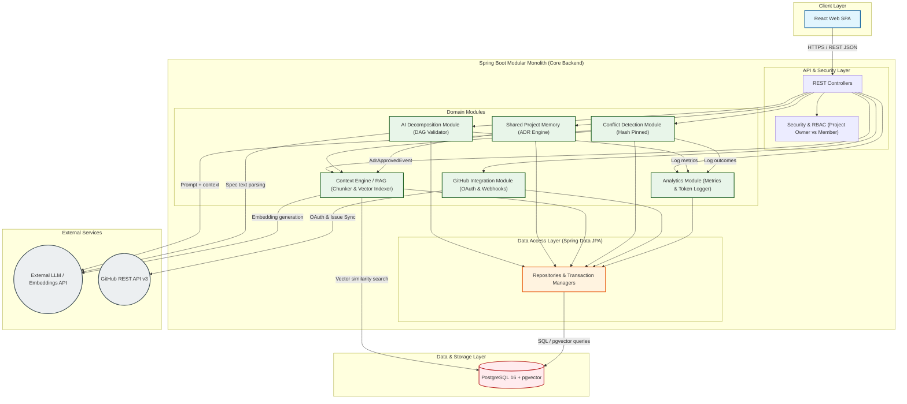
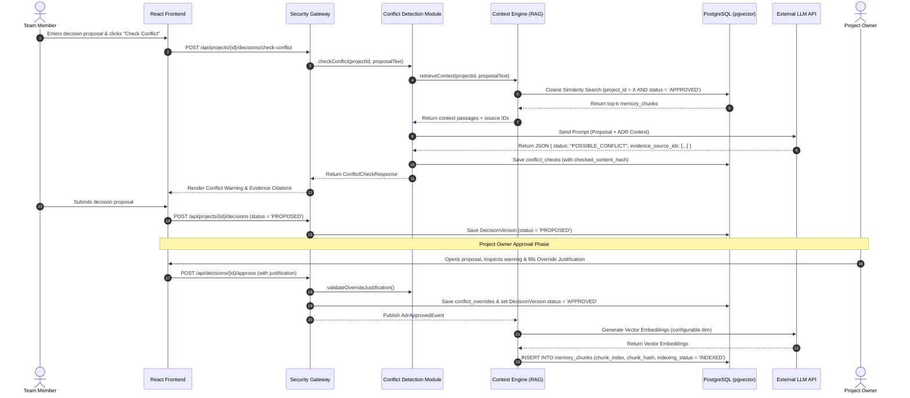

# System Design Document (SDD)

## Team AI Orchestrator

**Version:** 1.1 (Revised)  
**Date:** November 2026  
**Target Architecture:** Modular Monolith (Spring Boot 3.x / Java 21) + Single-Page Application (React 18+ / TypeScript / Vite)

---

## 1. Architectural Strategy and Technology Stack

### 1.1 Architectural Pattern: Modular Monolith
To maximize execution velocity for a two-developer engineering team while maintaining domain boundaries and code quality, **Team AI Orchestrator** follows a **Modular Monolith** architecture.

Rather than deploying distributed microservices—which introduce network overhead, distributed tracing complexity, and complex multi-repo CI/CD—all domain modules reside within a single Spring Boot application instance. Domain modules communicate internally via strongly typed Java interface contracts and Spring Application Events. Database-level encapsulation (composite keys and explicit project scoping) guarantees that modules operate within their respective tenant boundaries, enabling seamless microservice extraction in the future if scaling needs dictate.

### 1.2 Technology Stack
* **Frontend:** React 18+, TypeScript, Vite, Tailwind CSS, TanStack Query (React Query).
* **Backend Monolith:** Java 21, Spring Boot 3.x, Spring Data JPA, Spring Security, Flyway (DB migrations).
* **Database & Vector Search:** PostgreSQL 16+ with `pgvector` extension (HNSW indexing with cosine distance).
* **External Integrations:** OpenAI REST API / Azure OpenAI (using Spring AI / RestClient for structured JSON outputs and embeddings), GitHub REST API v3 via Spring `RestClient`.

---

## 2. High-Level Architecture Component Diagram

---

## 3. Subsystem and Module Specifications

### 3.1 Web SPA Frontend (React + TypeScript)
* **Responsibility:** Workspace navigation, specification uploads, interactive DAG backlog editing, ADR version management, conflict warning inspection, RAG chat assistant, and AI activity dashboards.
* **Communication:** REST JSON calls over HTTPS using JWT authentication. Uses TanStack Query for server-state caching and Optimistic UI updates.

### 3.2 Security & RBAC Module (`com.orchestrator.security`)
* **Responsibility:** Handles JWT authentication, request context injection, and project-level role validation (`PROJECT_OWNER` vs. `MEMBER`).
* **Enforcement:** Validates `project_id` access rights on every API endpoint. Restricts ADR approvals, task publishing, repository configuration, and conflict overrides strictly to `PROJECT_OWNER`.

### 3.3 Core Backend & Specification Module (`com.orchestrator.core`)
* **Responsibility:** Workspace entity management, user setup, specification text extraction (`TXT` / text-layer `PDF`), task entity persistence, and dependency validation.
* **DAG Validation Logic:** Includes `TaskDependencyValidator` to run Depth-First Search (DFS) or recursive CTE graph checks. Uses an optimistic locking `version` counter on task entities to prevent race conditions during concurrent DAG edits.

### 3.4 AI Decomposition Module (`com.orchestrator.decomposition`)
* **Responsibility:** Transforms raw specification text into structured task hierarchies (Epics, Tasks, Subtasks) complete with mandatory `acceptance_criteria` and dependency edges using LLM JSON schema targets. Passes outputs to `TaskDependencyValidator` before persisting draft tasks.

### 3.5 Shared Project Memory (`com.orchestrator.memory`)
* **Responsibility:** Manages Architectural Decision Records (ADRs) and their version states (`PROPOSED`, `APPROVED`, `SUPERSEDED`, `REJECTED`).
* **Event Publishing:** When a `PROJECT_OWNER` approves a new ADR version, it marks previous active versions as `SUPERSEDED` and fires `AdrApprovedEvent` via Spring `ApplicationEventPublisher`.

### 3.6 Context Engine / RAG Module (`com.orchestrator.rag`)
* **Responsibility:** Listens for `AdrApprovedEvent`, splits approved text into passages, calculates SHA-256 `chunk_hash`, stores `chunk_index`, generates vector embeddings via the external API, and persists chunks to `memory_chunks`.
* **RAG Search:** Performs cosine similarity queries filtering strictly by `WHERE project_id = :projectId AND status = 'APPROVED'`. Tracks status via `indexing_status` (`PENDING`, `INDEXED`, `FAILED`).

### 3.7 Conflict Detection Module (`com.orchestrator.conflict`)
* **Responsibility:** Evaluates proposed decisions against active approved ADRs. Stores `checked_content_hash` along with check results (`NO_CONFLICT`, `POSSIBLE_CONFLICT`, `INSUFFICIENT_CONTEXT`) and evidence references to detect staleness if the proposal is subsequently edited.
* **Overrides:** Requires and stores written justifications in `conflict_overrides` when an Owner overrides a `POSSIBLE_CONFLICT` warning.

### 3.8 GitHub Integration Module (`com.orchestrator.github`)
* **Responsibility:** Reads repository credentials from `github_integrations` and manages task publication to GitHub Issues via GitHub REST API v3. Ensures idempotency by checking and updating existing `github_issue_id` references.

### 3.9 Analytics Module (`com.orchestrator.analytics`)
* **Responsibility:** Listens asynchronously to internal application events to populate `ai_operation_logs`. Records `operation_type`, `operation_status` (`SUCCESS`, `FAILED`, `TIMEOUT`), token consumption (`prompt_tokens`, `completion_tokens`), generation latency, active human review time, error messages, and human decision outcomes (`ACCEPTED`, `MODIFIED`, `REJECTED`).

---

## 4. Interaction Patterns and Sequence Flows

### 4.1 Internal Monolith Communication
1. **Synchronous In-Process Calls:** Used for immediate queries and transactional validations (e.g., `ConflictDetectionService` querying `ContextEngine.retrieveContext()`).
2. **Asynchronous Application Events:** Used for non-blocking secondary processes:
   * `AdrApprovedEvent`: Triggers asynchronous chunking and vector indexing in `ContextEngine`.
   * `AIOperationEvent`: Triggers background metric logging in `AnalyticsModule` without delaying HTTP API responses.

### 4.2 Sequence Diagram: Decision Proposal & Hash-Pinned Conflict Check

